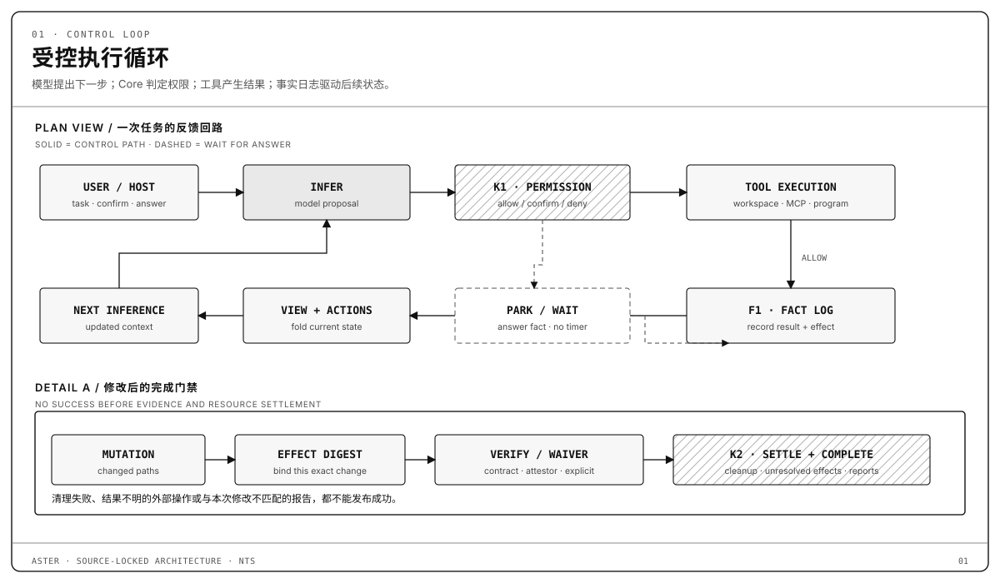
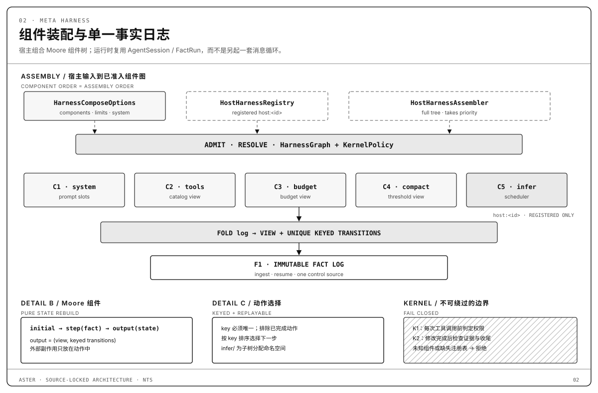
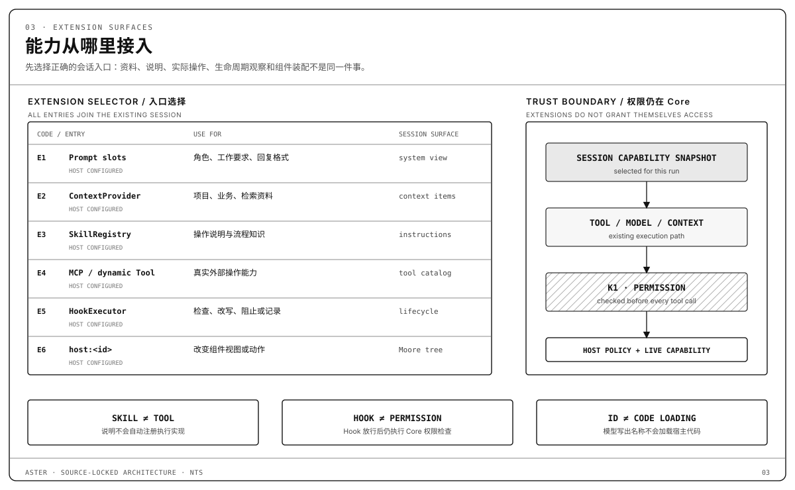

<div align="center">
  <picture>
    <source media="(prefers-color-scheme: dark)" srcset="apps/web/public/tenant/aster/logo-dark.png">
    <source media="(prefers-color-scheme: light)" srcset="apps/web/public/tenant/aster/logo-light.png">
    
  </picture>

  <h1>Aster</h1>

  <p><strong>从模型提案，到可验证的任务交付。</strong></p>
  <p>Rust 编写的智能体执行内核与终端编程工具</p>
  <p>受控执行 · 事实日志 · 验证闭环 · Rust 嵌入</p>

  <p>
    <a href="https://aster-ai-lab.github.io/aster/">下载官网</a> ·
    <a href="#快速开始">快速开始</a> ·
    <a href="#运行机制">运行机制</a> ·
    <a href="#当前限制">当前限制</a> ·
    <a href="#参与开发">参与开发</a>
  </p>
</div>

---

Aster 连接你配置的模型，在真实项目中读取文件、修改代码并调用工具。
权限策略约束执行，事实日志记录过程，验证证据约束任务何时可以完成。
你可以直接使用 Aster CLI，也可以把内核嵌入自己的 Rust 应用。

## 从目标到可验证结果

在项目目录启动 Aster，输入你的目标，例如：

```text
修复配置解析的边界错误，只修改相关文件。
先说明计划，再完成修改并运行相关测试。
最后列出改动、验证结果和仍未解决的问题。
```

完成编程任务，需要把模型的建议接入实际执行，并保留可检查的结果：

| 关键问题 | Aster 的处理方式 |
| --- | --- |
| 哪些操作可以执行？ | 工具调用先经过权限判定，需要确认时等待用户回答。 |
| 执行过什么、结果如何？ | 模型、工具和控制事件写入同一份事实日志。 |
| 修改是否满足完成条件？ | 内核检查对应本次修改的验证报告，或宿主显式豁免，再判定能否完成。 |

## 快速开始

### 1. 下载 CLI

从 [最新发布页](https://github.com/aster-ai-lab/aster/releases/latest)下载对应系统的归档，或使用安装脚本自动发现最新版本并校验 SHA-256：

```bash
curl -fsSL https://raw.githubusercontent.com/aster-ai-lab/aster/main/scripts/install.sh | bash -s -- --prefix "$HOME/.local/bin"
```

Windows 使用 [install.ps1](https://github.com/aster-ai-lab/aster/blob/main/scripts/install.ps1)。

> [!IMPORTANT]
> 发布包由 `aster` 与 `a3s-code-acp` 组成，请始终将两个程序放在同一目录并成对更新；Windows 对应两个 `.exe` 文件。CLI 默认启动同目录的 ACP 伴随进程，需要指定其他位置时可设置 `A3S_ACP_AGENT_BIN`。

Linux 归档分为两个 glibc 世代：

- `linux`：需要 glibc 2.32 及以上。
- `kylin`：面向 glibc 2.31 的 x86_64 构建，适用于银河麒麟 V10 SP1、Ubuntu 20.04、Debian 11 等较旧系统。

安装脚本会按本机 glibc 自动选择，`aster update` 使用同一规则。当前发布为未签名构建。

### 2. 配置模型

创建或编辑 `~/.a3s/config.acl`。以下示例使用 OpenAI 兼容接口，
请把接口地址和 `your-model` 替换为服务实际提供的值：

```acl
default_model = "openai/your-model"

providers "openai" {
  base_url = "https://your-api.example/v1"
  api_key = env("OPENAI_API_KEY")
  models "your-model" {}
}
```

密钥通过环境变量提供。更多配置见 [ACL 示例](crates/code/agent.example.acl)；
`A3S_CONFIG` 可以指定其他配置文件，终端内的 `/config` 用于管理模型配置。

### 3. 启动项目

在解压目录执行，并将项目路径替换为实际路径。

macOS / Linux：

```sh
export OPENAI_API_KEY="你的 API 密钥"
./aster --cwd /path/to/project
```

Windows PowerShell：

```powershell
$env:OPENAI_API_KEY = "你的 API 密钥"
$env:A3S_CONFIG = Join-Path $HOME '.a3s/config.acl'
.\aster.exe --cwd C:\path\to\project
```

需要在任意目录使用 `aster` 时，将两个程序所在目录加入 `PATH`。

### 更新

从 v0.1.2 起，已安装的 CLI 支持自我更新：

```bash
aster update
```

更新通道会从仓库 manifest（`latest.json`）发现版本，校验归档摘要，再原子安装成对的 `aster` 与 `a3s-code-acp`。

- `aster update --check`：只检查可用版本，不修改安装。
- `aster update --version X.Y.Z`：安装指定版本。
- v0.1.1 的旧安装不包含该通道，请先使用安装脚本重装一次。
- 手动更新时，请一起替换同目录的两个程序。

### 卸载

删除 `aster` 与 `a3s-code-acp` 两个程序即可；`~/.a3s` 中的本地配置与数据可保留。

## 运行机制

Harness 负责把模型调用接入一个受控的任务过程。
Aster 的 **Meta Harness** 允许 Rust 宿主组合系统指令、工具、预算、上下文压缩和调度组件，
同时由内核维持权限与完成条件。

### 受控执行循环

模型提出下一步，权限策略决定工具能否执行，结果写入同一份事实日志，
再由日志驱动后续上下文与动作。需要确认或补充信息时，运行等待对应回答；计时器不能代替用户授权。



### Meta Harness 组件装配

默认装配列表为 `system + tools + budget + compact + infer`。
列表顺序是装配顺序，不是固定调用顺序；运行时根据日志状态和动作 key 选择下一步。
宿主可以注册 Rust 组件或提供完整组件树，但不能关闭 Core 的权限与完成门禁。



### 扩展入口

提示槽、上下文、Skills、工具、Hooks 和宿主组件承担不同职责，并通过原有会话进入执行过程。
Skills 提供操作说明，MCP 和动态工具提供实际调用能力；任何扩展都不能自行放宽权限。



### 验证、资源收尾与恢复

发生修改后，完成判定需要与本次修改摘要对应的验证证据或宿主显式豁免，
并等待所属 Run 的资源收尾。事实重放用于恢复控制状态；结果不明的外部副作用仍需单独核实，不能盲目重试。


进一步阅读：

- [Meta Harness](crates/code/manual/META_HARNESS.md)：组件组合与 Rust 嵌入接口。
- [持续工程与目标](crates/code/manual/DURABLE_ENGINEERING.md)：长期目标、预算和等待条件。
- [持久记忆](crates/code/manual/DURABLE_MEMORY.md)：记忆隔离、修订与激活边界。

## 当前限制

- 需要自行配置可用的模型服务及相应凭据。
- macOS 原生 Shell 工具目前仍会因 `native_process_lifetime_unqualified` 被拒绝；依赖 Shell 的完整编程流程尚未通过平台资格验证。详见[验证记录](docs/validation.md)。
- 指定项目目录不等于隔离所有本机进程。实际执行边界由宿主策略和沙箱共同决定。
- 本页的运行机制说明对应当前源码；已发布版本的能力以对应发布说明为准。

## 参与开发

源码构建需要固定 Rust 工具链及仓库内私有组件的读取权限。
准备方式、构建约定和检查要求见 [仓库约定](AGENTS.md)与[开发规范](docs/development-standards.md)。

桌面开发运行 `just dev`（Aster）或 `just dev:toyou`（ToWork），保留进程即可使用前端热更新。
原生开发缓存分别位于 `target/studio/aster` 和 `target/studio/toyou`，与普通 Cargo 检查、测试的构建锁分开。
首次使用各自的目录需要建立缓存；显式指定 `CARGO_TARGET_DIR` 时仍使用指定目录。
开发构建会自动使用 PATH 中已有的 `sccache`，并保留显式设置的 `RUSTC_WRAPPER`；设置为空可停用。
已完成对应租户的原生构建、且开发服务器仍在运行时，可用 `just fork toyou 4319` 打开隔离副窗口而不执行 Cargo。
Rust 修改仍需重新构建。性能测量与限制见[构建和启动验收记录](docs/evidence/desktop/2026-10-26-build-speed/OUTCOME.md)。

| 修改方向 | 源码入口 |
| --- | --- |
| CLI 启动与参数 | [apps/aster](apps/aster) |
| ACP 会话与宿主协议 | [crates/code/acp](crates/code/acp) |
| Harness、权限与完成判定 | [crates/code/core](crates/code/core) |
| 组件、效果执行与事实重放 | [crates/effect](crates/effect) |

[验证记录](docs/validation.md)说明已检查的范围与已知限制。
报告缺陷请提交到 [Issues](https://github.com/aster-ai-lab/aster/issues)，
附操作系统、复现步骤、预期结果及去除凭据后的日志。

## 许可证

仓库根许可证为 [MIT](LICENSE)。各组件及第三方材料继续遵循各自许可证与来源声明。
