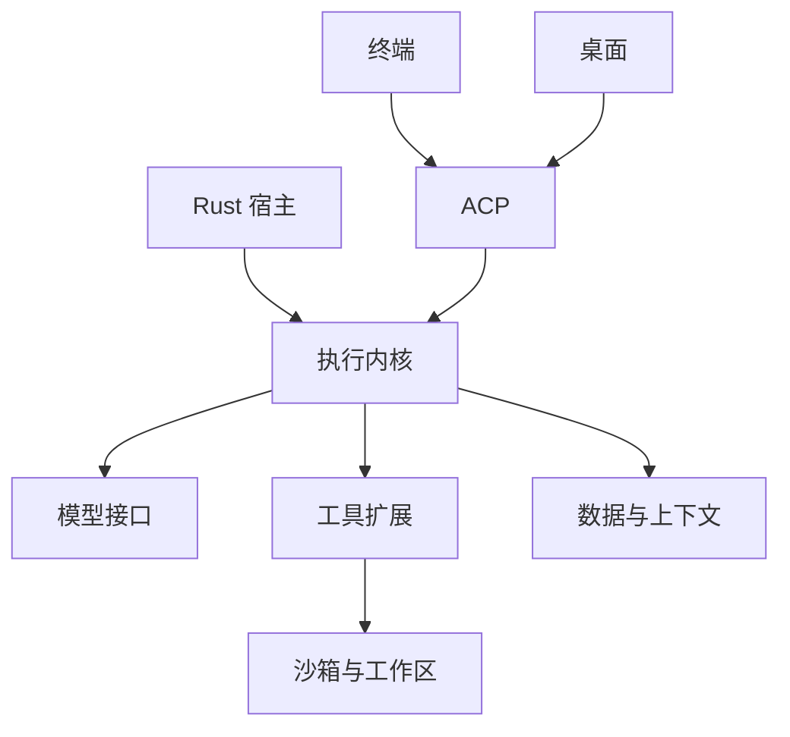

<div align="center">
  <picture>
    <source media="(prefers-color-scheme: dark)" srcset="apps/web/public/tenant/aster/logo-dark.png">
    <source media="(prefers-color-scheme: light)" srcset="apps/web/public/tenant/aster/logo-light.png">
    
  </picture>

  <h1>Aster</h1>

  <p><strong>终端、桌面与可嵌入的 Agent 执行内核</strong></p>
  <p>连接模型、工具和工作区，保留执行过程与验证结果。</p>

  <p>
    <a href="https://aster-ai-lab.github.io/aster/">下载官网</a> ·
    <a href="#快速开始">快速开始</a> ·
    <a href="#项目架构">项目架构</a> ·
    <a href="#执行与恢复">执行与恢复</a> ·
    <a href="#参与开发">参与开发</a>
  </p>
</div>

---

Aster 在终端和桌面工作区中执行任务，也提供可嵌入 Rust 应用的 Harness。
它连接你配置的模型，读取文件、修改代码并调用工具。
工具权限、执行记录和完成检查由内核管理。

在项目中输入目标：

```text
修复配置解析的边界错误，只修改相关文件。
完成修改后运行相关测试。
最后列出改动、验证结果和仍未解决的问题。
```

| 使用方式 | 入口 |
| --- | --- |
| 终端编程 | Aster CLI：交互、会话恢复、项目工具与环境管理。 |
| 桌面工作区 | Studio：任务交互、文件预览，以及 Office、浏览器和屏幕采集。 |
| Rust 嵌入 | Core：通过 `AgentSession` 调用执行、事件和恢复接口。 |

## 项目架构

终端与桌面的 Agent Plane 通过 ACP 调用执行内核。
Rust 宿主可以直接调用 Core。
下图表示主要依赖，具体能力由宿主配置和授权决定。



| 组件 | 职责 | 源码 |
| --- | --- | --- |
| 终端 | 输入、显示、会话管理与 ACP 进程启动。 | [CLI](apps/aster) · [Terminal](crates/terminal) |
| 桌面宿主 | 桌面交互、租户隔离、文件与工具集成。 | [Studio](apps/studio) |
| 协议适配 | 会话请求、事件、审批、取消与恢复。 | [ACP](crates/code/acp) |
| 执行内核 | Session / Run、组件装配、权限、预算与完成检查。 | [Core](crates/code/core) · [Effect](crates/effect) |
| 模型网关 | 可选的模型路由、流量准入、健康检查和流式转发。 | [Gateway](apps/gateway) |
| 执行环境 | 沙箱策略、进程约束、虚拟机与客体执行。 | [Sandbox](crates/sandbox) · [OCI Runtime](crates/oci-runtime) · [Box](crates/box) |
| 数据与上下文 | 持久记忆、工作区检索与知识数据。 | [Memory](crates/memory) · [Search](crates/search) · [Vec](crates/vec) · [OKF](crates/okf) |
| 工作区工具 | 文档编辑、浏览器操作与屏幕采集。 | [Office](packages/office) · [Browser](crates/browser) · [Capture](crates/capture) |

模型可直接配置为远端 API，也可经模型网关访问。
MCP、Skill 和宿主工具通过 Core 的扩展入口接入。
Studio 的独立模型调用由对应宿主管理结果检查。

Cloud、API 和边缘服务承担可选的服务端职责。
它们使用各自的 Cargo 工作区；产品代码与嵌入式模型网关使用根工作区。
边缘服务的范围见 [Control-plane](apps/control-plane/README.md)。

多 Harness 的统一适配、共享运行时与授权域见
[协作架构设计](docs/architecture/harness-gateway.md)。
该方案目前处于设计阶段，尚未编码和联调。

## 快速开始

### 1. 下载 CLI

从[官网](https://aster-ai-lab.github.io/aster/#download)选择对应系统的安装包。
macOS / Linux 也可通过脚本安装稳定通道中的 CLI：

```bash
curl -fsSL https://raw.githubusercontent.com/aster-ai-lab/aster/main/scripts/install.sh | bash -s -- --prefix "$HOME/.local/bin"
```

Windows PowerShell：

```powershell
irm "https://raw.githubusercontent.com/aster-ai-lab/aster/main/scripts/install.ps1" -OutFile "$env:TEMP\aster-install.ps1"
powershell -NoProfile -ExecutionPolicy Bypass -File "$env:TEMP\aster-install.ps1" -Prefix "$env:LOCALAPPDATA\Aster\bin"
```

脚本校验归档的 SHA-256。
固定版本时，分别使用 `--version X.Y.Z` 或 `-Version X.Y.Z`。

> [!IMPORTANT]
> `aster` 与 `aster-acp` 必须放在同一目录并成对更新。
> macOS 还需要完整的 `sandbox/` 组件，请安装完整归档。
> 指定其他 ACP 位置时，可设置 `ASTER_ACP_AGENT_BIN`。

当前 Linux 构建统一使用 x86_64、glibc 2.31 基线。
平台构建与发布条件见[发布规范](docs/release-governance.md)。

### 2. 配置模型

创建或编辑 `~/.aster/config.acl`。以下示例使用 OpenAI 兼容接口，
请把接口地址和 `your-model` 替换为服务实际提供的值：

```acl
default_model = "openai/your-model"

providers "openai" {
  base_url = "https://your-api.example/v1"
  api_key = env("OPENAI_API_KEY")
  models "your-model" {}
}
```

密钥通过环境变量提供。更多配置见 [ACL 示例](crates/code/agent.example.acl)。
`ASTER_CONFIG` 可以指定其他配置文件，终端内的 `/config` 用于管理模型配置。

### 3. 启动项目

使用上述安装目录，并将项目路径替换为实际路径。

macOS / Linux：

```sh
export OPENAI_API_KEY="你的 API 密钥"
"$HOME/.local/bin/aster" --cwd /path/to/project
```

Windows PowerShell：

```powershell
$env:OPENAI_API_KEY = "你的 API 密钥"
$env:ASTER_CONFIG = Join-Path $HOME '.aster/config.acl'
& "$env:LOCALAPPDATA\Aster\bin\aster.exe" --cwd C:\path\to\project
```

将安装目录加入 `PATH` 后，可直接运行 `aster`。
项目工具版本与环境变量的配置见[环境管理](docs/cli-environments.md)。

### 更新

```bash
aster update --check
aster update
```

更新器从 CLI 通道读取版本并校验归档摘要。
指定版本可运行 `aster update --version X.Y.Z`。
手动更新时，也需要一起替换两个程序和所需的沙箱组件。

### 卸载

删除安装的 `aster` 与 `aster-acp`。macOS 还需删除安装器放在同目录的 `sandbox/`。`~/.aster` 中的本地配置与数据可保留。

## 执行与恢复

Core 的 **Meta Harness** 将系统指令、工具、预算、压缩和推理装配为执行图。
Rust 宿主可以替换或增加组件，权限与完成检查始终由内核保留。

| 环节 | 约束 |
| --- | --- |
| 执行 | 模型提出工具调用，权限策略先判定；需要授权时等待对应回答。 |
| 记录 | 执行事实追加到 Fact Log，运行决策和恢复以日志为准。 |
| 查询 | RunStore 提供状态查询，事件流通知进度；记忆和检索有独立存储。 |
| 完成 | 修改需要绑定当前效果摘要的验证证据或宿主豁免，并结清所属资源。 |
| 恢复 | 日志重放恢复控制状态；结果不明的外部操作需要先核实。 |
| 长期目标 | 每个切片执行一个 Run，再检查预算、等待条件和交付证据。 |

Skills 提供操作说明，MCP 和动态工具提供调用能力。
任何扩展都不能自行扩大权限。
完成一次运行也不代表整个目标已经验收。

机制细节见 [Meta Harness](crates/code/manual/META_HARNESS.md)、
[持续工程与目标](crates/code/manual/DURABLE_ENGINEERING.md)和
[持久记忆](crates/code/manual/DURABLE_MEMORY.md)。

## 当前限制

- 需要自行配置可用的模型服务及相应凭据。
- macOS ARM64 的默认隔离命令在 Linux 虚拟机中执行，需要完整沙箱组件。本机安装的工具不会自动出现在客体中。
- 缺少沙箱组件时，macOS 本机原生沙箱仍拒绝执行。发布前须从最终归档完成[沙箱执行验收](tests/cli_sandbox_smoke.py)。
- 指定项目目录不等于隔离所有本机进程。实际执行边界由宿主策略和沙箱共同决定。
- 可选功能按宿主、构建特性和授权启用。已发布版本的能力以对应发布说明为准。

## 参与开发

使用仓库固定的 Rust 工具链，从根目录构建。
Cargo 命令执行前需初始化私有 Studio 子模块：

```bash
git submodule update --init -- apps/studio
just build
just code --cwd /path/to/project
```

`just build` 构建 CLI 与 ACP，并在 macOS ARM64 上准备沙箱组件。
`just code` 直接运行已构建的 CLI；源码变更后需先重新执行 `just build`。
桌面构建还需前端依赖和平台工具，准备步骤见 [Studio 说明](apps/studio/README.md)。

| 开发任务 | 命令或入口 |
| --- | --- |
| 构建桌面及配套程序 | `just build-studio` |
| 桌面开发与热更新 | `just dev` |
| 指定桌面租户 | `just dev toyou` |
| 检查边缘服务工作区 | `cargo check --locked --manifest-path apps/control-plane/Cargo.toml --workspace` |
| 共享界面与编辑器 | [UI](packages/ui) · [Office](packages/office) · [Form](packages/form) |
| 官网与文档 | [Web](apps/web) |

Studio 默认租户为 `aster`，租户身份、数据和更新包分别管理。
桌面开发缓存位于 `target/studio/<tenant>`。
`apps/api`、`apps/cloud` 和 `apps/control-plane` 不属于根 Cargo 工作区。

开发前阅读[仓库约定](AGENTS.md)、[开发规范](docs/development-standards.md)与
[设计规范](DESIGN.md)。构建和发布遵循[发布规范](docs/release-governance.md)。
当前接口与版本说明见[手册索引](crates/code/manual/README.md)。
Core、ACP 与 TUI 的进程拓扑、模块职责、调用链、状态恢复、搜索索引和发布门禁见
[Aster 源码导览](docs/architecture/aster-core-acp.md)。
历史验证范围见[验证记录](docs/validation.md)。

报告缺陷请提交到 [Issues](https://github.com/aster-ai-lab/aster/issues)。
请附操作系统、复现步骤、预期结果及去除凭据后的日志。

## 许可证

仓库根许可证为 [MIT](LICENSE)。各组件及第三方材料继续遵循各自许可证与来源声明。
