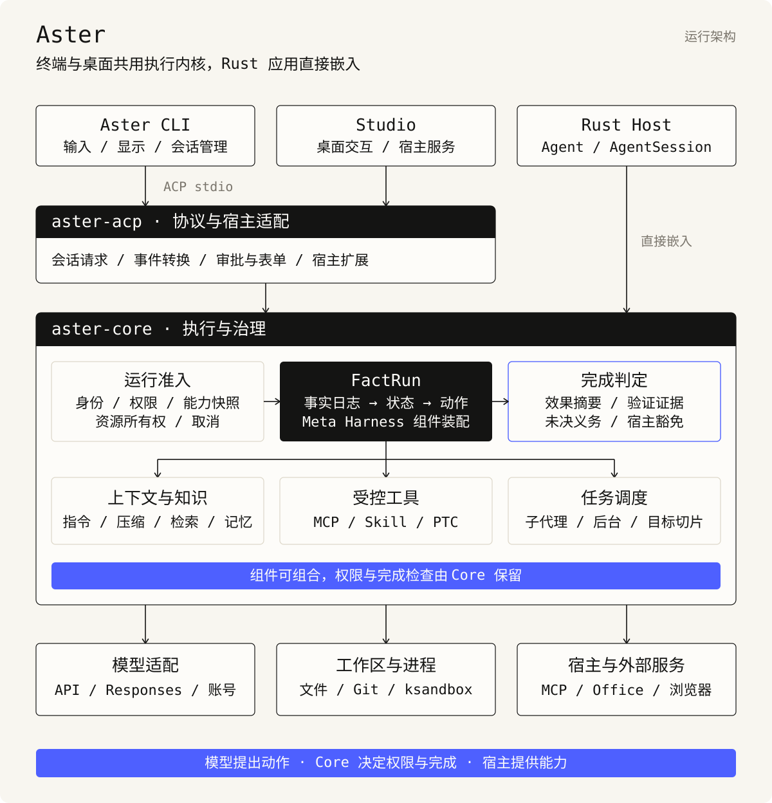
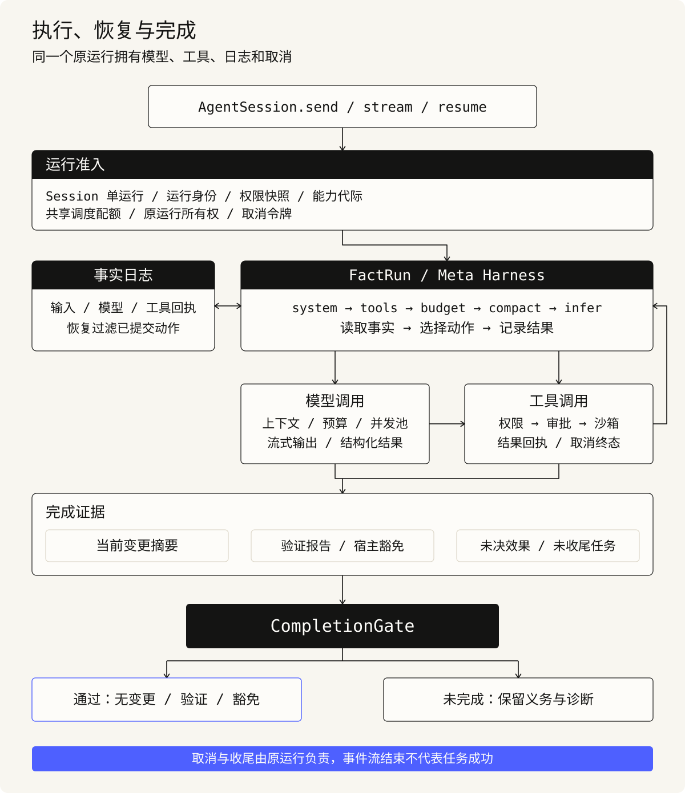
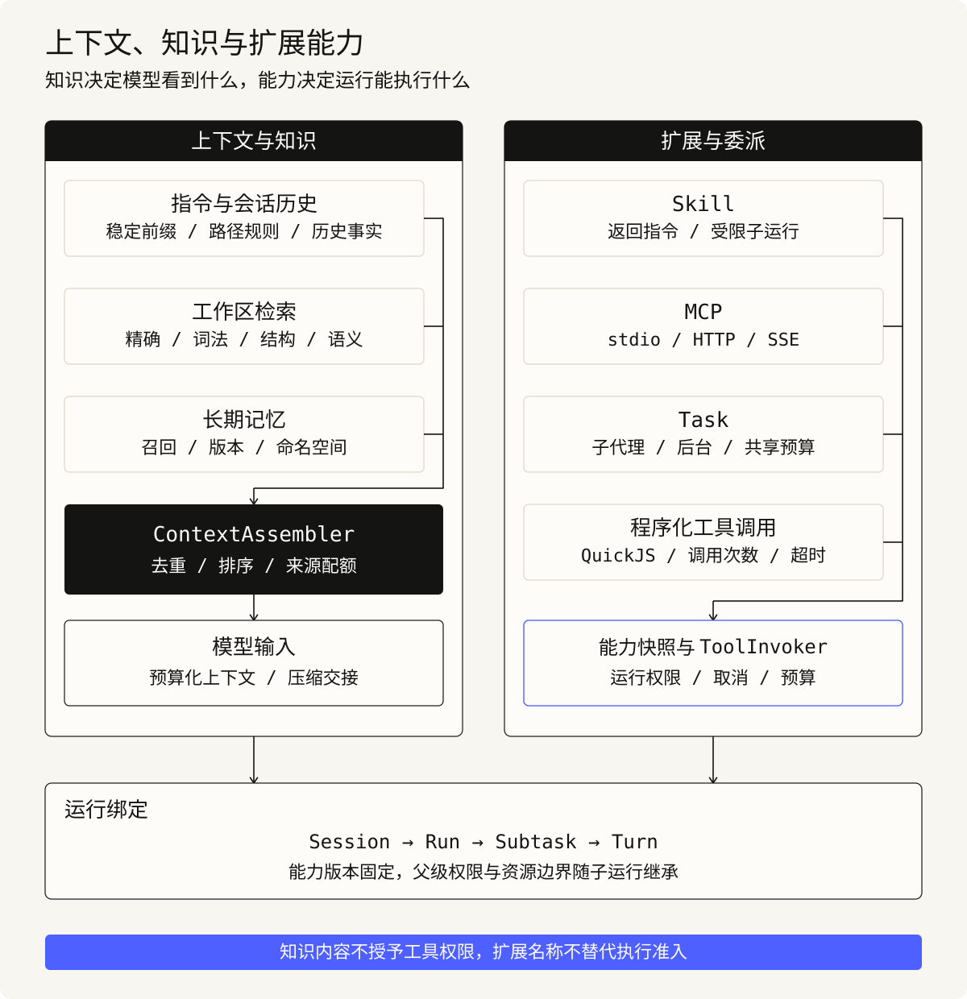
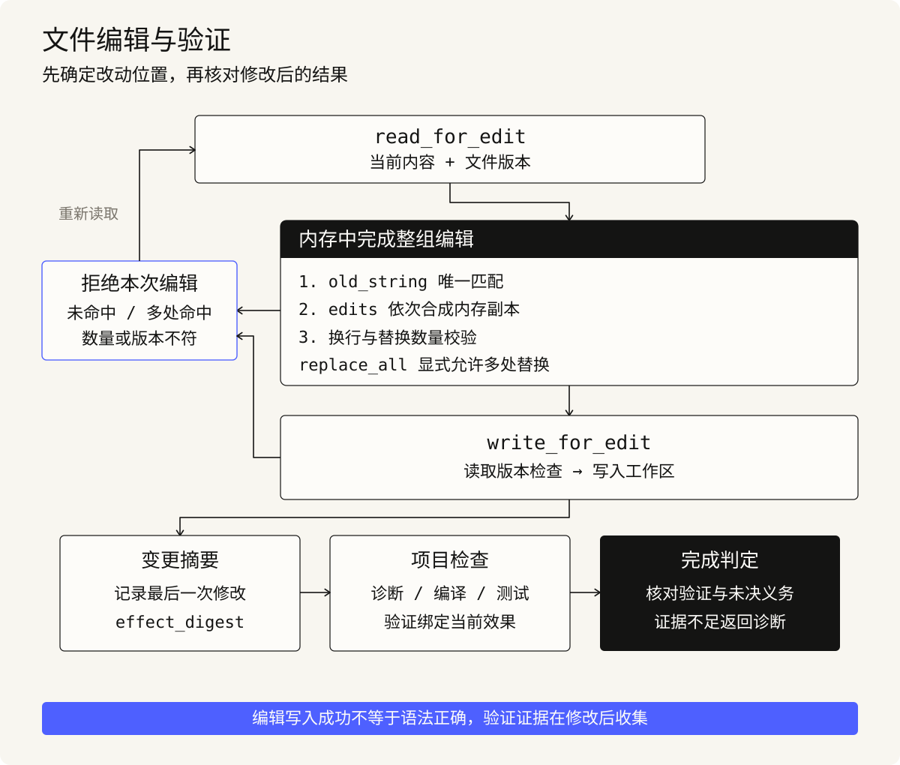
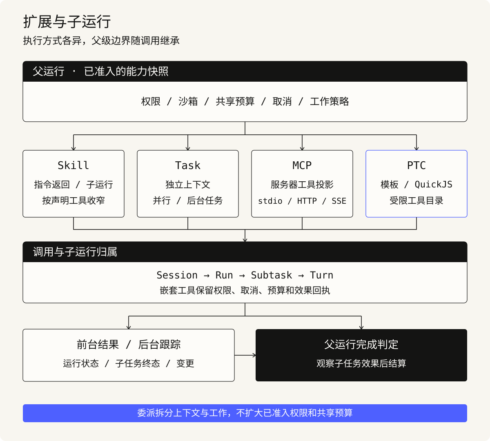
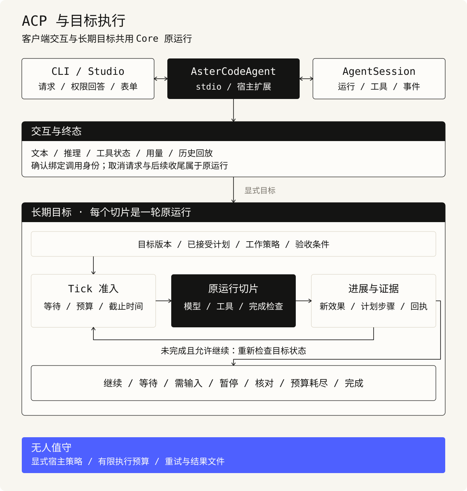

<div align="center">
  <picture>
    <source media="(prefers-color-scheme: dark)" srcset="apps/web/public/tenant/aster/logo-dark.png">
    <source media="(prefers-color-scheme: light)" srcset="apps/web/public/tenant/aster/logo-light.png">
    
  </picture>

  <h1>Aster</h1>
  <p><strong>终端、桌面与可嵌入的 Agent 执行内核</strong></p>
  <p>读取项目、修改文件、执行工具，并保存执行记录与验证结果。</p>

  <p>
    <a href="https://aster-ai-lab.github.io/aster/">官网与下载</a> ·
    <a href="#快速开始">快速开始</a> ·
    <a href="#项目架构">项目架构</a> ·
    <a href="#执行与恢复">执行与恢复</a> ·
    <a href="#上下文与知识">上下文与知识</a> ·
    <a href="#工具与扩展">工具与扩展</a> ·
    <a href="#客户端与长期任务">客户端与长期任务</a> ·
    <a href="#参与开发">参与开发</a>
  </p>
</div>

模型给出修改方案后，执行环境还要处理文件冲突、权限确认、命令失败和进程退出。
Aster 将这些工作放在共享的 Rust 内核中。终端与桌面使用同一套执行路径，Rust 应用也能直接嵌入。

在项目中输入任务：

```text
修复配置解析的边界错误，只修改相关文件。
完成修改后运行相关测试。
最后列出改动、验证结果和仍未解决的问题。
```

| 使用方式 | 入口 |
| --- | --- |
| 终端编程 | Aster CLI：交互、项目工具、会话管理与恢复。 |
| 桌面工作区 | Studio：任务交互、文件预览、文档与浏览器集成。 |
| Rust 嵌入 | Core：会话执行、流式事件、工具接入与运行控制。 |

## 项目架构

<p align="center">
  
</p>

[Core](crates/code/core) 管理模型、工具和完成判定，[ACP](crates/code/acp) 接入终端与桌面，
[Effect](crates/effect) 用事实日志驱动执行与恢复。
命令隔离由锁定版本的 [ksandbox](https://github.com/kense-labs/ksandbox) 提供，使用操作系统进程边界。

## 快速开始

### 安装

macOS / Linux：

```bash
curl -fsSL https://raw.githubusercontent.com/aster-ai-lab/aster/main/scripts/install.sh \
  | bash -s -- --prefix "$HOME/.local/bin"
export PATH="$HOME/.local/bin:$PATH"
aster --version
```

将 `export PATH="$HOME/.local/bin:$PATH"` 加入所用 Shell 的启动文件后，新终端会保留该设置。

Windows（PowerShell）：

```powershell
irm "https://raw.githubusercontent.com/aster-ai-lab/aster/main/scripts/install.ps1" -OutFile "$env:TEMP\aster-install.ps1"
powershell -NoProfile -ExecutionPolicy Bypass -File "$env:TEMP\aster-install.ps1"
$bin = Join-Path $env:LOCALAPPDATA 'Aster\bin'
[Environment]::SetEnvironmentVariable('Path', "$bin;" + [Environment]::GetEnvironmentVariable('Path', 'User'), 'User')
$env:Path = "$bin;$env:Path"
aster --version
```

安装器校验归档成员、`BUILD_ID` 和 `SHA256SUMS`，安装配套的 `aster`、`aster-acp` 与 `embedding/`。
两个可执行文件需要保持配套。另指定 ACP 路径时使用 `ASTER_ACP_AGENT_BIN`。
Linux 归档分 x86_64 与 arm64，glibc 基线为 2.31。

| 需求 | 参数 |
| --- | --- |
| 固定版本 | Unix：`--version X.Y.Z`；Windows：`-Version X.Y.Z` |
| 修改安装目录 | Unix：`--prefix DIR`；Windows：`-Prefix DIR` |
| 下载桌面安装包 | [官网下载页](https://aster-ai-lab.github.io/aster/download/) |

### 配置模型

在 `~/.aster/config.acl` 写入配置。Windows 路径为 `%USERPROFILE%\.aster\config.acl`。
下面以 OpenAI API 为例：

```acl
default_model = "openai/gpt-4o"

providers "openai" {
  base_url = "https://api.openai.com/v1"
  api_key = env("OPENAI_API_KEY")
  models "gpt-4o" {
    name = "GPT-4o"
  }
}
```

macOS / Linux：

```bash
export OPENAI_API_KEY="你的 API 密钥"
```

PowerShell：

```powershell
$env:OPENAI_API_KEY = '你的 API 密钥'
```

使用兼容服务时，按服务端配置修改 `base_url`、模型 ID 和 `default_model`。
完整配置见 [ACL 示例](crates/code/agent.example.acl)。

### 启动

```bash
cd /path/to/your/project
aster
```

指定工作区、模型或初始任务：

```bash
aster --cwd /path/to/your/project
aster --model provider/model-id
aster --cwd /path/to/your/project "列出仓库结构并说明主要入口"
```

会话内通过 `/model`、`/config` 切换模型配置。
指定配置文件时设置 `ASTER_CONFIG`。

### 更新与卸载

```bash
aster update --check
aster update
aster update --version X.Y.Z
```

旧更新器无法处理新增归档成员时，重新运行安装器以安装完整的 pair 与资源目录。

macOS / Linux 卸载默认安装：

```bash
rm -f ~/.local/bin/aster ~/.local/bin/aster-acp
rm -rf ~/.local/bin/embedding
```

Windows（PowerShell）：

```powershell
$bin = Join-Path $env:LOCALAPPDATA 'Aster\bin'
Remove-Item -Force -ErrorAction SilentlyContinue "$bin\aster.exe", "$bin\aster-acp.exe"
Remove-Item -Recurse -Force -ErrorAction SilentlyContinue "$bin\embedding"
```

配置与会话数据保留在 `~/.aster`，可按需单独删除。

## 执行与恢复

<p align="center">
  
</p>

### 运行所有权与取消

- **场景**：命令还在写文件，用户停止后立即提交新任务。
- **为什么需要**：关闭输出流不会结束命令，旧任务可能干扰新任务。
- **原理**：准入时绑定运行身份与取消令牌，由原执行器收尾后释放许可。[源码](crates/code/core/src/agent_api/conversation_runtime/owned_worker.rs)

### 事实日志与恢复

- **场景**：工具执行后进程崩溃，重启继续任务。
- **为什么需要**：只存对话无法确认工具执行状态，重试可能重复写入。
- **原理**：`FactRun` 从日志重建状态，按 `cause` 跳过已提交动作；结果未知时先核实。[源码](crates/code/core/src/fact_control.rs)

### Meta Harness

- **场景**：只读问答、代码修改和长程任务使用不同执行策略。
- **为什么需要**：复制多套循环会让权限、预算和完成规则分叉。
- **原理**：组件共享事实日志并组合动作，权限与完成检查由内核保留。ACP 只开放预定义组合。[源码](crates/code/core/src/meta_harness.rs)

### 配置与权限

- **场景**：打开陌生仓库，仓库配置声明了 MCP 命令和权限。
- **为什么需要**：项目内容不能替用户启动进程、使用凭据或扩大权限。
- **原理**：区分可信宿主层与工作区层；运行冻结权限，执行时优先检查拒绝规则。[配置](crates/code/acp/src/config.rs) · [权限](crates/code/core/src/permissions/policy.rs)

### 进程沙箱

- **场景**：允许模型运行 Shell，但只授予限定的文件与网络访问。
- **为什么需要**：允许一个工具，不等于允许它访问整个宿主。
- **原理**：ksandbox 在操作系统层限制访问，默认拒绝网络；沙箱缺失时拒绝执行，提权另行授权。[源码](crates/code/core/src/sandbox/native.rs)

macOS 清理限于进程组，`setsid()` 脱离的后代不在回收范围。

### 工具回执与输出

- **场景**：调用超时，或工具返回大段错误与日志。
- **为什么需要**：未知效果不能盲目重试，长输出会挤占上下文。
- **原理**：按调用身份记录成功、失败、取消或未知；限制展示量，保留内容通过 artifact 分页取回。[回执](crates/code/core/src/fact_control/receipts.rs) · [输出](crates/code/core/src/tools/result_transform.rs)

### 完成判定

- **场景**：测试通过后，模型又修改了一行代码。
- **为什么需要**：旧测试结果不能证明最终文件通过，文字声明也不能充当证据。
- **原理**：验证或宿主豁免绑定当前 `effect_digest`，同时核对未决效果与子任务。无变更且无未决义务时允许答复结束。[源码](crates/code/core/src/harness_loop.rs)

### 工作策略与评审

- **场景**：修复者声称已处理评审意见，但被审查的文件已经变化。
- **为什么需要**：修复声明不等于复核通过，旧评审不能覆盖新内容。
- **原理**：意见绑定策略、目标内容与适用步骤；`addressed` 和 `accepted` 分别记录。[源码](crates/code/acp/src/engineering.rs)

### 模型适配与结构化输出

- **场景**：切换模型服务，或要求答案符合固定 JSON 结构。
- **为什么需要**：协议不匹配和输出格式错误都会使后续调用失败。
- **原理**：按协议创建客户端；JSON Schema 校验不通过时有限修复，任务完成另行判定。[协议](crates/code/core/src/llm/factory.rs) · [输出](crates/code/core/src/agent_api/structured_output_runtime.rs)

### 预算与调度

- **场景**：模型反复调用工具，或并行子任务占满模型容量。
- **为什么需要**：重复尝试会耗尽资源，后台工作也可能长期抢不到执行机会。
- **原理**：分别限制轮次、时间和静默等待；共享配额控制并发，等待较久的任务提升优先级。[预算](crates/code/core/src/fact_control.rs) · [调度](crates/code/core/src/task_scheduler.rs)

## 上下文与知识

<p align="center">
  
</p>

### 上下文装配

- **场景**：项目指令、检索片段、记忆和工具结果同时进入输入。
- **为什么需要**：重复与过期内容会挤掉有效信息，单一来源可能占满上下文。
- **原理**：按来源更新、去重排序，分配条数与 token 预算；路径规则按目标注入。[装配](crates/code/core/src/context/assembler.rs) · [路径规则](crates/code/core/src/path_instructions.rs)

### 压缩交接

- **场景**：长会话接近模型窗口，任务仍有未完成步骤。
- **为什么需要**：直接删除历史会丢失约束和待核实操作。
- **原理**：摘要之外单独保留指令、目标与未决义务，原事实继续存储；摘要失败时使用有界回退。[源码](crates/code/core/src/fact_control/compaction.rs)

### 混合检索

- **场景**：既要按概念找实现，也要精确定位符号，文件还在变化。
- **为什么需要**：语义相近不等于名称命中，旧索引也不能代表当前源码。
- **原理**：融合精确、词法、结构与语义排名；返回前重读文件，校验摘要和片段范围。[查询](crates/code/core/src/workspace/retrieval/hybrid_query.rs) · [校验](crates/code/core/src/workspace/retrieval/verification.rs)

### 记忆

- **场景**：跨会话复用已确认的项目约定。
- **为什么需要**：过时版本和未经核实的推测会污染后续判断。
- **原理**：工作、会话和长期记忆分层；V2 按命名空间、修订号和激活证据控制召回。[分层](crates/code/core/src/memory.rs) · [V2](crates/code/core/src/durable_memory.rs)

## 工具与扩展

<p align="center">
  
</p>

### 内容块编辑

- **场景**：读文件后行号发生偏移，或同一代码块出现多次。
- **为什么需要**：按旧行号或模糊位置修改，可能误伤相邻逻辑。
- **原理**：默认唯一内容匹配，整组替换先在内存试应用，再携带读取版本写入。语法正确性由修改后的检查确认。[源码](crates/code/core/src/tools/builtin/edit.rs)

<p align="center">
  
</p>

### 子代理与工作流

- **场景**：并行查调用链、修改独立模块，再汇总结果。
- **为什么需要**：共享全部历史会相互干扰，独立授权又可能突破父任务限制。
- **原理**：子任务使用独立上下文，继承权限、沙箱、共享预算与取消；后台结果和写入仍需观察。[源码](crates/code/core/src/tools/task.rs)

### Skill

- **场景**：复用团队写作规范，或运行一套限定工具的检查流程。
- **为什么需要**：操作说明不需要额外代理，专用流程又需要收窄工具范围。
- **原理**：指令型 Skill 无工具声明时返回内容；声明工具时启动受限子运行，并组合父级权限。[源码](crates/code/core/src/tools/skill.rs)

### MCP

- **场景**：连接数据库、代码托管服务或本地辅助进程。
- **为什么需要**：外部工具接口不同，发现工具也不代表已获授权。
- **原理**：统一连接与工具投影，绑定服务器命名空间，再进入运行权限检查；仓库声明先取得信任。[管理器](crates/code/core/src/mcp/manager.rs) · [信任](crates/code/acp/src/config.rs)

### 程序化工具调用

- **场景**：读多个文件、筛选结果，再按固定规则调用下一项工具。
- **为什么需要**：确定的流程逐步交给模型，会增加往返与中间输出。
- **原理**：模板或 QuickJS 脚本调用允许列表内工具，保留运行上下文，并限制调用数、内存、输出与时间。[源码](crates/code/core/src/tools/program_tool.rs)

### 能力代际

- **场景**：任务执行期间，插件更新或 MCP 工具发生变化。
- **为什么需要**：同名工具更换实现后，原运行的授权与结果可能不再对应。
- **原理**：运行租用固定能力代际，按 Session、Run、Subtask、Turn 管理许可与清理；新代际供后续准入使用。[源码](crates/code/core/src/capability)

## 客户端与长期任务

<p align="center">
  
</p>

### ACP 协议适配

- **场景**：终端与桌面共用内核，但显示与宿主服务不同。
- **为什么需要**：界面逻辑进入 Core，会让 Rust 嵌入者依赖桌面环境。
- **原理**：stdio 请求映射到 `AgentSession`，事件按身份转换为文本与工具状态；额外能力走闭集扩展。[协议](crates/code/acp/src/agent/protocol.rs) · [事件](crates/code/acp/src/agent/turn.rs)

### 审批与表单

- **场景**：同时等待命令授权和业务选择。
- **为什么需要**：普通聊天回复难以确定对应哪次调用，也不能直接形成永久授权。
- **原理**：请求与回答按 ID 配对；只有显式 `allow-always` 才按工作区保存受限命令规则。[交互](crates/code/acp/src/agent/permission_ask.rs) · [审批学习](crates/code/acp/src/approval_learning.rs)

### 宿主工具

- **场景**：桌面需要 Office、扫描页读取和浏览器面板，终端未必具备。
- **为什么需要**：展示宿主没有的能力，会产生无法执行的调用。
- **原理**：按宿主声明注册工具，再检查运行权限；Office 产物保存后重开验证，浏览器导航与页面控制分别授权。[源码](crates/code/acp/src/agent/session_open.rs)

### 长期目标

- **场景**：迁移任务跨多轮执行，中途还要等待确认。
- **为什么需要**：一轮回复结束不代表目标完成，重复尝试也不代表新进展。
- **原理**：目标拆为多个 Run，tick 按计划版本、等待条件、进展、验收证据和预算决定下一步。[源码](crates/code/core/src/goal_control/continuation.rs)

### 无人值守

- **场景**：批处理或评测运行，没有用户在场回答。
- **为什么需要**：交互等待会卡住任务，自动重试又可能无限消耗资源。
- **原理**：宿主提供明确的确认与问答策略，在总时限内有限重试并保存结果；运行结束不代替业务验收。[源码](crates/code/acp/src/unattended.rs)

## 构建特性与启用条件

| Core profile | 编译内容 |
| --- | --- |
| `minimal` | 执行循环、工作区工具、身份、事件与治理接口。 |
| `local-code`（默认） | 增加持久词法索引、grep trigram 候选过滤与网页 PDF 文本提取。 |
| `scientific` / `full` | 增加 SQLite 持久记忆向量与浏览器搜索。`full` 是 `scientific` 的别名。 |

构建特性只决定代码是否可用，运行配置与宿主绑定决定是否启用：

- ACP 显式依赖 Core 的 `local-code`。浏览器搜索使用 ACP 的 `headless-search` 特性。
- ACP 默认构建包含 SVG 图像处理、账号导入代码和嵌入资产；账号导入仍需显式选择。
- CLI 发行构建从同目录 `embedding/` 加载资产，Studio / 本地默认构建保留内嵌资产。
- ACP 工作区语义检索需要启用 `workspace_retrieval.local_cpu`；嵌入资产存在不代表语义索引已经启用。
- V2 记忆需要宿主提供存储、命名空间与召回策略。Office、浏览器和插件按宿主能力装配。

定义见 [Core Cargo 特性](crates/code/core/Cargo.toml)、[ACP Cargo 特性](crates/code/acp/Cargo.toml)与[发布规范](docs/release-governance.md)。

## 参与开发

从仓库根目录使用固定 Rust 工具链。Cargo 命令前先初始化私有 Studio 子模块：

```bash
git submodule update --init -- apps/studio
just build
just code --cwd /path/to/project
```

`just build` 构建终端与 ACP。`just code` 依赖 `build`，先构建再启动。
桌面开发需要前端依赖和平台工具，见 [Studio 说明](apps/studio/README.md)。

| 开发任务 | 命令或入口 |
| --- | --- |
| 构建 Studio、ACP 与 Office companion | `just build-studio` |
| 启动当前源码的桌面开发环境 | `just dev` |
| 指定桌面租户 | `just dev toyou` |
| 嵌入 Core 与接口说明 | [Core](crates/code/core/src/lib.rs) · [手册索引](crates/code/manual/README.md) |
| 共享界面与文档工具 | [UI](packages/ui) · [Office](packages/office) · [Form](packages/form) |
| 官网与文档 | [apps/web](apps/web) |

Studio 默认租户为 `aster`，租户身份、数据和更新包独立管理。
开发约定见 [AGENTS.md](AGENTS.md)与[仓库宪章](.specify/memory/constitution.md)，交付规则见[发布规范](docs/release-governance.md)。

缺陷反馈提交到 [Issues](https://github.com/aster-ai-lab/aster/issues)，附操作系统、复现步骤、预期结果及去除凭据后的日志。

## 许可证

仓库根许可证为 [MIT](LICENSE)。各组件及第三方材料遵循各自许可证与来源声明。
