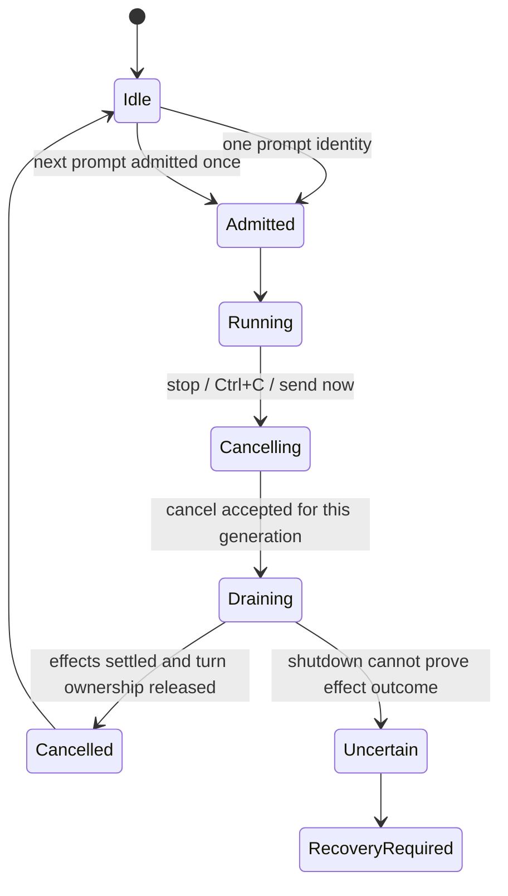

# Aster TUI end-to-end test plan

Status: **planned, not executed**. Source inventory date: 2026-11-10.
Static declarations are pinned to the committed revision in `inventory.json`.
The parallel cancellation fix is not imported from its uncommitted working tree;
reconcile the inventory and freeze the final candidate after it lands.

This plan covers the shipped `aster` TUI and its paired `aster-acp`, including
Core effects reached through that UI. It does not turn SDK-only capabilities,
hidden upstream product features, or a successful refusal into working TUI
features. The historical `../20261012` catalogue remains a historical record;
its 1,020 planned cases are not evidence for this candidate.

## Deliverables and coverage boundary

- `inventory.json`: current source declarations, ownership, aliases, argument
  contracts, settings metadata, bindings, and source hashes
- `catalog.json`: individually identified cases and parameter expansions,
  preconditions, steps, independent oracles, lanes, priority, and `PLANNED` status
- `cases.md`: readable scenario details and exhaustive command, setting,
  action, model-form, and tool mappings

The catalogue has **508 planned case definitions**, including **124 specific
cross-feature scenarios**. Parameters expand these definitions into additional
execution rows; neither number is a pass count.

Static inventory: **75 local command registrations, 8 Core command defaults,
5 ACP command declarations, 52 settings, 76 action identifiers, 72 default
binding rows, 16 model-configuration field variants, and 26 reviewed tool
seeds**. These sets overlap. They are not counts of currently usable features.
It also maps all **13 active-modal variants, 14 palette variants, 13 JSON Render
components and 7 MCP elicitation field kinds** declared by the inspected source.
There are 38 unavailable local command handlers and 18 unavailable setting
keys in Aster's source gates. ACP can replace an unavailable local handler;
`/memory` and `/tasks` must therefore be qualified after the real handshake.
`/resume` and `/fork` are current entries, not historical disabled commands.

Before executing a frozen candidate, capture the actual command catalogue,
model/config options, permission modes, tool schemas, MCP names, session
capabilities, platform qualifications, and welcome-screen entries. Reconcile
every added, removed, gated, or shadowed row with this plan. A source constant
called effective is not proof of runtime reachability. Unregistered enum
variants are not offered shortcuts. An unknown runtime row is a coverage gap.

The unit of completion is a case plus its platform/provider parameters and
evidence. Report separately: inventory mapped, runner implemented, cases
executed, native visual review, live-provider execution, and failures closed.
Do not use a planning check, a screen keyword, a mock result, an ignored test,
or a model's success narrative as a product pass.

## Execution lanes

| Lane | Real boundary | What it proves |
| --- | --- | --- |
| `U` | Shipped TUI + ACP; real local files/settings/clipboard/terminal | UI-only operations and persistence; assert zero new model calls where the action is local |
| `D` | Shipped TUI → real ACP → real Core → owned protocol fixture → real effects | Deterministic timing, native request fields, failures and races; not real-model reasoning |
| `L` | Shipped TUI → real ACP → real Core → named live provider/model → real tools | Actual model selection, tool orchestration, task completion and verification |
| `N` | Current packaged/native binary in a real terminal, driven with agent-desktop | Actual mouse hit targets, keyboard handling, IME, clipboard, resize, colors and terminal restoration |
| `F` | `D` or `L` plus an owned transport/process fault | Recovery, identity isolation, uncertain effects, shutdown and late-event behavior |
| `G` | Exact real dispatch path with a capability deliberately absent | Honest refusal and zero prohibited effects; does not qualify the missing positive capability |

Native visual and live-provider campaigns are explicitly requested work here,
but this plan does not add a permanent screenshot gate or a new CI framework.
Reuse existing PTY and protocol fixtures. A protocol fixture must implement
the real request/stream contract; do not bypass pager dispatch, ACP admission,
Core history, permissions, or process shutdown.

## Candidate and fixture contract

1. Freeze a clean commit after the parallel cancellation changes land. Record
   Git SHA, submodule SHA, toolchain/features, OS/architecture, binary paths,
   SHA-256, versions, both `--build-id` values, and archive hashes. CLI and ACP
   versions have different version lines; their paired build identity must
   agree. A dirty source snapshot is diagnostic evidence, not a release candidate.
2. Reuse fixed-purpose test directories. Each case owns an isolated profile,
   workspace, provider fixture, and child-process tree. Do not change the
   operator's profile, credentials, real repositories, input source or clipboard
   without preserving and restoring the original state. Child environment
   isolation does not repurpose the shell's `HOME` variable.
3. Create product configuration with the existing ACL parser/serializer and
   configuration contract. Report effective layer precedence. Test evidence
   may be JSON; it is not a replacement product configuration format.
4. Before live tests, explicitly qualify the exact provider/account, model ID,
   adapter, tool support, accessible endpoint and available test budget. No
   fallback model, reused answer, silently increased timeout, or copied user
   profile. Missing access is `BLOCKED`, not `PASS` or an early successful return.
5. Freeze each checker and deadline before the run. Record hashes and keep
   acceptance checkers outside the model-writable workspace when permitted by
   the real host contract. For native execution, preserve the product's actual
   qualification and sandbox gates; absent capability blocks the positive test.
6. Use correlated event/state waits. Save initial file/Git/process/network
   baselines and independent final checks. Never infer tool completion from
   `Cancelled`, a stopped spinner, or the foreground join handle alone.
7. Clean only resources created by the case, by retained identity. Restore
   terminal modes, input source, clipboard formats and native window ownership.
   Preserve failing evidence before cleanup; redact before external storage.

| Fixture | Required content and independent oracle |
| --- | --- |
| `profile` | Empty and populated ACL layers, bad syntax, read-only parent, synthetic secret, two same-named providers; exact before/after digests |
| `catalog` | Two model routes with deliberately different effort modes, defaults, context/output limits; counted delayed metadata replies and captured request fields |
| `stalled-turn` | Owned HTTP endpoint that blocks before headers, mid-stream, and after tool dispatch; explicit release latch and request counter |
| `foreground-tool` | Qualified real process and descendant; start/end events, shutdown acknowledgement, late-write trap, unrelated-process sentinel |
| `sessions` | Two marked sessions in two workspaces; queued draft, persisted model/effort/mode, long transcript, cancelled and unfinished turns |
| `files` | Fresh canary read/write/edit corpus; Unicode, spaces, CRLF, binary, missing and bounded large files; root-boundary sentinels |
| `verification` | Two independent defects and frozen checker: fail → partial fix still fails → complete fix passes; reports bound to current effects |
| `retrieval` | Labelled lexical/semantic corpus, path filters, duplicate basenames, update/delete revisions, real embedding/index qualification |
| `questions` | Required/optional, boolean/number/enum/text/multi-choice, long labels, invalid defaults, cancel, timeout if advertised; actual returned schema values |
| `extensions` | Owned skill/MCP/child agent through official configuration; versioned tools, progress, failure, disconnect, schema/permission/capability constraints |
| `terminal` | Fullscreen/minimal/inline qualification, geometry, truecolor fallback, Kitty capability, SSH/tmux context, original terminal state |
| `package` | Exact platform archive, independent member allowlist and checksums, paired BUILD_ID, offline embedding load, clean PATH launch |

## The cancellation contract under test

This is an acceptance model, not a proposal for a second product state machine.
The pending cancellation patch must be tested at two distinct boundaries:
control responsiveness and actual worker/tool settlement. The source snapshot
currently declares 35 s settlement grace, 50 ms abort grace, and a 30 s detached
join hold. Re-read the final committed values before execution. Their existence
does not authorize releasing a turn while a foreground tool still writes.
Exercise the just-before/at/after boundaries without weakening the invariant.
The committed baseline also has a 150 ms event-drain window. Hold a real tool
past that window and observe its eventual terminal event; a fixed drain timer
must not substitute for tool settlement, even if the pending fix removes it.

For send-now, the replacement is retained once, cancellation targets the old
generation, and the next prompt may start only after the previous writer/effects
have settled. Duplicate click/key events must not duplicate admission. Delayed
old completion, queue snapshots, model replies, permission answers or timers
must not requeue or resurrect the old prompt. If an effect is genuinely unknown,
show that outcome and use the existing recovery contract; never claim a clean
cancel or automatically replay a possibly completed write.

## Async model capability contract under test

Selecting a model must leave input and cancellation responsive while discovery
runs. Compare picker, footer, session configuration, ACP metadata and the actual
provider request. Provider/model names alone are not capability evidence.

- Cover `Unknown`, `Unsupported`, `Preset`, `Effort`, `Adaptive`, `OutputConfig`,
  `Budget`, and `ThinkingLevel`; qualify each against the exact declared protocol
- Distinguish reset/default (field omitted), explicit `none`, and a real effort
  value; do not coerce every provider into the same effort vocabulary
- Verify context window and output limit independently, including units,
  context minus output reservation, invalid/missing metadata and too-small input
- Delay discovery for A, switch to B, then return A; only B may change. Repeat
  with account, base URL, model-level override and credential revision changes
- Test cold/warm cache, failed request, retry, expiry and duplicate responses;
  retain provenance and honest unknown status instead of inventing exact limits
- Freeze the effective configuration of an admitted turn. A later discovery or
  UI change must not rewrite that turn's route or reasoning fields retroactively
- A user choice made while discovery is pending must survive the response,
  including explicit `none`. Test declared precedence between metadata and a
  saved explicit override; contradictory limits must not silently exceed the
  provider contract

## Per-entry expansion rules

Every source row in `inventory.json` maps to concrete case IDs in `catalog.json`.
Common rules supplement, rather than replace, the specific scenarios in
`cases.md`.

| Entry kind | Required variations |
| --- | --- |
| Local/ACP/Core slash command | Discoverability and exact typed invocation; every alias; exact argument grammar and empty/invalid/excess arguments when applicable; mode/session/capability gate; cancellation/draft retention; zero LLM requests for locally handled actions |
| Unavailable local handler | Menu/shortcut advertisement gate and direct typing; zero prohibited effects; qualify any ACP replacement separately after handshake; aliases must not bypass the gate |
| Boolean setting | Both states, reset/inherit, immediate behavior, owner-specific persistence, restart when declared, write failure/draft retention |
| Enum setting | Every source canonical choice, label/value identity, invalid value rejection, reset, save/reopen, preview Escape rollback when supported; unsafe choices must not preview |
| Integer setting | min−1, min, min+1, middle, max−1, max, max+1, empty, nonnumeric, overflow; no invalid write; compare display and stored effective value |
| Dynamic setting/group | Runtime refresh and stale removal, no-override sentinel, duplicate labels, all declared child keys; qualify hidden rows before positive tests |
| Bound action | Every primary/alternate key in its exact context, mouse/menu equivalent if present, overlay shadowing, disabled context, held/repeated input and actual hint/key agreement |
| Unbound action identifier | Confirm absence from offered default shortcuts; a reachable non-default entry requires explicit runtime qualification and the same behavioral oracle |
| Model form field | Open/focus/edit/save/reopen; cancel/restore; field-specific invalid data, defaults/layer precedence, persistence failure; secrets and account access remain opt-in |
| Tool/capability | Real runtime schema and registration, valid effect, schema rejection before side effects, permission denial, error/cancel settlement and independent artifact; inspect missing capability separately |

Do not apply invalid-argument expectations blindly to commands whose defined
contract deliberately passes text through. `/gboom` is deliberately hidden and
its arguments follow a special passthrough path; debug and maintenance surfaces
remain part of direct-dispatch and branding coverage. A disabled `/queue` slash
handler does not remove the active composer queue or its shortcut from scope.

## Platform, terminal and provider matrix

| Dimension | Required coverage and status |
| --- | --- |
| Release platforms | macOS arm64, Linux x86_64, Linux arm64, Windows x86_64; run natively on each before claiming that platform |
| Native terminals | macOS Terminal and iTerm2; qualified Linux terminal; Windows Terminal + PowerShell; record versions/capabilities. Additional terminal brands are opt-in compatibility extensions |
| Modes | Fullscreen, minimal, and `--no-alt-screen` when accepted by the current launcher; switch both directions in process and preserve current session |
| Geometry | 120×40, 80×24, 40×12; shrink/expand during picker, permission, streaming, cancellation and long output |
| Input | ABC, Simplified Chinese Pinyin IME, emoji/combining characters; CRLF/multiline/bracketed paste; primary and fallback terminal key encodings |
| Providers | Every actually supported adapter/account path offered in this release; one real qualified model for each native reasoning mode that is available; exact IDs captured at run time |
| Permissions | Every advertised mode, default/reset and per-tool decision; YOLO has one consistent product label and retains sandbox/capability boundaries |
| Context | Empty, typical, near effective input budget, and just over; streaming output reservation, compaction, resume and discovered-limit changes |
| Concurrency | Model A→B stale discovery; stop vs ToolEnd; stop vs final response; send-now vs queue update; resume/switch vs late notification; duplicate request IDs |
| Faults | HTTP auth/rate limit/5xx, metadata unavailable, stream stall/truncation, ACP EOF/malformed message, disk write failure, process shutdown delay |

First execute a primary candidate per case. Then use pairwise expansion for
ordinary display/input combinations. Never replace explicitly listed permission,
identity, cancellation or destructive-operation races with pairwise sampling.
Report all matrix expansions, not only the number of base cases. Unsupported
native capability is a blocked positive lane, not a reason to bypass its gate.

## Native agent-desktop procedure

Build the pair from the exact recorded candidate, or extract the final archive
and verify its identity. Open a new owned native terminal window with the
isolated environment; do not attach a stale installed process. Record terminal
identity, geometry and input source. Use agent-desktop to locate/click the real
stop target, focus/edit the composer, drive each modal and inspect the result.
Save before/action/after screenshots plus the correlated event/effect timeline.

For Chinese input, capture preedit and commit separately: the Enter that commits
IME text must not also submit a prompt. Include punctuation and hotkey chords.
If agent-desktop cannot synthesize a key and an OS automation fallback is used,
record which action used it; do not label that action agent-desktop verified.
Do not change clipboard contents to inject test text unless the clipboard case
explicitly requires it and can restore every original format. Screen recording
alone does not prove process cancellation, model routing or persisted effects.

## Existing execution assets to reuse

| Existing source | Relevant scope; execution must still be recorded |
| --- | --- |
| `crates/code/acp/tests/shipped_tui_e2e.rs` and `shipped_tui_e2e/session_controls.rs` | Real shipped pair, `/resume`, mouse stop, Ctrl+C and send-now |
| `crates/code/acp/tests/shipped_tui_e2e/reasoning.rs` | Discovery, effort/reset and restart request assertions |
| `crates/code/acp/tests/shipped_tui_e2e/retrieval.rs` | Shipped retrieval path |
| `crates/code/acp/tests/tui_913_hermetic.rs` | Deterministic UI/protocol controls; historical filename is not a version claim |
| `crates/code/acp/tests/account_model_tui_e2e.rs` and `cursor_account_tui_e2e.rs` | Account/model configuration and routes |
| `crates/code/acp/tests/aster_tui_live_e2e.rs` and its modules | Existing real-provider PTY driver, forms, lifecycle, tools, reading and input controls |
| `crates/code/acp/tests/reasoning_live.rs`, `cursor_native_tools_live.rs` | Real reasoning/native tool routes; access prerequisites apply |
| `crates/code/acp/tests/release_smoke.rs` | Packaged/product smoke where actually supported |
| `docs/evidence/code/2026-11-10-tui-visual-controls/OUTCOME.md` | Prior candidate's native evidence; reuse fixtures and lessons, not its pass status for changed inputs |

Check current test names, ignore attributes, required environment and supported
features before choosing exact commands. Use the repository's root target
cache with one Cargo owner. Reuse passing results only while all relevant
candidate/configuration inputs are unchanged. Do not run multiple live suites
against the same profile/account or report skipped/ignored cases as passes.

## Execution order and ownership

| Stage | Scope | Responsible owner | Completion evidence |
| --- | --- | --- | --- |
| 0 | Inventory reconciliation, source/binary/profile freeze, fixture qualification | Test owner + release owner | No unmapped current runtime entry; explicit unavailable and blocked lists |
| 1 | P0 cancellation/queue, model/context discovery, permissions, resume and verified file change | ACP/Core + TUI owner | UI/protocol/effect agreement, no duplicate admission, no orphan writer, P0 races repeated with fixed interleavings |
| 2 | All commands, settings, shortcuts, forms, input, transcript, sessions and tools | TUI/test owner | Each eligible case executed with independent oracle; exact per-entry mappings |
| 3 | Native terminals/platforms, live providers/accounts, unavailable-capability refusals | Platform/provider owner | Actual native evidence per advertised target/adapter; no inferred platform passes |
| 4 | Transport/disk/process faults, restart, long session and functional repetition | ACP/Core/test owner | All resources settled or honestly uncertain; no replay, queue resurrection or cross-session contamination |
| 5 | Frozen packaged pair and existing required release qualification | Release owner | Archive allowlist/hash/build identity, required exact-SHA workflow passes, native package smoke |

This is an execution roadmap, not an additional release policy. Follow
`docs/release-governance.md` for mandatory gates. Do not delay the already
authorized release for optional terminal brands, unrequested performance work,
or a new testing framework. Confirmed product defects in changed release paths
remain blockers and need focused regression evidence.

## Result and evidence contract

Execution states: `PASS`, `FAIL_PRODUCT`, `FAIL_SPEC`, `FAIL_INFRA`, `BLOCKED`,
`NOT_RUN`, `N/A(reason)`. Keep original failures and retries. A missing model,
token, runner, native capability or implementation cannot be a pass.

Per case, retain: case/parameter IDs; source/binary/config fingerprints; exact
input actions; redacted request and event timeline; session/run/turn/generation/
tool identifiers; discovery source and wire reasoning fields where relevant;
typed outcomes; independent file/checker/process/network/storage observations;
bounded VT and native screenshots when used; deadlines, retries and cleanup.
Do not put secrets, raw account payloads, private endpoints or unrelated user
content in committed evidence. An uncertain external effect requires an
uncertain result, not a success sentence.

Exit criteria for a claimed complete TUI campaign: every runtime entry is mapped;
all eligible required cases and declared matrix cells are executed; unresolved
P0/P1 defects are listed and resolved before claiming acceptance; blocked and
unsupported cells are explicit; no test-owned live writer/process remains;
required release checks use the final candidate. Separate opt-in performance
measurements from functional acceptance and freeze any SLO before measuring.

## Explicitly not claimed

This document and its catalogue do not establish that any new product case has
passed, that every provider exposes discoverable limits, that all tools are
available on every host, or that native visual checks cover another platform.
They do not implement a runner, change product behavior, enable hidden features,
or replace release qualification with a catalogue validation.
