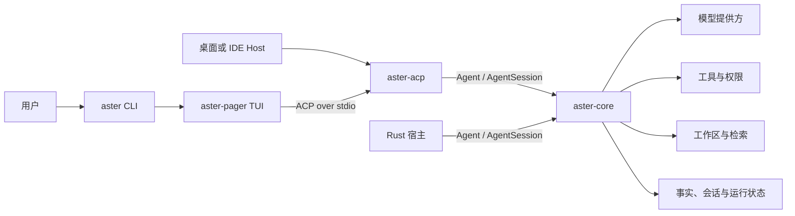
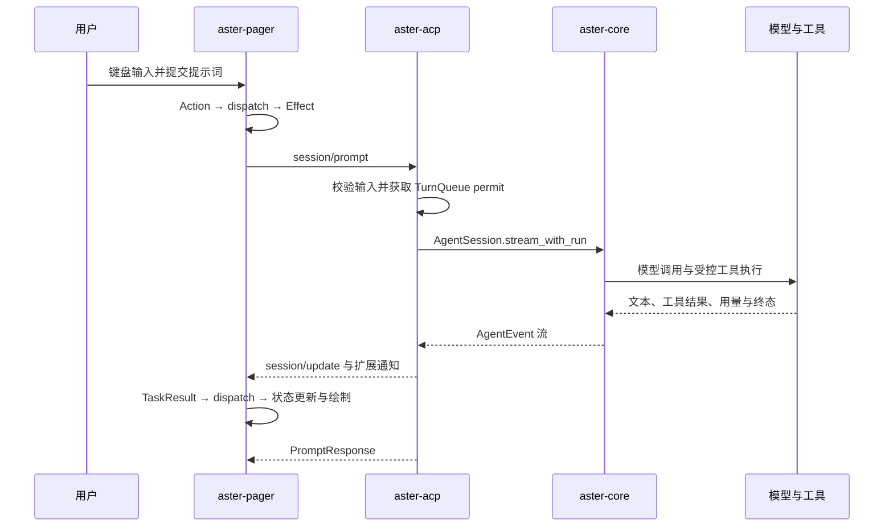

# Aster Core、ACP 与 TUI 源码导览

> 本文以源码为主线解释 Aster 的进程拓扑、模块职责、请求调用链、状态持久化、搜索索引、权限与完成门禁。
>
> 版本范围：Core／ACP `9.2.0`，CLI `0.2.1`（后续 `0.3.0` 将绑定本版）。文档更新于 2026-11-08。
>
> 本文只描述已经提交的实现，不把工作区中的未提交实验功能写成正式能力。验证数字是特定基线的验收记录，不是性能或发布承诺。

## 目录

1. [系统全景](#1-系统全景)
2. [一次提示词的完整调用链](#2-一次提示词的完整调用链)
3. [进程启动与会话建立](#3-进程启动与会话建立)
4. [Core 公共 API 与执行模型](#4-core-公共-api-与执行模型)
5. [Meta Harness、权限与完成门禁](#5-meta-harness权限与完成门禁)
6. [ACP 会话、事件与取消](#6-acp-会话事件与取消)
7. [TUI 状态管理与渲染](#7-tui-状态管理与渲染)
8. [配置与能力装配](#8-配置与能力装配)
9. [工作区抽象与搜索](#9-工作区抽象与搜索)
10. [检索持久化与增量索引](#10-检索持久化与增量索引)
11. [会话持久化、恢复与关闭](#11-会话持久化恢复与关闭)
12. [工具、MCP、Skills 与宿主扩展](#12-工具mcpskills-与宿主扩展)
13. [错误、降级与可观测性](#13-错误降级与可观测性)
14. [源码修改导航](#14-源码修改导航)
15. [验证基线](#15-验证基线)
16. [已知边界与维护规则](#16-已知边界与维护规则)

## 1. 系统全景

### 1.1 三层职责

Aster 把交互界面、协议适配和执行内核分开：



| 层 | 主要包 | 责任 | 不承担的责任 |
| --- | --- | --- | --- |
| 终端 | `apps/aster`、`aster-pager` | 参数解析、终端事件、会话界面、ACP 客户端、输出渲染 | 不直接复制 Core 的模型循环和权限判断 |
| 协议 | `crates/code/acp` | ACP 方法与通知、会话映射、宿主能力装配、事件投影 | 不另建一套绕过 Core 的执行内核 |
| 内核 | `crates/code/core` | 模型与工具编排、Run、权限、事实记录、验证、工作区、持久化 | 不负责终端绘制，也不要求所有宿主都使用 ACP |

`aster` 与 `aster-acp` 是两个进程。`aster-pager` 是链接进 CLI 的终端 UI 库，不是独立可执行文件。Rust 宿主也可以完全跳过 CLI 和 ACP，直接嵌入 `aster-core`。

### 1.2 源码入口

| 要阅读的部分 | 入口 |
| --- | --- |
| CLI 主函数 | [`apps/aster/src/main.rs`](../../apps/aster/src/main.rs) |
| 非 TTY 启动判定 | [`apps/aster/src/startup.rs`](../../apps/aster/src/startup.rs) |
| TUI crate 导出 | [`aster-pager/src/lib.rs`](../../crates/terminal/crates/codegen/aster-pager/src/lib.rs) |
| TUI 架构说明 | [`aster-pager/README.md`](../../crates/terminal/crates/codegen/aster-pager/README.md) |
| ACP sidecar 启动 | [`aster-pager/src/acp/aster_spawn.rs`](../../crates/terminal/crates/codegen/aster-pager/src/acp/aster_spawn.rs) |
| ACP 可执行文件入口 | [`acp/src/bin/aster-acp.rs`](../../crates/code/acp/src/bin/aster-acp.rs) |
| ACP 协议方法 | [`acp/src/agent/protocol.rs`](../../crates/code/acp/src/agent/protocol.rs) |
| ACP 会话装配 | [`acp/src/agent/session_open.rs`](../../crates/code/acp/src/agent/session_open.rs) |
| ACP 事件与 Turn | [`acp/src/agent/turn.rs`](../../crates/code/acp/src/agent/turn.rs) |
| Core crate 导出 | [`core/src/lib.rs`](../../crates/code/core/src/lib.rs) |
| Core 高层 API | [`core/src/agent_api.rs`](../../crates/code/core/src/agent_api.rs) |
| Core Agent 门面 | [`core/src/agent_api/agent_facade.rs`](../../crates/code/core/src/agent_api/agent_facade.rs) |
| Core Session 门面 | [`core/src/agent_api/session_facade.rs`](../../crates/code/core/src/agent_api/session_facade.rs) |
| Run 状态与事件存储 | [`core/src/run.rs`](../../crates/code/core/src/run.rs) |
| Meta Harness | [`core/src/meta_harness.rs`](../../crates/code/core/src/meta_harness.rs) |

### 1.3 关键不变量

1. CLI 与 ACP 正式配套二进制必须共享构建身份并成对更新。
2. ACP stdout 只传协议；诊断走 stderr 或日志文件，不能污染协议流。
3. Core 的权限和完成门禁不能被宿主自定义 Harness 关闭。
4. 一个 Run 的身份、能力代际和终态必须稳定；迟到事件不能把终态改回执行中。
5. 阻塞文件 I/O 不能长期占用异步 executor；取消需要工作线程协作。
6. 部分扫描、部分索引和降级检索必须显式标记，不能伪装成全量成功。
7. 构建成功、测试通过、候选包验收和正式发布是四个不同结论。

## 2. 一次提示词的完整调用链

### 2.1 交互式 TUI



TUI 的三类消息分工如下：

- `Action`：无副作用的用户意图。
- `Effect`：dispatch 产生的异步工作，例如 ACP 请求或文件 I/O。
- `TaskResult`：异步工作的结果，再次进入 dispatch 更新状态。

定义见 [`app/actions.rs`](../../crates/terminal/crates/codegen/aster-pager/src/app/actions.rs)。主事件循环只负责多路 I/O、定时和绘制，不把所有业务规则塞进一个循环，见 [`app/event_loop.rs`](../../crates/terminal/crates/codegen/aster-pager/src/app/event_loop.rs)。

### 2.2 Headless

`aster -p` 不经过交互式 `AppView`，而是由 [`headless.rs`](../../crates/terminal/crates/codegen/aster-pager/src/headless.rs) 驱动：

```text
解析 HeadlessOptions
  → 启动 aster-acp
  → initialize / authenticate
  → session/new 或 session/load
  → 可选 set_model
  → session/prompt
  → 将 ACP 更新归约为 plain、json 或 NDJSON 输出
  → 关闭 sidecar 并退出
```

Headless 仍使用同一 ACP 和 Core，不存在另一套只用于脚本的模型执行器。输出格式、结构化结果和终态由 headless reducer 与 emitter 处理。

### 2.3 直接嵌入 Core

Rust 宿主的典型路径更短：

```rust,no_run
use aster_core::{Agent, AgentEvent};

# async fn example() -> anyhow::Result<()> {
let agent = Agent::new("agent.acl").await?;
let session = agent.session_async("/my-project", None).await?;
let (mut events, worker) = session.stream("解释认证模块", None).await?;
while let Some(event) = events.recv().await {
    if let AgentEvent::TextDelta { text } = event {
        print!("{text}");
    }
}
worker.await?;
# Ok(())
# }
```

`AgentEvent` 是 `#[non_exhaustive]`，真实宿主必须保留通配分支。完整公开导出以 [`core/src/lib.rs`](../../crates/code/core/src/lib.rs) 为准。

## 3. 进程启动与会话建立

### 3.1 CLI 启动

[`apps/aster/src/main.rs`](../../apps/aster/src/main.rs) 的启动顺序包括：

1. 记录进程和版本信息，处理内部子进程模式。
2. 解析 `PagerArgs`，提前处理版本、诊断和配对更新命令。
3. 如果用户要求交互 TUI，但 stdin／stdout 不是终端，输出简短说明并返回。
4. 应用工作目录、沙箱和托管策略，构建 Tokio runtime。
5. 分发普通子命令、Agent 子命令、Headless 或交互式 Pager。

并不是每个 CLI 子命令都启动 ACP。环境管理、诊断、版本等命令可以直接完成，不支付会话启动成本。

### 3.2 ACP sidecar 与配对检查

[`aster_spawn.rs`](../../crates/terminal/crates/codegen/aster-pager/src/acp/aster_spawn.rs) 负责：

- 默认选择当前 `aster` 所在目录中的 `aster-acp`。
- 允许通过 `ASTER_ACP_AGENT_BIN` 显式指定外部 Agent。
- 对正式配套二进制执行 `--build-id`，与 CLI 的 `ASTER_PAIR_BUILD_ID` 比较。
- 创建 stdin／stdout／stderr 管道，并建立 `ClientSideConnection`。
- 在取消、传输结束或子进程退出时回收 bridge 和子进程。

显式外部 Agent 有自己的生命周期，不适用正式配套包的构建身份检查。缺失、不可执行或身份不匹配的正式 companion 会失败，而不是静默换用未知后端。

### 3.3 ACP 进程模型

[`acp/src/bin/aster-acp.rs`](../../crates/code/acp/src/bin/aster-acp.rs) 使用：

- 8 MiB 入口线程和 Tokio 工作线程栈，容纳内联的会话与提示词状态机。
- 多线程 Tokio runtime 加 `LocalSet`。
- `AgentSideConnection` 连接 stdio。
- 默认安静的 stderr 日志，以及可选的每日文件日志。

CPU 阻塞或同步文件扫描不能假设 `spawn_blocking` 的 JoinHandle 被 drop 后操作系统线程就会停止。需要协作取消的设计见[搜索取消](#94-预算与协作取消)。

### 3.4 initialize、new 与 load

ACP 的主要协议入口位于 [`agent/protocol.rs`](../../crates/code/acp/src/agent/protocol.rs)：

| 方法 | 主要行为 |
| --- | --- |
| `initialize` | 读取宿主规则与能力，返回 Aster 身份、模型状态、权限与工作区准入信息 |
| `new_session` | 生成 session ID，准备工作区，装配 Core Session，注册工具并保存初始快照 |
| `load_session` | 校验恢复目标，加载或替换 Core Session，重放持久化 transcript |
| `set_session_mode` | 更新权限姿态并通知客户端 |
| `set_session_model` | 在与 Turn 相同的队列中替换 Core Session，保留会话 ID 和历史 |
| `prompt` | 校验内容，排队，启动或恢复 Run，投影事件并返回 StopReason |
| `cancel` | 记录当前 turn generation，取消 Core Run 和子任务，唤醒等待方 |

`new_session` 和 `load_session` 最终都进入 [`open_core_session`](../../crates/code/acp/src/agent/session_open.rs)，区别是后者提供已保存的 `SessionStore`。模型切换使用 `replace_session_async`，避免先关闭旧会话再发现新会话构建失败。

## 4. Core 公共 API 与执行模型

### 4.1 Agent、SessionOptions 与 AgentSession

| 类型 | 作用 | 关键约束 |
| --- | --- | --- |
| `Agent` | 持有配置、跨会话调度器、全局 MCP 和会话注册表 | 一个 session ID 在同一 Agent 中只能有一个存活或构建中的 Session |
| `SessionBuilder` | 记录 typed options，在 `build()` 时初始化异步资源 | Builder 阶段不执行文件系统或 MCP 初始化 |
| `SessionOptions` | 模型、权限、存储、记忆、工作区、Skills、预算和 Harness 的每会话配置 | 恢复时必须重新注入运行时对象，并校验持久化策略 |
| `AgentSession` | 工作区绑定的执行、事件、控制、观察和持久化 API | 对话操作 single-flight；关闭后新操作快速失败 |

Core 的 single-flight 与 ACP 的排队不是同一层：

- Core 对重叠的对话操作返回 `SessionBusy`，防止 transcript 并发修改。
- ACP 在调用 Core 前用 `TurnQueue` 串行化客户端 prompt，最多允许 **32 个等待中的 prompt**。
- 模型切换也获取同一个 ACP Turn permit，避免在 Run 执行中替换 Session。

### 4.2 Run 与事件

[`core/src/run.rs`](../../crates/code/core/src/run.rs) 定义稳定状态：

```text
Created → Planning → Executing → Verifying → Completed
                                      └────→ Failed
                                      └────→ Cancelled
```

实际事件可以跨阶段到达，但 `RunStatus::is_terminal()` 后的状态不会被迟到事件倒退。每个 Run 保存：

- Run ID、Session ID、prompt、状态和时间戳。
- 冻结的 package／capability binding。
- 结果文本或错误。
- 累计事件数和保留的事件窗口。
- 可选的不可变工作区 change set。

`InMemoryRunStore` 支持按 Run 数、事件数和事件字节数做 FIFO 保留。`event_count` 是历史累计值，不等于当前保留缓冲区长度，因此游标不会因淘汰而重复。需要跨进程持久化时，由 SessionStore 保存和恢复这些记录。

### 4.3 stream、send 与 cancel

- `send` 等待完整结果。
- `stream` 返回事件接收器和 worker JoinHandle。
- `stream_with_run` 额外返回 admission 时确定的 `RunHandle`，调用方不会误观察后续 Run。
- `cancel` 请求取消当前操作，但保留 Session 以供下一次 prompt。
- `cancel_and_settle` 等待原 worker 释放 admission，区分“已发出取消”和“原执行已清退”。
- `close` 取消整个 Session 的派生操作并释放资源，是终止语义，不是单次 Turn 取消。

事件流结束本身不证明成功，也不证明资源清理完毕。调用方应观察 Run 终态、worker 和必要的关闭结果。

## 5. Meta Harness、权限与完成门禁

### 5.1 默认组件图

[`core/src/meta_harness.rs`](../../crates/code/core/src/meta_harness.rs) 的默认顺序是：

```text
system → tools → budget → compact → infer
```

宿主可以提供 `components: [...]`，重排 stock parts，或挂载 Rust 侧的 `host:<id>` 组件。完整 Rust 宿主还可以提供自定义 assembler。

`KernelPolicy::admit()` 始终保留：

- `permission_overlay = true`：每次工具调用先经过权限策略。
- `completion_gate = true`：修改型运行需要验证证据或绑定效果摘要的宿主豁免。

因此，自定义 Harness 是**受控装配能力**，不是绕过内核治理的后门。更完整的设计合同见 [Meta Harness 手册](../../crates/code/manual/META_HARNESS.md)。

### 5.2 一次执行的概念分解

```text
用户输入与冻结策略
  → 组装模型上下文和可用工具
  → 模型提出文本或工具调用
  → 权限判定 / 人工确认
  → 工具执行并记录事实
  → 将工具观察交回模型
  → 必要时压缩或继续
  → 验证与完成判定
  → End、Error 或显式强制停止
```

这里有三类不同预算：

- 模型与工具轮次预算。
- 整体执行或宿主目标预算。
- 工作区扫描、文件大小和输出等资源预算。

它们不能相互替代。搜索的 30 秒预算尤其不表示整个模型任务保证在 30 秒内完成。

### 5.3 权限与验证

权限策略不仅决定“能否执行”，也影响模型能看到哪些工具。需要人工确认时，Core 发出 `ConfirmationRequired`，ACP 将其映射为 `session/request_permission`，再把选择传回 `confirm_tool_use`。

完成阶段区分：

- 普通叙述性回答。
- 有验证证据的完成。
- 有宿主豁免的完成。
- 不同资源或目标下的独立终态。
- 工具效果未结清、验证失败或预算耗尽导致的非成功终态。

ACP 在 prompt response 前发送 `aster/turn/outcome`，让 TUI 的终态标记能反映真实完成门禁，而不只是显示一个耗时。

## 6. ACP 会话、事件与取消

### 6.1 AsterCodeAgent 与 LiveSession

[`AsterCodeAgent`](../../crates/code/acp/src/agent.rs) 持有进程级状态：

- 一个延迟创建的 Core `Agent`。
- ACP session ID 到 `LiveSession` 的映射。
- 默认模型与 reasoning effort。
- 持久目标、turn generation 和取消 generation。
- 全局 MCP 基线、宿主文档桥和插件选择。
- 普通或 `--unattended` 会话配置。

每个 `LiveSession` 保存：

- `Arc<AgentSession>`、工作区和模型 ID。
- 权限状态与资产 deny 规则。
- 宿主指令、Harness components 和动态工具。
- 独立 `TurnQueue`。
- 会话级 MCP 集合和当前 prompt ID。

`SessionSetup` 把新建、恢复和模型替换共用的输入收拢为一个 typed value，防止某条重建路径漏掉工作区、宿主或 MCP 配置。

### 6.2 会话装配顺序

```text
ensure_core_agent
  → session_options_for
      → 读取 workspace_retrieval
      → 准备可选本地 embedding
      → 合并宿主提示词、权限、Skills、Hooks 和存储
  → Agent.session_async / resume_session_async / replace_session_async
  → 注册插件与宿主工具
  → 加入 sessions 映射
  → start_workspace_indexing
```

普通 ACP 与无人值守 ACP 使用同一套装配边界。无人值守模式改变状态根、权限和结果处理，不会取消搜索预算，也不会获得一套测试专用的生产开关。

### 6.3 Core 事件到 ACP 通知

[`agent/turn.rs`](../../crates/code/acp/src/agent/turn.rs) 是事件投影中心：

| Core 事件 | ACP／TUI 表现 |
| --- | --- |
| `TextDelta` | Agent message chunk |
| `ReasoningDelta` | Agent thought chunk |
| `ToolExecutionStart` | 新建或更新工具卡片 |
| `ToolOutputDelta` | 工具输出增量 |
| `ToolEnd` | 工具完成状态、输出和退出码 |
| `ConfirmationRequired` | 权限请求，随后回写 Core 确认 |
| `TaskUpdated` / `PlanningEnd` | 计划更新 |
| `SubagentStart` / `Progress` / `End` | 子 Agent 生命周期 |
| `ModelUsageBound` / `AutoCompact` | 用量与压缩通知 |
| `End` | 用量、最终文本和 turn outcome |
| `Error` / `ToolEffectUnresolved` | 失败的 prompt，而不是成功的 EndTurn |

同一个工具 ID 的确认、开始和结束更新同一张卡片，避免重复渲染。已经通过 delta 发送的文本不会在 `End` 再重复发送一次。

### 6.4 取消的两层语义

ACP 为每个 Session 记录单调递增的 turn generation：

```text
prompt 开始 → generation = N
cancel 到达 → cancelled_generation = N
后续 prompt → generation = N + 1
```

迟到的 cancel 只影响它看到的 generation，不能把下一轮误判为已取消。`finish_prompt` 也以 generation 为准，而不是搜索错误文本里是否含有 “cancel”。

公开 ACP 取消可以尽快返回 `StopReason::Cancelled`，但原 worker 仍可能需要追加取消事实、释放 capability 和完成清理。短暂等待后分离公开 JoinHandle，不等于宣称所有后台工作已经硬停止。

## 7. TUI 状态管理与渲染

### 7.1 模块地图

`aster-pager` 的主要目录：

| 模块 | 职责 |
| --- | --- |
| `app/app_view.rs` | Welcome、Agent、Dashboard 等顶层状态与输入路由 |
| `app/agent_view/` | 单会话的 composer、scrollback、工具面板和 modal 状态 |
| `app/actions.rs` | Action、Effect、TaskResult 合同 |
| `app/dispatch/` | 同步状态归约和 Effect 生成 |
| `app/effects/` | ACP、文件和会话列表等异步副作用 |
| `app/event_loop.rs` | 终端输入、ACP channel、任务结果、tick、配置变化与绘制 |
| `acp/` | sidecar、连接、模型状态和协议客户端辅助 |
| `views/` | Prompt、Welcome、设置、扩展等 UI 组件 |
| `scrollback/` | 消息、工具、diff 和折叠块渲染 |
| `headless.rs` | 非交互单次 prompt 与结构化输出 |

### 7.2 AppView 与 AgentView

`AppView` 是应用根状态，知道当前是 Welcome、某个 Agent 还是 Dashboard。每个 `AgentView` 对一个终端会话视图负责，但它不是 Core Session 本身：

- Core 拥有模型、工具、Run 和事实。
- ACP 拥有协议会话与事件映射。
- AgentView 拥有面向显示的状态、焦点、折叠、面板和本地交互。

这层区分避免 UI 状态被误认为执行事实，也允许会话恢复时重建整个视图。

### 7.3 事件循环与背压

主事件循环使用 `tokio::select!` 处理多源事件。绘制由 `Presenter` 协调：

- 合并重复 draw 请求。
- 控制绘制频率和全量重绘。
- 跟踪 queued／written 序号，避免上一帧未写出就无限堆帧。
- writer 持续无进展超过 5 秒时报告阻塞，恢复后结束该阻塞 episode。
- resize 使用去抖，避免每个终端事件都重建所有布局。

因此，“模型正在运行”和“终端 writer 无法输出”是两类不同停顿。排查 TUI 卡死时需要同时看 ACP 事件是否前进，以及 writer 是否有写入进展。

### 7.4 三种终端运行方式

| 方式 | UI 状态机 | ACP 使用 | 输出 |
| --- | --- | --- | --- |
| 交互式 `aster` | AppView / AgentView / Action / Effect | 启动配套 sidecar | 全屏或 minimal 终端界面 |
| `aster -p` | Headless reducer / emitter | 启动配套 sidecar | plain、JSON 或 NDJSON |
| `aster agent stdio` | 无交互 UI | 将 sidecar 接到当前 stdio | ACP 协议流 |

交互式 sidecar 的 stderr 被捕获，避免日志直接画到 TUI。Headless stdout 是产品输出，写入失败与 Broken Pipe 分别处理。

## 8. 配置与能力装配

### 8.1 配置层次

| 层次 | 典型来源 | 作用 |
| --- | --- | --- |
| 模型与 Provider | `~/.aster/config.acl`、显式 ACL | Provider、模型、执行与工作区配置 |
| ACP 启动参数 | `--cwd`、`--config`、`--model`、`--reasoning-effort` | 进程默认值；`--config` 优先于 `ASTER_CONFIG` |
| 客户端 initialize | capabilities 与 `_meta` | 宿主文件能力、终端 Markdown、规则与权限输入 |
| 会话参数 | `session/new` / `load` 的 cwd、MCP、`_meta` | 单会话宿主能力与工具集合 |
| Core SessionOptions | ACP 或 Rust 宿主构造 | 最终 typed 配置、运行时 trait 对象和策略 |
| Pager／Shell 设置 | CLI 参数与 UI 配置 | 主题、键位、渲染和终端行为 |

Core 配置仍由 ACL 解析。UI 设置不能被误当成放宽 Core 权限或沙箱的通道。

### 8.2 普通、无人值守和隔离宿主

| 模式 | 状态与权限 | 检索与工具 |
| --- | --- | --- |
| 普通 ACP | 交互权限、常规 SessionStore | 默认本地工作区，按配置启动检索与宿主工具 |
| `--unattended` | 私有状态根、无人值守权限、执行预算和结果文件 | 使用同一 Core 工作区能力，不等待人工回答 |
| Source review | 固定拒绝执行能力、隔离上下文 | 不加载普通 Hooks 和检索能力 |
| Knowledge compile | 编译范围 guard、隔离上下文、磁盘内容 attestor | 只允许明确准入的读取和输出能力 |

### 8.3 能力代际

Session 持有一组可更新的能力目录；Run 在 admission 时冻结一个代际。模型定义、工具执行和持久化身份因此引用同一代能力，而不是在一次 Run 中途混用新旧工具。

“工具已配置”“工具对模型可见”“权限允许执行”是三个不同判断，排查工具问题时不能只看其中一个。

## 9. 工作区抽象与搜索

### 9.1 WorkspaceServices

主要实现：

| 模块 | 职责 |
| --- | --- |
| [`workspace/services.rs`](../../crates/code/core/src/workspace/services.rs) | 统一文件、搜索、命令、Git 和检索能力，继承操作超时 |
| [`workspace/local.rs`](../../crates/code/core/src/workspace/local.rs) | 本地文件系统、有界遍历、精确搜索和访问策略 |
| [`workspace/manifest.rs`](../../crates/code/core/src/workspace/manifest.rs) | 使用不可变文件清单与检索目录加速搜索 |
| [`workspace/retrieval/`](../../crates/code/core/src/workspace/retrieval) | chunk、catalog、持久化、后台协调、词法与语义检索 |

工具不直接假设所有工作区都是进程本地目录。Rust 宿主可以注入其他 `WorkspaceServices`，但必须保留相同的能力、错误和权限语义。

### 9.2 搜索调用链

```text
search(mode="grep", query, path, include, output_mode, limit)
  → SearchTool 参数适配
  → GrepTool.execute
  → WorkspaceServices.run_with_timeout("grep", ...)
      ├─ Manifest 尚未就绪 → LocalWorkspaceBackend
      └─ Manifest 已就绪   → ManifestWorkspaceBackend
  → 精确正则匹配、来源路径和 truncated 元数据
```

`query` 是后端正则表达式，`path` 是工作区相对根，`include` 是 glob 过滤。分页参数不改变权限边界。

### 9.3 本地与清单路径

本地搜索在 `spawn_blocking` 中遍历和读取，包含：

- 正则与 glob 入口校验。
- 工作区边界和敏感路径拒绝。
- 单文件大小限制。
- 时间与文件数预算。
- 协作取消。
- 部分结果和 `truncated` 标记。

清单就绪后，搜索复用不可变快照中的文件列表，再对候选路径执行精确扫描。首个快照尚未形成时直接回退本地搜索，不要求调用方等待索引完成。

自动 trigram 只负责候选剪枝，不是匹配权威。含正则元字符、无法安全转换为纯文本针的查询，以及长度小于 3 字节的针，不构建自动 trigram 索引。最终命中始终由精确正则扫描决定。

### 9.4 预算与协作取消

| 机制 | 当前值 | 到达边界后的行为 |
| --- | --- | --- |
| 扫描时间预算 | 30 秒 | 保留部分结果并标记截断 |
| 扫描文件预算 | 20,000 个文件 | 保留部分结果并标记截断 |
| 工作区操作超时 | 30 秒 | 返回结构化超时错误 |
| 单文件文本上限 | 16 MiB | 拒绝或记录跳过，不无界分配 |
| 目录失败日志样本 | 最多 3 条 | 有界诊断，同时保留类型计数 |

本地 Git／grep worker 使用 `CancelGitWorkerOnDrop`：调用方 Future 被 drop 时设置 `AtomicBool`，工作线程在处理后续文件前检查并退出。

候选索引构建已经移出 executor，但它本身不是可硬中断的固定 30 秒操作。复杂正则不再触发无用的全量候选索引构建，不能据此宣称所有索引构建都能在固定时间内取消。

### 9.5 截断不等于空结果

- 有部分命中但未完成全量扫描：返回命中并设置 `truncated = true`。
- 没有命中且扫描被截断：仍不能宣称“全仓没有匹配”。
- 文件过大或未读取：单独报告未搜索文件。
- 后端超时或内部失败：返回错误，不包装成成功的空数组。

## 10. 检索持久化与增量索引

### 10.1 代际目录

```text
index/
  CURRENT
  generation-<catalog-revision>-<epoch>/
    manifest.json
    collection/
```

新代际先在 staging 构建，成功后重命名并更新 `CURRENT`。`epoch` 防止进程重启后相同 revision 覆盖旧代际。跨进程发布与清理由文件锁协调：查询使用共享读锁，写入和垃圾回收使用独占锁。

主要源码：

- [`retrieval/persistent.rs`](../../crates/code/core/src/workspace/retrieval/persistent.rs)
- [`retrieval/reconcile.rs`](../../crates/code/core/src/workspace/retrieval/reconcile.rs)
- [`retrieval/runtime.rs`](../../crates/code/core/src/workspace/retrieval/runtime.rs)
- [`retrieval/aster_vec.rs`](../../crates/code/core/src/workspace/retrieval/aster_vec.rs)

### 10.2 Manifest v3

每个 chunk 可保存：

- chunk ID、路径、语言、行号和字节范围。
- 源内容摘要、chunk 文本摘要和源 revision。
- chunk 原文。
- 可选的引擎主键 `pk`。

没有可索引 token 的 chunk 可以没有引擎文档。重开时校验文本摘要、chunk 身份和重复 ID；来自其他 epoch 的代际不能只凭 revision 数字否决新内容。

### 10.3 稀疏主键与序号映射

引擎主键采用 `d<N>`，但增量代际中允许稀疏：

```text
初始：d0, d1, d2
删除 d1 并追加：d0, d2, d3
再次追加：d4，而不是复用 d3
```

`native_ordinals` 把引擎主键映射到当前 chunk 顺序。保留 chunk 可以移动位置而不改变主键；追加主键必须跳过所有仍存活的 `previous_pks`；重开后从 manifest 的 `pk` 恢复映射。

`AsterVecLexicalIndex::apply_delta_at_path` 消费增量计划分配的 `appended_pks`，不另建一套主键。写入前检查数量、空值、NUL、保留与追加重复，以及每个文档的主键存在性。增量失败可以回退全量构建，但必须记录原因。

### 10.4 目录协调失败

`CatalogReconcileFailure` 使用结构化类型：

| 类型 | 含义 |
| --- | --- |
| `TooManyChunks` | 单文件 chunk 数超过当前 128 上限 |
| `BudgetExceeded(resource)` | 文件数、chunk 数、文本字节或索引字节估算超限 |
| `ReadFailed` | 文件读取或 chunk 构建任务失败 |
| `Other` | 其他目录协调错误 |

日志同时记录失败文件数、已索引文件数、失败类型计数和最多三个样本。分类发生在错误转换为字符串之前，不靠正则猜错误文本。

敏感路径、二进制、生成文件、超过 512 KiB 的文件和 `docs/evidence` 产物不进入检索目录。普通 grep 和文件读取仍有自己的准入规则；检索目录限制不是全仓访问策略。

## 11. 会话持久化、恢复与关闭

### 11.1 不同状态不能混为一谈

| 状态 | 所有者 | 用途 |
| --- | --- | --- |
| Fact Log | Core／Effect | 执行事实、transcript 重放、效果与恢复依据 |
| SessionStore | Core | Session 快照、历史、策略、Run 记录和用量 |
| RunStore | Core，随 Session 持久化 | Run 状态、事件游标、结果和 change set |
| Session checkpoint export | 宿主所有 | 精确工具边界或逻辑恢复点 |
| Durable Memory | Core／记忆后端 | 跨 Turn 或跨 Session 的长期记忆 |
| Workspace index | WorkspaceServices | 文件清单、chunk、词法和语义检索代际 |
| AgentView 状态 | TUI | 焦点、折叠、面板和显示状态，不是执行事实 |

普通 ACP 的默认文件 SessionStore 位于产品主目录下的 `session-store`，ACL `sessions_dir` 可以覆盖。恢复时使用快照中保存的工作区，而不是盲目采用调用方新传入的路径；SessionStore 因此也是信任边界。

### 11.2 新建、恢复与替换

- 新建：`session_async` 构建新 Session，并注册存活 ID。
- 恢复：`resume_session_async` 从指定 store 加载快照，重建运行时对象。
- 替换：`replace_session_async` 先保存旧 Session，在旧 Session 仍可用时构建替代者，成功后再切换注册表。
- Fork：从已验证历史生成新 ID，不复制源 Goal 的执行权威或 loop checkpoint。

运行时 trait 对象、宿主取消 token、embedding、MCP 连接和文档桥不会简单从 serde 快照“自动复活”，恢复路径必须重新注入并验证兼容策略。

### 11.3 关闭顺序

`AgentSession.close()` 与 `Agent.close_session(id)` 使用同一个 close handle，避免两条路径行为漂移。关闭包括：

1. 标记 Session 已关闭，新 send／stream 快速失败。
2. 停止新队列工作并取消 Session 派生 token。
3. 取消当前 Run、子 Agent 和待处理确认。
4. 在边界内处理记忆维护、已接受提取和队列清理。
5. 断开 Session 自有 MCP，但不误关 Agent 或宿主共享的 manager。
6. 释放检索和其他 Session 资源。

重复关闭是 no-op。单次 `cancel()` 与整个 `close()` 不能互换。

## 12. 工具、MCP、Skills 与宿主扩展

### 12.1 工具来源

| 来源 | 注册位置 | 注意事项 |
| --- | --- | --- |
| Core 内建工具 | Session 构建与 ToolExecutor | 仍受权限、沙箱、预算和工作区约束 |
| 全局 MCP | `Agent` 的 global manager | 新 Session 继承；状态“已配置”不等于“已连接” |
| 会话 MCP | `session/new` / `load` | ACP 合并所有存活 Session 的集合并集 |
| 动态宿主工具 | `register_dynamic_tool` | 插件、Office、浏览器和宿主文档桥 |
| Skills | 工作区、个人目录和配置目录 | 提供指令，不自行扩大权限 |
| Hooks | 受信任的 hook executor | 生命周期拦截，不等于无限执行权 |
| Meta Harness host mount | Rust `HostHarnessRegistry` | 可改变组件装配，不能关闭内核策略 |

ACP 的 MCP 合并规则防止打开第二个 Session 时删除第一个 Session 的服务器。同名同定义可以去重；同名但定义不同的跨 Session 接管会被拒绝，因为 `mcp__<server>__<tool>` 按名称路由。

### 12.2 宿主文档与本地资产

ACP 可以注册：

- `open_local_asset`。
- `search_wiki`。
- `search_memory`。
- Office 读取与文件工具。
- Workspace browser。
- `output_check`。

这些工具是否出现取决于宿主声明和构建配置。它们也进入同一权限与 deny 规则，不因来自桌面宿主就自动获得无条件执行权。

### 12.3 沙箱

本地 Session 默认安装 Aster native sandbox。`allow_process_host_sandbox` 是显式宿主选择，不是默认降级；缺少必需沙箱组件时，正式安装与执行必须失败。

网络默认保持 fail-closed。启用 mediated network 还需要明确 allowlist，不能只设置一个模式就假定网络已经可用。

## 13. 错误、降级与可观测性

### 13.1 错误与降级表

| 场景 | 预期行为 |
| --- | --- |
| Manifest 未就绪 | 使用本地有界搜索 |
| 正则不适合 trigram | 跳过自动候选索引，继续精确扫描 |
| 达到扫描预算 | 返回部分结果并标记截断 |
| 调用方取消 | 取消当前 generation／Run，worker 协作清退 |
| 增量构建失败 | 记录原因并回退全量构建 |
| 持久化 manifest 损坏 | 拒绝该代际并进入重建路径 |
| 目录部分失败 | 发布已验证子集，保留失败类型和数量 |
| 语义索引不可用 | 使用可用检索通道，不声称全量 Ready |
| Core Turn worker 异常终止 | ACP 返回失败，不伪造 EndTurn |
| ACP transport 关闭 | TUI 进入失败或重连路径，不把静默当完成 |
| 缺少沙箱组件 | 安装或执行失败，不发布不完整配套包 |

### 13.2 观测入口

| 入口 | 能回答的问题 |
| --- | --- |
| `aster_acp::retrieval_phase` | 配置、embedding、Core Session 和索引阶段是否推进 |
| `perf_probe` | prompt 是否进入、事件是否 drain、尾段是否返回 |
| Core Run snapshot / events | Run 是否终态、错误是什么、事件游标在哪里 |
| TUI writer queued / written | 是否已有输出但终端 writer 没有前进 |
| Headless JSON／NDJSON | 单次任务的真实 StopReason、错误、用量和结构化结果 |
| `docs/evidence` | 特定变更实际跑过哪些命令、结果和未声明事项 |

日志应使用结构化字段。凭据、请求头和敏感 payload 不应进入 Debug、Display 或公开证据。

## 14. 源码修改导航

| 修改目标 | 先读 | 重点回归 |
| --- | --- | --- |
| 调整 CLI 启动或子命令 | `apps/aster/src/main.rs`、`startup.rs` | 非 TTY、Headless、交互启动、子命令不启动多余 Agent |
| 修改 sidecar 发现或配对 | `aster-pager/src/acp/aster_spawn.rs` | 同目录发现、显式 override、BUILD_ID、进程回收 |
| 修改 TUI 输入 | `app/actions.rs`、`app/dispatch/`、`app/app_view.rs` | Action 无副作用、异步结果回到 dispatch、焦点和队列 |
| 修改 TUI 绘制或卡顿 | `app/event_loop.rs`、`scrollback/`、writer | 背压、恢复、resize、minimal／fullscreen |
| 修改 Headless 输出 | `headless.rs`、`headless/reducer.rs` | plain／JSON／NDJSON、Broken Pipe、StopReason |
| 修改 ACP 会话创建 | `acp/src/agent/session_open.rs`、`protocol.rs` | new／load／replace、普通与无人值守、工具注册 |
| 修改权限或取消 | `permission_state.rs`、`turn.rs`、`protocol.rs` | generation、迟到事件、人工确认、worker 清理 |
| 修改模型切换 | `protocol.rs`、`session_open.rs`、`models.rs` | Turn 串行化、旧 Session 保留、历史与工具不丢失 |
| 修改 Core API | `agent_api/`、`agent.rs`、`run.rs` | single-flight、Run 身份、事件与关闭语义 |
| 修改 Harness | `meta_harness.rs`、`harness_loop.rs` | 权限和完成门禁不可关闭、预算与恢复 |
| 修改搜索 | `workspace/local.rs`、`manifest.rs`、`services.rs` | 两条路径的预算、取消、截断和错误分类 |
| 修改索引 | `workspace/retrieval/` | 稀疏主键、重开、代际发布、部分失败 |
| 修改发布 | `justfile`、`scripts/package-aster-cli.sh`、`tests/cli_sandbox_smoke.py` | CLI／ACP 配对、13 个归档成员、隔离安装真实执行 |

相关目录的 `AGENTS.md`、开发规范和路径 regime 优先于本文的通用建议。

## 15. 验证基线

### 15.1 Core 与 ACP 收敛记录

以下是本版本文档对应的已执行验证，不是“所有本地改动均稳定”的声明：

| 验证 | 结果 |
| --- | --- |
| Core 本地工作区测试 | 43 通过 |
| Core 检索测试 | 188 通过 |
| ACP 无人值守端到端 | 33 通过 |
| ACP stdio 一致性 | 14 通过 |
| 合计 | **278 通过，0 失败** |
| Core 全目标 Clippy | 通过，保留警告 |
| ACP 全目标 Clippy | 通过，保留警告 |
| 工作区依赖检查 | 7 项通过 |
| 局部 rustfmt 与 `git diff --check` | 通过 |

### 15.2 受控观测

| 场景 | 观测值 |
| --- | --- |
| 20,005 个非匹配文件加 1 个匹配文件 | 热运行中位耗时比约 1.55×，仅适用于该夹具 |
| ACP 预算集成：20,002 个 Markdown 文件 | 普通会话 868 ms；无人值守 1,615 ms，含 mock 模型编排 |
| 原故障真实 CLI→ACP 搜索 | 63.973 秒，退出码 0 |
| 真实仓库分析任务 | 98.502 秒，退出码 0 |

这些数字受机器负载、模型、索引状态和夹具影响，不能当作普遍 SLA。

### 15.3 候选归档记录

- CLI／ACP 的 BUILD_ID 相同。
- `scripts/package-aster-cli.sh macos` 生成 13 个必需成员。
- 沙箱文件通过 `aster_confine.py verify`。
- 归档 SHA-256：`69c5712f891f75e5a26444aceed46bd44aef533ec8a6d9fed41d7df92f9da747`。
- 隔离安装后，普通沙箱模式和 `--mode yolo` 都执行了真实命令并核对精确随机 nonce。

证据：

- [Core／ACP 发布收敛](../evidence/code/2026-11-05-core-acp-release-convergence/OUTCOME.md)
- [搜索预算与端到端验证](../evidence/code/2026-11-05-grep-e2e/OUTCOME.md)
- [aster-vec 增量主键与目录准入](../evidence/code/2026-11-05-aster-vec-delta/OUTCOME.md)

### 15.4 复现命令

```bash
# Core 工作区测试
CARGO_TARGET_DIR=target/grep-budget-tests CARGO_BUILD_JOBS=8 \
  cargo test --locked -p aster-core --lib workspace::local::tests -- --test-threads=1

# Core 检索测试
CARGO_TARGET_DIR=target/grep-budget-tests CARGO_BUILD_JOBS=8 \
  cargo test --locked -p aster-core --lib workspace::retrieval::

# ACP 无人值守回归
CARGO_TARGET_DIR=target/grep-budget-tests CARGO_BUILD_JOBS=8 \
  cargo test --locked -p aster-acp --test unattended_e2e -- --test-threads=1

# ACP 协议一致性
CARGO_TARGET_DIR=target/grep-budget-tests CARGO_BUILD_JOBS=8 \
  cargo test --locked -p aster-acp --test acp_conformance_stdio -- --test-threads=1

# 静态检查
CARGO_TARGET_DIR=target/grep-budget-tests CARGO_BUILD_JOBS=8 \
  cargo clippy --locked -p aster-core --all-targets --no-deps
CARGO_TARGET_DIR=target/grep-budget-tests CARGO_BUILD_JOBS=8 \
  cargo clippy --locked -p aster-acp --all-targets --no-deps

# 配对构建与沙箱准备
RUSTC_WRAPPER= CARGO_TARGET_DIR=target/grep-budget-tests CARGO_BUILD_JOBS=2 just build

# 候选包与隔离验收
scripts/package-aster-cli.sh macos <bin-dir> <archive>
python3 tests/cli_sandbox_smoke.py <archive> --output-dir <evidence>
python3 tests/cli_sandbox_smoke.py <archive> --mode yolo --output-dir <evidence-yolo>
```

全量 Core lib 测试如果出现测试栈不足，可使用 `RUST_MIN_STACK=8388608`。这只能处理测试栈配置，不能用于掩盖真实递归问题。

## 16. 已知边界与维护规则

### 16.1 当前边界

1. 上述验证只覆盖列出的 Core／ACP 搜索、索引和协议范围，不证明所有 Core／ACP／TUI 本地改动稳定。
2. Core 全量 lib 测试曾接近完成但达到工具时限；单个栈溢出用例在 8 MiB 测试栈下通过，不能写成全套全绿。
3. Pager 全量测试有 34 项失败，TUI 完整 AUTO／MANUAL 长程旅程需要独立结果，不属于上述 Core／ACP 通过范围。
4. 默认索引预算不能保证大型仓库全量 Ready；部分索引可用不等于完整覆盖。
5. 候选索引构建已移出 executor，但还不是严格的固定时间可取消操作。
6. 当前验证平台是 macOS ARM64。沙箱中的 Linux 客体不等于 Linux 主机验收；Windows 和 Linux 主机未验证。
7. 全仓格式检查可能受到无关工作区差异影响，局部通过不能替代全仓结论。
8. 上述归档是本地候选包的验收记录，不表示对应版本已经打标签或上传。

### 16.2 修改后的最低检查

修改搜索或索引时：

1. 覆盖本地与 Manifest 两条路径的预算、取消和截断。
2. 用复杂正则证明不会进行无用的全量候选索引构建。
3. 用编辑、删除、重命名和重开证明稀疏主键不冲突。
4. 验证失败分类来自类型，日志样本数量有界。
5. 验证普通 ACP 与无人值守 ACP 默认装配，而不只测 Core 内部接口。

修改 ACP 或 TUI 时：

1. 使用真实 CLI→ACP 任务检查模型与协议编排，不只依赖 mock。
2. 分别验证新建、恢复、模型切换、取消和关闭。
3. 对 TUI 卡顿同时采集 Core Run、ACP prompt 和 writer 进展，避免只凭界面猜根因。
4. Headless 验证真实 stdout 合同、StopReason、错误和退出码。

发布前：

1. 从同一源码构建 CLI 与 ACP，并核对 BUILD_ID。
2. 从最终归档做隔离安装。
3. 执行真实命令并验证随机输入和沙箱差异，不只看程序能否启动。
4. 在证据的 “Explicitly not claimed” 中记录未覆盖平台、套件和功能。
