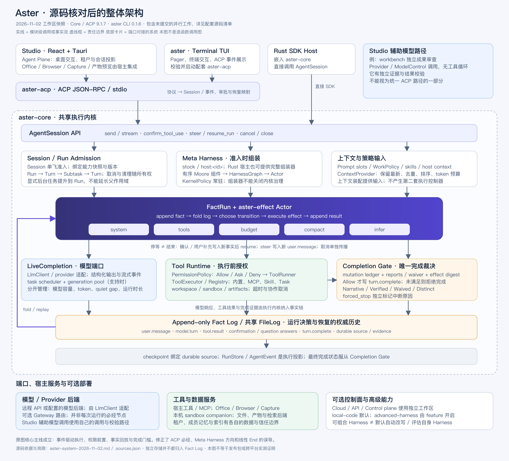

# Aster 整体架构核对（2026-11-02）

原图抓住了 Core 的主线：FactRun 驱动 effect actor，事实日志支持折叠与恢复，
工具执行前检查权限，完成裁决由 Core 保留。因此，它适合作为执行内核的概览。
它没有完整表示当前 Aster 产品架构；入口、组装顺序和结束状态需要修正。

[新版 PNG](aster-system-2026-11-02.png) ·
[可编辑 SVG](aster-system-2026-11-02.svg) ·
[源码快照与摘要](aster-system-2026-11-02.sources.json)

## 核对范围

本次读取当前工作区的实际入口与直接依赖，包括 Terminal、ACP、Core、Studio
Agent Plane、独立成果审查器、工作区与 feature 清单。主仓库基准为
`453506a2a`，Studio 基准为 `57d3335f2`。工作区包含其他会话的未提交改动；
配套 JSON 逐文件记录完整提交号、SHA-256 和与 HEAD 的差异。

原图绑定 `8729d7c84a2d…` 与 9.1.6。本次判断针对当前源码，未复原该历史提交。
当前包名为 `aster-core`、`aster-acp`，两者清单版本为 9.1.7；`aster` CLI
清单版本为 0.1.6。它们不是一个统一的产品版本号，也不证明已发布这些版本。

## 原图与当前源码的差异

| 项目 | 核对结论 | 新图表达 |
| --- | --- | --- |
| TUI / Studio / Rust Host 都经过 ACP | 过度合并。Terminal 启动 ACP companion，Studio Agent Plane 也启动 ACP；Rust 宿主可以直接调用 `AgentSession`。 | ACP 路径与直接 SDK 路径分开。 |
| Actor → Meta Harness | 顺序有误。`open_composed_with_hosts` 先准入并组装图，再创建 Actor。Meta Harness 不是执行后的业务模块。 | Meta Harness 位于准入阶段，指向 Actor。 |
| 固定五个组件 | 这描述默认 stock 组合。Rust 宿主还能挂载 `host:<id>` 或提供完整 assembler；内核治理仍不可清除。 | 保留默认组件，单列宿主扩展与 KernelPolicy。 |
| 单一事实日志 | 对运行决策和恢复成立，不代表所有产品数据都存入一个日志。`RunStore` 与 `AgentEvent` 是执行投影；记忆、索引、产物和宿主数据各有合同。 | 权威历史、投影、恢复引用与外部数据分开。 |
| 完成 → 验证后写 turn.complete → End | 过度简化。无修改的回答可以是 `Narrative`；`Verified`、`Waived`、`Distinct` 含义不同。确认、用户问题、后台任务和中断也不是同一个 End。 | 明确等待 / 恢复、完成门槛和独立 forced-stop 原因。 |
| SessionOptions 冻结运行配置 | 不足以表达当前准入边界。还需要绑定能力版本、Run / Turn / Subtask 所有权及清理。 | 增加能力快照与作用域层次。 |
| budget 一个方块 | 适合作为 stock 组件名，不足以解释系统容量。任务调度、模型生成容量、工具轮数、单工具超时、上下文和运行时长有不同的所有者。 | 在模型 / 工具端口标出各维度，未合并成新 Budget 框架。 |
| 整个 Studio 都走 Core 循环 | 不成立。workbench 独立成果审查器通过 Provider / ModelControl 发起无工具调用，并自行校验证据和结果。 | 单列辅助模型路径。 |
| 整体 Aster | 原图主要画了代码执行内核。Office、Browser、Capture、模型后端、sandbox companion 与可选控制面缺失。 | 补上端口对接系统，避免把它们画成每次运行都经过的链。 |

## 当前设计是否合理

核心责任划分合理：协议适配放在 ACP，事实驱动执行放在 Core，宿主提供交互与
能力，权限与完成裁决保留在内核。可组合执行图与不可移除的治理门槛可以共存，
不需要再添加一层总控 Agent。原图关于“可组合 Harness 不等于默认自动修改自身
Harness”的谨慎表述仍应保留。

需要完善的是架构合同的表达和验证覆盖。以下两项是已确认的文档问题：

1. `core-authorities.md` 仍称源码相对 `apps/code/core/src/`，实际目录已经是
   `crates/code/core/src/`。原图中的包名和版本也未覆盖当前清单。
2. 该文档的预算表称 FactRun 的 `tool_timeout_ms` 尚未验证。当前调用链是
   `ExecutorTools → execute_tool_queued_or_direct → execute_tool_timed / ToolCommand`，
   已传递 `self.config.tool_timeout_ms`。旧表不能作为“工具超时没有执行”的证据。
   这次源码追踪也不等于对所有工具、排队、嵌套与取消情形的运行时证明。

以下是设计评估和后续建议，不是已复现的运行时缺陷：

- 维护现有预算表，按“维度、单位、所有者、生效入口、测试”校准事实。先修表和
  缺失的路径证明；没有证据要求引入统一预算抽象。
- 为 Core agent turn 与 Studio 辅助模型调用分别声明容量、超时、取消、用量和
  结果校验责任。辅助路径已有独立超时和结果校验，不能据此称其不受控；也不能
  假定 Core 的门槛和观测会自动覆盖它。
- 把 `Verified` 理解为已声明检查对绑定的 effect digest 通过。它不是所有用户
  需求、文件内容、视觉质量或事实正确性的通用证明。宿主需选择与交付物相符的检查。
- 恢复文档应保留事实源、checkpoint、会话快照与投影的区别。实时进度事件可以
  由执行过程直接产生；新图的聚合连线不表示每个进度事件都先写入 Fact Log。

## 源码依据

| 结论 | 实际入口 |
| --- | --- |
| Terminal 启动配套 ACP | [aster_spawn.rs](../../crates/terminal/crates/codegen/aster-pager/src/acp/aster_spawn.rs#L57) |
| Studio Agent Plane 启动 ACP | [turns.rs](../../apps/studio/src-tauri/src/agent_plane/turns.rs#L4213) |
| Rust 宿主直接 send / stream | [session_facade.rs](../../crates/code/core/src/agent_api/session_facade.rs#L270) |
| Session 单飞与共享事实日志 | [run_admission.rs](../../crates/code/core/src/agent_api/run_admission.rs#L1) |
| 先组装图，再打开 FactRun | [fact_control.rs](../../crates/code/core/src/fact_control.rs#L1010) |
| 默认组件、宿主 assembler、不可清除的 KernelPolicy | [meta_harness.rs](../../crates/code/core/src/meta_harness.rs#L124) |
| Run / Turn / Subtask 生命周期 | [agent_execution.rs](../../crates/code/core/src/capability/agent_execution.rs#L13) |
| 上下文去重、排序与预算 | [assembler.rs](../../crates/code/core/src/context/assembler.rs#L153) |
| 模型生成容量准入 | [admission.rs](../../crates/code/core/src/llm/admission.rs#L229) |
| 工具权限、执行、运行时长与取消 | [executor_tools.rs](../../crates/code/core/src/fact_control/executor_tools.rs#L347) |
| 单工具超时实际传递 | [tool_execution_runtime.rs](../../crates/code/core/src/agent/tool_execution_runtime.rs#L216) |
| 完成状态及唯一裁决入口 | [harness_loop.rs](../../crates/code/core/src/harness_loop.rs#L54) |
| 完成门槛与 turn.complete 写入 | [turn_outcome.rs](../../crates/code/core/src/agent_api/conversation_runtime/turn_outcome.rs#L205) |
| Studio 无工具独立审查 | [workbench_reviewer.rs](../../apps/studio/src-tauri/src/agent_plane/workbench_reviewer.rs#L129) |
| 运行历史、投影与预算的既有合同 | [core-authorities.md](../../crates/code/docs/architecture/core-authorities.md) |
| 默认与高级功能开关 | [Core Cargo.toml](../../crates/code/core/Cargo.toml#L200) |
| 根工作区与排除的控制面工作区 | [Cargo.toml](../../Cargo.toml#L1) |

## 交付检查与局限

SVG 为可编辑矢量源，PNG 从该 SVG 使用仓库已有的 Sharp 渲染，尺寸为
3840 × 3480。已重新打开 PNG 检查文字、边界、连线和裁切，并核对源码引用。
SVG XML 可解析，文档链接与行号均有效。Playwright 几何检查未运行成功，
原因是本机没有其要求的 Chromium；没有为此下载浏览器。
没有添加依赖，也没有为绘图修改运行时代码。

本次是模块级架构核对，不是全仓代码审计、所有 feature 组合的可达性证明、
发行包检查或跨平台运行测试。图中可选系统不表示它们均已安装、启用或处于同一个
进程。源码处于并行修改中；以后复用本图应先核对快照摘要和实际启用的 feature。
