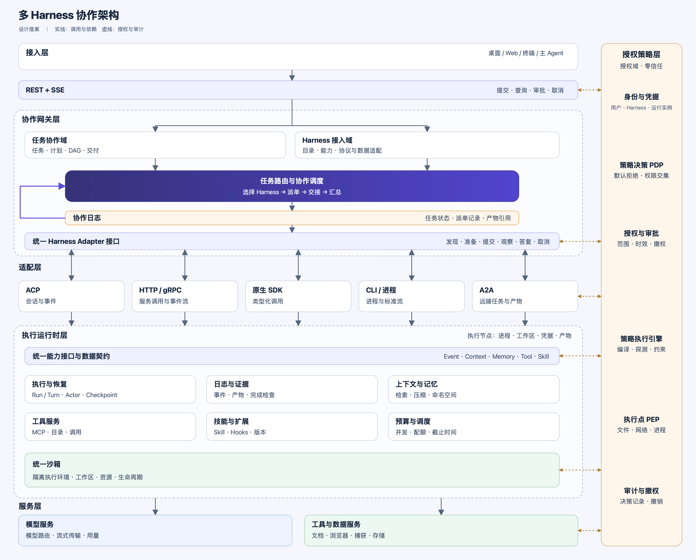

# 多 Harness 协作架构设计

桌面、Web、终端和主 Agent 通过 REST 与 SSE 访问协作网关。
网关管理任务、路由、DAG、审批和交接。
异构 Harness 通过统一 Adapter 接口接入。

执行运行时管理执行节点，统一提供日志、记忆、工具与技能。
授权策略层在接入、派单、工具调用和资源访问时执行检查。

状态：架构设计，尚未编码和联调。

[架构图 PNG](harness-gateway.png) ·
[可编辑 SVG](harness-gateway.svg) ·
[源码与核验记录](harness-gateway.sources.json)

## 层级

| 层 | 职责 |
| --- | --- |
| 接入层 | 提交任务、显示进度、处理审批、接收交付物。 |
| 协作网关层 | 任务管理、能力目录、路由、DAG、审批、交接与交付汇总。 |
| 适配层 | 将 ACP、HTTP/gRPC、原生 SDK、CLI/进程、A2A 映射为统一接口。 |
| 执行运行时层 | 执行恢复、日志证据、上下文记忆、MCP、Skill、预算调度与统一沙箱。 |
| 服务层 | 模型推理、外部工具和持久数据服务。 |
| 授权策略层 | 身份、策略决策、授权审批、执行约束、审计与撤权。 |

层级表示技术职责，限界上下文表示模型和数据边界。
协议适配归接入域，执行与资源管理归运行时。
授权域作决定，各层执行点落实决定。

## 限界上下文

| 上下文 | 聚合与约束 | 公开契约 |
| --- | --- | --- |
| 任务协作域 | `WorkTask` 保存目标、依赖、交付条件与协作状态。依赖图必须无环，已派发任务固定计划版本。 | `TaskSpec`、派单命令、交接包、交付结果。 |
| Harness 接入域 | `HarnessRegistration` 保存实现版本、能力与适配配置。任务要求必须落在已验证的能力范围内。 | 能力目录、连接回执、原生 ID 映射。 |
| 执行域 | `Run` 管理执行状态、调用记录、预算、检查点和验证证据。终态执行不能重新接收写入。 | 执行命令、状态事件、执行租约、验证报告。 |
| 记忆域 | `MemoryNamespace` 和 `MemoryRecord` 管理归属、版本、来源与保留策略。读写范围受命名空间授权约束。 | 授权检索、显式写入、上下文引用。 |
| 能力域 | `CapabilityPackage` 和 `ToolBinding` 管理 MCP 工具与 Skill。已发布版本固定内容摘要和数据契约。 | 能力目录、工具契约、技能包、绑定回执。 |
| 授权域 | `Policy` 和 `Grant` 管理主体、资源、操作、范围、时效和撤销状态。子级授权不能扩大父级权限。 | 授权决定、策略摘要、执行约束、审计事件。 |

聚合校验本域不变量，应用服务协调跨域操作。
域间传递公开命令、事件、ID 和不可变 DTO。
各域维护自己的仓库，通过事件更新查询投影。
执行前的授权检查必须读取有效策略和授权记录。

Harness Adapter 是 Harness 接入域的防腐层。
它负责原生接口和数据格式的转换。
领域模型通过端口访问存储、协议和执行后端。
实现方法参考 [DDD 模式参考](https://www.domainlanguage.com/ddd/reference/)。

任务协作域拥有 DAG，执行域负责已派发 Run 的容量调度。
协作网关保存任务与 Run 的关联，运行时保存执行事实。
各协议的会话、任务或进程 ID 由接入域映射。
隔离环境的实际生命周期归执行后端，Run 保存租约和执行代次。

## 统一 Harness Adapter

协作网关调用统一接口，接入域按注册配置选择 Adapter。
各 Harness 按声明的能力和协议接入。
Harness 保留原生推理循环、专业策略与私有状态。

| 接入方式 | Adapter 职责 |
| --- | --- |
| ACP | 协商版本与能力，映射会话、事件、权限请求与取消。 |
| HTTP / gRPC | 调用服务 API，将原生请求、状态与事件流映射为公开契约。 |
| 原生 SDK | 通过公开类型和调用接口驱动 Harness，接收回调或事件。 |
| CLI / 进程 | 管理启动参数、工作目录、标准流、退出状态与进程取消。 |
| A2A | 发现远端能力，映射任务状态、输入请求和产物。 |

A2A 的底层传输也可能采用 HTTP 或 gRPC。
适配器类型与连接传输分别配置。

| 统一操作 | 约束 |
| --- | --- |
| 发现能力 | 返回版本、输入、工具、隔离、交互、取消与恢复能力。 |
| 准备执行 | 调用运行时，绑定执行节点、工作区、凭据引用、沙箱和额度。 |
| 提交任务 | 接收 `TaskSpec`，返回执行绑定与实际可证明的接收状态。 |
| 观察执行 | 提供事件流或状态查询，转换为统一事件与序号。 |
| 答复交互 | 映射输入请求与审批，由授权域决定权限。 |
| 取消与恢复 | 只开放已验证的能力，核对实际停止或恢复结果。 |
| 收集结果 | 返回产物、证据、用量与原生结束原因。 |

接入域记录各 Adapter 的实际能力。
接收状态无法证明时记录 `delivery_unknown`。
普通文本输出不能冒充结构化工具事件或完整会话状态。
任务所需的能力缺失时拒绝派单。

ACP Adapter 可复用现有 v1 实现。
版本协商、会话与传输分别遵守
[初始化规范](https://agentclientprotocol.com/protocol/v1/initialization)、
[会话规范](https://agentclientprotocol.com/protocol/v1/overview)和
[传输规范](https://agentclientprotocol.com/protocol/v1/transports)。
A2A 适配器依据 [A2A 协议规范](https://a2a-protocol.org/latest/specification/)映射任务与产物。

模型调用使用独立模型接口。
MCP 提供工具与资源访问，Skill 提供指令与资源包。

## 执行运行时

Core 中可复用的执行机制归入执行运行时层。
Harness 保留专业策略、提示词和私有状态，通过运行时端口使用共享能力。

| 模块 | 提供的能力 | 复用来源 |
| --- | --- | --- |
| 执行与恢复 | Run / Turn、执行图、Actor、子任务、取消和检查点。 | [运行记录](../../crates/code/core/src/run.rs)、[执行图](../../crates/code/core/src/meta_harness.rs)、[检查点](../../crates/code/core/src/loop_checkpoint.rs)。 |
| 日志与证据 | 事实日志、事件查询、产物、effect digest 和完成检查。 | [事实控制](../../crates/code/core/src/fact_control.rs)、[完成证明](../../crates/code/core/src/completion_attestor.rs)。 |
| 上下文与记忆 | 检索、来源标记、排序、压缩、命名空间与记忆接口。 | [上下文接口](../../crates/code/core/src/context/mod.rs)、[记忆集成](../../crates/code/core/src/durable_memory.rs)。 |
| 工具服务 | 工具目录、调用、MCP、超时和结构化结果。 | [工具系统](../../crates/code/core/src/tools/mod.rs)。 |
| 技能与扩展 | Skill、Hooks、能力版本和加载绑定。 | [Core 扩展入口](../../crates/code/core/src/lib.rs)。 |
| 预算与调度 | 并发准入、额度预留、用量结算和截止时间。 | [任务调度](../../crates/code/core/src/task_scheduler.rs)、[预算契约](../../crates/code/core/src/budget.rs)。 |

共享执行引擎按事实驱动 Actor。
保留原生循环的 Harness 通过 Adapter 接受运行时管理。
上下文、压缩和记忆按已验证的能力接入。
Harness 未暴露的内部状态仍由自身维护。

权限检查和完成检查保留强制约束。
权限决策归授权域，运行时在操作入口实施检查。
完成检查核对执行证据，协作网关再核对任务交付条件。
现有预算契约提供检查点，父子预算执行需要补齐实现。

## 执行节点

每次运行绑定一个执行节点和对应的资源租约。
运行时负责准备、启动、观测、停止和清理。
Adapter 负责驱动原生接口，并报告执行结果。

| 资源 | 运行时职责 | 数据与授权边界 |
| --- | --- | --- |
| 进程 | 启动 Harness 和子进程，收集输出，确认退出与取消。 | 进程标识留在执行绑定中，停止操作校验执行代次。 |
| 工作区 | 绑定目录、修改基线和写入所有权。 | 只读任务支持并行，写入任务使用单写者或独立隔离工作区。 |
| 沙箱 | 创建隔离环境，设置网络、挂载、资源和生命周期。 | 使用授权域批准的策略，约束无法实施时拒绝启动。 |
| 凭据 | 按操作范围提供凭据引用和受控访问。 | 密钥正文不进入任务、上下文、日志或交接包。 |
| 产物 | 收集文件和检查结果，记录内容摘要、类型和来源。 | 读取与导出单独授权，产物引用绑定工作区和运行。 |

本地 CLI 和原生 SDK 在受管进程中执行。
远端 Adapter 绑定远端节点、任务和产物引用。
远端能力必须满足任务要求的权限与隔离条件。

## 日志、记忆、MCP 与 Skill

各领域通过公开数据契约提供共享能力。
运行时提供统一访问入口，Adapter 转换 Harness 的原生格式。

| 能力 | 位置 | 公开数据结构 |
| --- | --- | --- |
| 日志与证据 | 执行域的事件与证据服务。 | `EventEnvelope`：版本、来源、主体、关联 ID、序号、载荷引用。 |
| 记忆与上下文 | 记忆域与上下文组装服务。 | `MemoryRecord`、`ContextItem`：命名空间、版本、来源、内容摘要、权限、截断标记。 |
| MCP 与工具 | 能力域目录、执行域工具调用端口。 | `ToolDescriptor`、调用与结果结构：工具 ID、schema、权限、调用关联、副作用类型。 |
| Skill 与扩展 | 能力域的技能目录与加载服务。 | `SkillPackage`：显式 ID、版本、内容摘要、入口、依赖、适用范围。 |

任务协作日志、执行事实和授权审计各有所属领域。
统一事件视图通过关联 ID 汇总这些记录。
原生事件保留来源和字段映射，缺失信息单独标记。
事实重放只适用于共享引擎的对应日志。

记忆按主体和工作区隔离，写入需要显式授权。
上下文摘要保留源材料引用和截断信息。
模型缓存、私有会话状态与隐含推理不进入通用记忆结构。

运行时按授权提供 MCP 端点与技能内容。
Adapter 根据适配能力配置工具、上下文与扩展。
Skill 声明所需能力，授权域决定实际授予范围。

适配清单固定数据版本、字段映射、原生扩展和转换损失。
必要信息无法表达时拒绝调用。
未知字段和语义不能通过文本猜测补齐。
跨域数据在入口校验一次，再以类型化结构传递。
公开 DTO 与聚合、数据库结构分开维护。

## 授权策略与统一沙箱

授权策略层采用零信任原则。
同机、同网络或复用连接都不自动获得信任。
身份验证与访问授权分别处理。
原则依据 [零信任架构](https://www.nist.gov/publications/zero-trust-architecture)。

策略决策点 PDP 计算访问决定。
执行点 PEP 位于接入、派单、工具、文件和网络入口。
两者的职责见 [零信任术语定义](https://pages.nist.gov/zero-trust-architecture/glossary.html)。

| 图中组件 | 归属 | 实现映射 |
| --- | --- | --- |
| 策略执行引擎 | 授权策略层。编译命令、文件、网络和进程约束，探测后端能力。 | [Aster Sandbox](../../crates/sandbox/src/lib.rs)。 |
| 统一沙箱 | 执行运行时层。管理隔离环境、工作区、资源、租约和生命周期。 | [Aster Box SDK](../../crates/box/sdk/src/lib.rs)、[沙箱 API](../../crates/box/sdk/README.md)。 |
| 模型服务接入 | 服务层。处理模型路由、限流、流式传输和用量。 | [Aster Gateway](../../apps/gateway/src/lib.rs)。 |

Sandbox 的策略约束由执行节点和平台后端落实。
Box 保存环境的实际生命周期与执行代次。
Run 通过租约引用环境，不另建一套环境状态机。
每个 Run 使用独立授权和工作区绑定。

本地进程在受管隔离环境中启动。
原生 SDK 由执行节点内的受管 worker 调用。
远端执行绑定远端节点和已验证的执行能力。
远端不能证明任务要求的权限与隔离条件时拒绝派单。

子任务权限取父级、任务和执行能力的交集。
授权绑定主体、资源、操作、Run、策略版本和有效期。
审批结果不能被 Skill 内容或重放日志扩大。
后端无法实施约束时拒绝启动。

撤权先阻止新操作，再处理活动执行。
现有 Sandbox 策略替换只影响后续命令的策略快照。
活动进程无法热收紧时，运行时停止对应执行实例。
撤权、停止和执行结果分别记录。

## 任务执行与交接

一次派单按以下顺序执行：

1. 校验任务范围与授权。
2. 选择 Harness 并固定计划版本。
3. 预留额度并绑定隔离环境。
4. 通过 Adapter 提交任务。
5. 记录事件、调用、产物和用量。
6. 核对执行证据与交付条件。

任务路由选择 Harness，模型路由选择推理模型。
同一工具续接保持模型与上下文连续性。
响应开始交付后，不拼接另一模型的输出。
有状态模型引用保留在所属提供方。

| 契约 | 内容 |
| --- | --- |
| `TaskSpec` | 目标、依赖、输入、交付条件、权限、预算、截止时间、计划版本、`submission_key`。 |
| `RunBinding` | task/run/attempt ID、Harness ID、适配器绑定、执行节点、隔离实例、执行代次、能力版本、工作区基线、凭据引用。 |
| `HandoffBundle` | 已完成与剩余工作、约束、产物、证据、内容摘要、来源、截断信息。 |
| `TaskResult` | 原生结束原因、实际产物、验证报告、用量覆盖、可恢复信息、交付状态。 |

交接使用事实、产物与证据引用。
协议相关的连接、会话、任务或进程 ID 保存在适配器绑定中。
公开任务契约不携带协议专属字段。
接收方按授权读取所需源材料。
远端执行者使用受控产物传输，不依赖本地主机路径。

工作区默认单写者，只读任务支持并行。
并行写入使用独立隔离工作区，合并时检查基线与冲突。
原写者确认停止后，下一写者才能接管。
运行时不自动创建 Git worktree。

工具和模型操作前预留额度，结束后按观测用量结算。
缺失用量单独标记。
硬金额上限要求全部计费调用经过可计量入口。

## 故障与恢复

协作网关恢复任务关联，运行时恢复执行记录。
恢复前核对原生执行标识、隔离实例和执行代次。
事实重放恢复决策状态，不重复执行已发生的副作用。

| 场景 | 处理 |
| --- | --- |
| 提交响应丢失 | 用原提交键查询。同键不同内容拒绝。 |
| 派单后断线 | 核对绑定、回执和恢复能力。接收状态未知时记录 `delivery_unknown`，不自动重跑写入任务。 |
| 进程退出 | 记录中断。按已证明的能力恢复，或用交接包创建新 attempt。 |
| 取消或撤权 | 先记录请求，再确认实际停止。停止前保留写入所有权。 |
| 替换 Harness | 停止原写者，核对基线与产物，再创建新的执行绑定。 |

提交去重约束网关接收，不保证外部副作用全局恰好一次。
日志、检查点和状态查询各保留自己的恢复边界。

## 落地顺序

| 阶段 | 交付 | 验收重点 |
| --- | --- | --- |
| 运行底座 | 领域契约、统一 Adapter、共享运行时、纵向授权、统一沙箱。 | 受限执行、真实任务、预算、取消、执行代次对账。 |
| 能力兼容 | 统一日志、记忆、MCP、Skill 与 Harness 适配。 | 版本、来源、权限、调用关联和转换损失。 |
| 协作与远端 | DAG、交接包、专长执行、远端适配。 | 依赖顺序、隔离工作区、产物传输、恢复副作用。 |

实现时复用现有公开接口，源码迁移单独安排。
公开 Rust API、工作区与存储边界按仓库约定保留。
兼容性、授权和跨平台执行需要实际联调验证。
