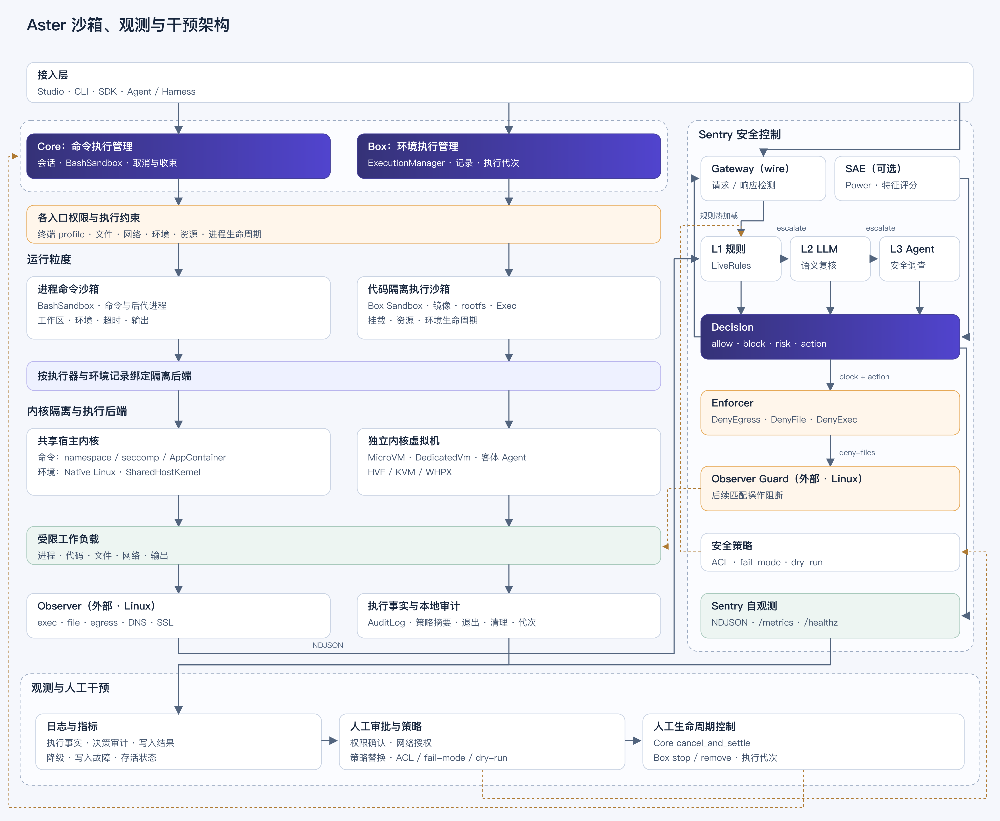

# Aster 沙箱、观测与干预架构

沙箱限制工作负载能访问的资源。
Sentry 根据观测信号判定风险。
Gateway、Observer Guard 和宿主分别执行干预。
阻断判定、控制文件写入和实际拒绝是 3 种结果。

源码核对日期：2026-11-03。
文字修订日期：2026-11-04。
文中的 Sentry 专指安全控制引擎 `aster-sentry`。

[架构图 PNG](sandbox-control.png) · [可编辑 SVG](sandbox-control.svg) ·
[源码与检查记录](sandbox-control.sources.json)

架构图沿用[多 Harness 架构图](harness-gateway.svg)的分层样式。
实线表示调用、依赖或观测数据。
金色虚线表示约束与人工控制反馈。

## 1. 各层职责

OCI 指开放容器倡议（Open Container Initiative）。
OCI Runtime 是仓库中的容器与虚拟机运行时。

| 层 | 组件 | 职责 |
| --- | --- | --- |
| 执行面 | Core `BashSandbox`、Box `ExecutionManager`、OCI Runtime | 管理命令和环境，执行隔离、取消与资源释放。 |
| 观测面 | Observer、Gateway Wire、Power 模型特征、沙箱审计 | 提供进程、文件、网络、正文和模型特征信号。 |
| 判定面 | `aster-sentry` | 执行分级判定，输出判定结果与控制动作。 |
| 干预面 | Gateway、Enforcer、Observer Guard、宿主控制接口 | 拒绝通信、替换敏感正文、写入拒绝规则或停止执行。 |
| 运维面 | 审计日志、指标、健康端点与人工控制 | 发现故障，修改策略，确认干预结果。 |

Core 管理一次命令及后代进程。
Box 管理镜像化执行环境。
Core 与 Box 分别保留授权和生命周期契约。
Core 的 OCI 命令路径直接调用 OCI 软件开发工具包（Software Development Kit，SDK）。

Observer 是外部依赖。
本仓库没有 Observer 采集器与 Guard 的源码。
图中的 Observer 连线依据事件契约与部署示例。
部署示例只说明接入方式，实际部署状态待验证。

## 2. 执行与平台边界

### 2.1 三类沙箱的区别

进程命令沙箱管理一次命令及后代进程。
代码隔离执行沙箱管理一套代码运行环境。
独立内核虚拟机（Virtual Machine，VM）提供客体与宿主的内核边界。
前 2 项描述管理单位，第 3 项描述隔离方式。
命令和代码环境都支持在 VM 中运行。

本文的代码隔离执行沙箱指 Box 的镜像化环境。
Box 支持共享宿主内核或使用 MicroVM。
共享内核路线必须显式选择。
这 3 类机制支持组合使用。

| 对比项 | 进程命令沙箱 | 代码隔离执行沙箱：共享内核路线 | 独立内核虚拟机 |
| --- | --- | --- | --- |
| 管理单位 | 一次命令及后代进程。 | 镜像根文件系统、进程、资源与环境句柄。 | VM、客体内核、客体 Agent 与工作负载。 |
| 内核 | 原生路径共享宿主内核。 | 共享 Linux 宿主内核。 | 客体内核与宿主内核分离。 |
| 文件系统 | 策略允许访问的宿主目录。 | 镜像根文件系统与显式挂载。 | 客体文件系统与显式共享目录。 |
| 网络 | 操作系统拒绝访问，或授权中介转发。 | 网络命名空间与配置的网络连接。 | 虚拟网络与配置的网络连接。 |
| 身份 | 平台进程权限、访问控制列表（Access Control List，ACL）或命名空间。 | 用户命名空间、身份映射与内核能力限制。 | 客体身份与宿主共享资源的访问契约。 |
| 资源限制 | 命令超时、输出上限与后端支持的资源策略。 | 控制组（cgroup v2）、进程与环境资源限制。 | 虚拟处理器、客体内存与客体内进程限制。 |
| 复用 | 每次调用启动命令。 | 同一环境支持后续代码子进程。 | VM 所有者决定复用或销毁时间。 |
| 结束 | 收集退出状态，终止受管后代进程。 | 停止环境，按资源所有权移除资源。 | 停止工作负载，停止 VM，释放受管资源。 |
| 剩余风险边界 | 共享内核与已授权的宿主资源。 | 共享内核、挂载、设备与网络授权。 | 虚拟机监控器、虚拟设备、共享挂载与控制通道。 |
| Sentry 观测 | 命令、文件、网络与正文事件。 | 事件需关联命名空间和环境身份。 | 宿主事件与客体事件需分别接入。 |

上表比较管理单位与隔离机制。
实际可用能力取决于平台、后端和配置。
本文没有性能测试结果。

### 2.2 进程命令沙箱

`BashSandbox` 定义 Core 的命令执行接口。
调用者提交命令、环境变量、超时和输出观察者。
`NativeBashSandbox` 把请求交给 `aster-cmd-sandbox`。
执行器按本次调用的策略快照准备受限进程。
操作系统在资源访问时执行限制。

命令沙箱约束接入执行器的命令与后代进程。
文件工具、浏览器和扩展使用各自的权限入口。
命令获准执行，只授予本次命令对应的权限。
命令结束后，工作区中的文件写入仍然保留。

Linux 原生路径使用 Bubblewrap 命名空间与系统调用过滤（seccomp）。
Windows 路径使用 AppContainer、ACL 与 Job Object。
`aster-cmd-sandbox` 还提供 macOS Seatbelt 后端。
Core 的 macOS 原生适配器仍拒绝执行命令。
拒绝原因是后代进程生命周期约束未满足。

macOS ARM64 的默认 `deny` 路径选择 OCI 客体。
Core 在每次命令调用时启动独立 Linux 客体。
命令使用的解释器必须存在于客体内。
宿主安装的解释器不会自动出现在客体内。

来源：[原生适配器](../../crates/code/core/src/sandbox/native.rs)、
[命令沙箱](../../crates/sandbox/src/lib.rs)、
[会话选择](../../crates/code/core/src/agent_api/session_sandbox.rs)。

### 2.3 代码隔离执行沙箱

Box 管理镜像根文件系统（rootfs）与执行环境。
镜像提供代码所需的解释器、编译器和工具。
调用者配置挂载、环境变量与资源限制。
同一环境支持在生命周期内执行代码子进程。

共享内核路线使用 `ExecutionIsolation::Sandbox`。
OCI 适配器把隔离选择映射为 `SharedHostKernel`。
这条路线共享 Linux 宿主内核。
独立 rootfs 只提供文件视图边界。

Box 的共享内核执行计划要求 10 项控制。
启动前，执行后端必须确认宿主能力与配置支持。
容器 root 的身份映射不能直接指向宿主 root。

| 控制 | 作用 |
| --- | --- |
| 用户命名空间（`user`） | 管理容器身份与宿主身份的映射。 |
| 挂载命名空间（`mount`） | 隔离挂载视图。 |
| 进程命名空间（`PID`） | 隔离进程编号与可见范围。 |
| 进程间通信命名空间（`IPC`） | 隔离进程间通信资源。 |
| 主机标识命名空间（`UTS`） | 隔离主机名与域名。 |
| 网络命名空间（`network`） | 隔离网络栈与网络接口。 |
| seccomp | 限制系统调用。 |
| capability bounding | 限制进程可持有的内核能力。 |
| no-new-privileges | 阻止执行程序时取得额外权限。 |
| cgroup v2 | 执行已配置的资源限制。 |

共享内核仍是这条路线的安全边界。
网络命名空间只隔离网络栈，不授予外部目标访问权。
挂载与网络访问分别受授权契约约束。
环境停止后，宿主挂载目录中的写入仍然保留。
持久卷按资源所有权规则保留或移除。

Linux 共享内核路线支持 Box 到 OCI 的执行绑定。
创建环境、启动初始进程和后续执行分别使用对应接口。
终止与删除沿用已选定的后端和执行代次。
后端遇到不支持的操作时返回错误。

来源：[隔离选择](../../crates/box/core/src/config.rs)、
[必要控制](../../crates/box/core/src/execution.rs)、
[身份映射](../../crates/box/runtime/src/sandbox/capability.rs)、
[OCI 映射](../../crates/box/runtime/src/local_execution/oci_backend.rs)、
[SDK 契约](../../crates/box/sdk/README.md)。

### 2.4 独立内核虚拟机

MicroVM 启动独立客体内核与客体用户空间。
代码的系统调用首先进入客体内核。
虚拟机监控器（Hypervisor）与虚拟设备隔离宿主和客体。
客体进程在客体系统内执行。

Box 默认选择 `ExecutionIsolation::Microvm`。
OCI 适配器把隔离选择映射为 `DedicatedVm`。
驱动分别使用 3 个平台的虚拟化接口。

| 平台 | 接口 |
| --- | --- |
| macOS | Hypervisor Framework（HVF）。 |
| Linux | Kernel-based Virtual Machine（KVM）。 |
| Windows | Windows Hypervisor Platform（WHPX）。 |

驱动可用且就绪时，后端才允许启动工作负载。
仅支持探测（`probe-only`）的驱动禁止启动工作负载。

`DedicatedVm` 表示工作负载拥有对应 VM。
OCI 还定义 `SharedGuestKernel`。
同一 VM 中的多个容器可能共享客体内核。
独立客体内核只说明客体与宿主之间的内核边界。

VM 仍能访问已授权的宿主共享目录。
虚拟网络仍受网络策略约束。
客体 Agent 与控制通道仍需认证和生命周期管理。
独立 VM 不表示可信执行环境（Trusted Execution Environment，TEE）已启用。
内存加密与远程证明也需分别验证。

Box 按环境生命周期管理 VM 环境。
Core 的 macOS OCI 命令路径按命令调用管理客体。
Core 只保留显式工作区中的跨调用文件。
命令结束后，客体 `/tmp` 与临时 rootfs 修改会丢弃。

宿主 Observer 只能观测宿主可见的 VM 活动。
客体内的进程、文件和网络事件需要客体侧接入。
Gateway 检查经 Gateway 转发的通信正文。
运行时观测与正文检查分别覆盖不同对象。

VM 的创建、启动、等待与删除使用不同接口。
后续执行能力取决于平台与后端。
Windows/WHPX 的初始执行入口遵循 Box SDK 契约。

来源：[OCI 隔离类型](../../crates/oci-runtime/crates/core/src/capability.rs)、
[Box 到 OCI 的映射](../../crates/box/runtime/src/local_execution/oci_backend.rs)、
[Core OCI 命令](../../crates/code/core/src/sandbox/oci.rs)、
[Box SDK](../../crates/box/sdk/README.md)。

### 2.5 当前默认与平台选择

Core 通过 `BashSandbox` 绑定命令执行器。
自定义执行器与远端命令执行器保留各自契约。
本地默认执行器按平台选择隔离后端。
Box 独立管理环境与后端路由。

| 路径 | 当前实现 | 主要边界 |
| --- | --- | --- |
| Linux Core 命令 | `NativeBashSandbox` → `aster-cmd-sandbox` | Bubblewrap 命名空间与 seccomp。 |
| Windows Core 命令 | `NativeBashSandbox` → `aster-cmd-sandbox` | AppContainer、ACL、PowerShell 7 与 Job Object。 |
| macOS ARM64，`deny` | `OciBashSandbox` → OCI SDK | 每次命令使用独立 VM。 |
| macOS Core 原生适配器 | 拒绝执行 | 后代进程生命周期约束未满足。 |
| Box 环境 | `ExecutionManager` 与持久后端路由 | 环境、资源、隔离要求与执行代次。 |
| 终端进程配置 | 终端的 `aster-sandbox` | Unix 内核约束与已接入的子进程入口。 |

终端 `aster-sandbox` 与 `aster-cmd-sandbox` 是不同组件。
终端进程配置应用失败时，底层可能记录警告后继续。
显式 `ProcessHost` 降级依赖宿主提供外层隔离。
Browser 的启动参数包含 `--no-sandbox`。
Sentry 观测不能代替执行入口所需的隔离。

来源：[会话绑定](../../crates/code/core/src/agent_api/session_sandbox.rs)、
[OCI 适配器](../../crates/code/core/src/sandbox/oci.rs)、
[原生适配器](../../crates/code/core/src/sandbox/native.rs)、
[Box 路由](../../crates/box/runtime/src/local_execution/router.rs)、
[终端进程配置](../../crates/terminal/crates/codegen/aster-sandbox/src/lib.rs)、
[Browser](../../crates/browser/src/pool.rs)。

## 3. 观测信号

### 3.1 Observer 运行时事件

事件使用 JavaScript 对象表示法（JSON）。
事件格式为按行分隔的 JSON（Newline-delimited JSON，NDJSON）。
Sentry 守护进程从标准输入逐行读取事件。

`ObservedEvent` 保存身份、来源、事件和原始行。
身份支持 `agent`、`task` 与 `session`。
解析器只接收已建模的事件类型。
解析失败时，守护进程跳过输入行。

| 事件 | 观测对象 |
| --- | --- |
| `ToolExec` | 进程编号与命令参数。 |
| `FileAccess` | 文件路径与读写方向。 |
| `Egress` | 对端地址与端口。 |
| `Dns` | 域名系统（DNS）查询。 |
| `SslContent` | 读写方向与捕获的正文。 |
| `SecurityAction` | 安全动作类型与详情。 |
| `LlmActivations` | 模型层与稀疏特征激活值。 |

`SslContent` 依赖外部采集器的捕获能力与显式启用。
正文捕获范围取决于平台和加密通信实现。
Linux 部署示例使用特权采集器与共享控制文件。
macOS 和 Windows 的等价采集链仍待验证。

来源：[事件定义](../../crates/sentry/src/event.rs)、
[守护进程](../../crates/sentry/src/bin/sentry.rs)、
[参考 DaemonSet](../../crates/sentry/deploy/daemonset.yaml)。

### 3.2 Gateway 正文观测

启用 `wire` 功能特性后，Gateway 引入 `aster-sentry`。
`WireGate` 检查大语言模型（LLM）的请求与响应正文。
`WireGate` 也检查模型上下文协议（MCP）的通信正文。
`inspect_wire()` 把正文转换为 `SslContent` 事件。
Sentry 对正文事件执行分级判定。
正文检测与敏感内容替换分别执行。

Gateway 提供 2 类接入入口。
独立 Wire 代理使用 `/wire/<agent>/...` 路由。
推理入口使用授权凭据绑定的防护策略（guardrails）。
启用 `wire` 且绑定策略后，对应路径才执行检测。
绕过受检入口的通信不受 `WireGate` 检查。

来源：[WireGate](../../apps/gateway/src/wire.rs)、
[防护策略绑定](../../apps/gateway/src/inference/authorization.rs)、
[请求分发](../../apps/gateway/src/entrypoint/inference_dispatch.rs)。

### 3.3 模型特征与 SAE

稀疏自编码器（Sparse Autoencoder，SAE）把模型内部激活编码为稀疏特征。
每个特征用特征编号和激活值表示。
特征编号的安全含义需要标注字典解释。
单个特征激活不等于已证明存在恶意行为。

Power 的 `InterpTap` 接收模型层的残差流（residual stream）。
模型层匹配配置时，`InterpTap` 输出稀疏特征事件。
事件包含特征编号与激活值，不包含通信正文。
Sentry 的 `SaeJudge` 根据标注字典和阈值判定风险。
SAE 返回 `escalate` 时，Pipeline 支持转交 L3 Agent 调查。

SAE 是可选路径。
SDK 或宿主必须显式组装包含 SAE 的 Pipeline。
守护进程的环境变量配置没有 SAE 字典入口。
源码中的接口只证明 Tap 和判定能力存在。
生产推理后端与 TEE 采集的接入状态仍待验证。

来源：[Power SAE](../../crates/power/src/sae.rs)、
[Sentry SAE](../../crates/sentry/src/sae.rs)、
[Pipeline](../../crates/sentry/src/pipeline.rs)、
[SDK 配置](../../crates/sentry/src/config.rs)。

### 3.4 沙箱审计

`aster-cmd-sandbox` 输出结构化审计记录。
审计对象包括文件、网络、进程、策略编译与环境。
原因码区分拒绝、能力缺失、超时和授权应用。
Core 与 Box 还保存输出、退出状态和执行代次。
审计记录与执行结果共同用于确认执行事实。

沙箱审计到 Sentry 的直接接入仍待验证。
Observer 事件与 Core 事件使用不同格式。
跨日志关联需要明确的身份与字段映射。

来源：[沙箱审计](../../crates/sandbox/src/observability/mod.rs)。

## 4. Sentry 分级判定

| 判定层 | 组件 | 调用条件 |
| --- | --- | --- |
| L1：规则判定 | `LiveRules`、`RuleEngine` | 对普通观测事件匹配规则。 |
| L2：模型复核 | `LlmJudge` | 复核 L1 转交的事件。 |
| L3：Agent 调查 | `AgentJudge` 与安全 Skill | 调查转交事件并返回判定。 |
| SAE：特征判定 | `SaeJudge` | 配置后接收 `LlmActivations`。 |

`allow` 表示允许。
`block` 表示阻断。
这 2 种结果通常结束本次判定。
`escalate` 表示转交更深层判定。

未配置 L2 时，L1 支持直接转交 L3。
显式配置后，高风险事件支持 L2 与 L3 推测并行。
L3 推测并发另有上限。

守护进程在读取线程执行 L1。
模型复核和 Agent 调查进入有界队列与工作线程池。
队列满时，守护进程按失败策略决定放行或拒绝。
守护进程定期检查规则文件变更。
新规则解析失败时，守护进程保留原规则。

`Decision` 保存判定结果与可选控制动作。
核心字段是 `verdict`、`tier`、`severity`、`reason` 和 `action`。
`risk` 字段保存结构化风险分类。
下游组件通过结构化字段读取风险类型。
L1 依赖规则匹配，仍存在规则规避风险。

来源：[Pipeline](../../crates/sentry/src/pipeline.rs)、
[规则引擎](../../crates/sentry/src/rules.rs)、
[Decision](../../crates/sentry/src/verdict.rs)、
[守护进程](../../crates/sentry/src/bin/sentry.rs)。

## 5. 干预链路

### 5.1 请求与响应交付前干预

Gateway 在转发前等待请求判定。
判定阻断时，独立 Wire 代理返回 403。
推理入口通过现有访问错误返回阻断结果。
请求获准且命中敏感内容规则时，`WireGate` 用占位符替换正文中的秘密。
响应复检前，`WireGate` 用本次请求的映射恢复占位符。

响应判定为 `block` 时，Gateway 扣留响应正文。
推理流式路径先缓冲正文，再复检与交付。
缓冲上限是 1 MiB。
交付前检查会延后正文交付，取消逐块流式体验。
独立 Wire 代理与推理入口使用各自的响应接口。

正文替换只作用于正文，认证请求头沿用原值。
编码后的秘密仍可能规避检测规则。
Gateway 阻断只限制对应通信，Agent 会话仍可能运行。

来源：[WireGate](../../apps/gateway/src/wire.rs)、
[普通响应](../../apps/gateway/src/entrypoint/protocol/http_handler.rs)、
[流式响应](../../apps/gateway/src/entrypoint/protocol/streaming_handler.rs)。

### 5.2 Observer 运行时干预

`Enforcer` 把控制动作写入拒绝规则文件（deny-file）。
`DenyEgress`、`DenyFile` 和 `DenyExec` 分别限制网络、文件和执行。
外部 Observer Guard 读取拒绝规则并执行限制。
文件与执行目标必须使用绝对路径。
网络目标必须通过单行检查，防止控制文件注入。

Observer 使用事件发生后的干预方式。
Guard 加载拒绝规则后，后续匹配操作才受限制。
已经发生的操作仍然保留原结果。
粗粒度拒绝目标也可能影响其他运行。

| 结果 | 能证明的事实 | 仍需证据 |
| --- | --- | --- |
| `Decision.block` | 判定引擎返回阻断。 | 控制动作是否执行。 |
| 审计中的 `enforced` 路径 | 本次调用成功写入拒绝规则文件。 | Guard 是否加载规则，内核是否拒绝访问。 |
| Guard 实际拒绝证据 | 执行边界拒绝了对应匹配操作。 | 对应运行是否退出、资源是否释放。 |
| Core 或 Box 的退出与资源释放结果 | 对应运行按宿主控制接口结束。 | Sentry 是否触发了宿主控制。 |

`dry_run`、缺少写入目标、重复或无效目标都可能跳过写入。
返回空写入路径时，需要结合执行模式确认原因。
实际内核拒绝仍需 Guard 的运行证据。

来源：[Enforcer](../../crates/sentry/src/enforce.rs)。

### 5.3 人工审批、取消与停止

Core 提供工具审批与限定范围的网络授权。
`cancel_and_settle()` 等待取消后的原运行释放资源。
接口返回 `false` 时，资源释放仍未确认。
Box 的 `stop` 与 `remove` 受执行代次约束。
沙箱策略替换只影响后续命令的策略快照。
撤销活动运行权限时，宿主仍需停止运行并确认结果。

图中的人工控制对应宿主已有的控制接口。
当前没有 Sentry 到 Core 或 Box 的统一自动停止适配器。
自动干预接入需要绑定身份、授权范围与执行代次。
告警本身不授予停止运行的权限。

来源：[Bash 权限](../../crates/code/core/src/tools/builtin/bash.rs)、
[会话取消](../../crates/code/core/src/agent_api/session_facade.rs)、
[Box 生命周期](../../crates/box/sdk/src/sandbox/lifecycle.rs)、
[策略替换](../../crates/sandbox/src/lib.rs)。

## 6. 观测 Sentry 自身

Sentry 守护进程输出需要审计的判定，格式为 NDJSON。
普通低风险 L1 `allow` 只计数。
审计记录包含判定、主体摘要与可选写入路径。
审计路径未统一调用错误上报 SDK 的脱敏器。

Gateway 的 `WireTrace` 记录通信方向与正文替换数量。
`WireTrace` 与 Sentry 判定审计分别输出。
统一关联需要明确的身份和日志字段映射。

| 指标或端点 | 含义 |
| --- | --- |
| `sentry_events_total` | 守护进程接收的可解析事件数。 |
| `sentry_blocked_total` | 阻断判定数。实际内核拒绝次数需另行统计。 |
| `sentry_overload_degraded_total` | 队列过载后按失败策略放行或拒绝的事件数。 |
| `sentry_enforce_failed_total` | 拒绝规则文件写入错误数。 |
| `/metrics` | Prometheus 指标端点。 |
| `/healthz` | 进程存活响应。干预链路健康状态需另行验证。 |

配置监听地址后，守护进程才启动指标服务。
当前没有统一的 Guard 生效回执指标。
阻断判定比例只反映判定结果。
干预有效性仍需实际拒绝与执行结果证据。

来源：[指标](../../crates/sentry/src/metrics.rs)、
[守护进程审计](../../crates/sentry/src/bin/sentry.rs)、
[运维手册](../../crates/sentry/docs/RUNBOOK.md)。

## 7. 当前边界与设计连接

Sentry 默认使用失败放行（fail-open）策略。
最终仍为 `escalate` 时，默认策略允许通过。
队列过载也使用配置的失败策略。
命令沙箱的默认拒绝属于独立的执行契约。

参考 DaemonSet 默认启用仅审计模式（`dry_run`）。
`dry_run` 保留判定与审计，跳过控制文件写入。
Observer Guard 仍是外部依赖。
跨平台采集和实际拒绝结果仍待验证。

命令行工具的 Sentry SDK 用于错误上报与脱敏。
错误上报 SDK 与 `aster-sentry` 使用不同接口。
Studio 当前的 `initSentry()` 是空实现。
错误上报 SDK 不提供本文的安全干预能力。

来源：[命令行 Sentry](../../crates/terminal/crates/codegen/aster-telemetry/src/sentry.rs)、
[Studio Sentry](../../apps/studio/src/renderer/services/sentry.ts)。

[多 Harness 设计](harness-gateway.md)中的 Sentry 对应安全判定能力。
Observer 提供运行时事件，Wire 提供通信检查入口。
执行后端继续管理环境与生命周期。
跨 Harness 统一关联与自动撤权仍属于设计连接。
本文未把设计连接列为已完成集成。

## 8. 本次验证

本次按[简明技术中文规范](https://github.com/A3S-Lab/stc-answer/blob/main/skills/stc-answer/stc/规范.md)改写文字。
检查覆盖中文规则、引用、文件摘要与修改差异。
架构图沿用 2026-11-03 的交付版本。
图像检查记录与本次文字检查分别保存。
实际检查结果见[源码与检查记录](sandbox-control.sources.json)。

### Explicitly not claimed

- 未执行 Rust 构建、Clippy 或运行时测试。
- 未部署 Observer、Sentry 守护进程或 Gateway。
- 未验证线上模型、TEE 或 SAE Tap 接入。
- 未证明拒绝规则文件已引发内核拒绝。
- 未验证跨平台采集与自动停止。
- 未新增授权、干预适配器或生产安全策略。

## 术语表

| 术语 | 英文或代码名 | 本文含义 |
| --- | --- | --- |
| Core | Aster Core | 管理命令执行、权限与会话的核心组件。 |
| Box | Aster Box | 管理镜像化执行环境的组件。 |
| OCI | Open Container Initiative | 开放容器倡议。 |
| Observer | Observer | 提供运行时事件的外部采集组件。 |
| Guard | Observer Guard | 读取拒绝规则并执行限制的外部组件。 |
| 策略快照 | Policy snapshot | 本次命令采用的固定策略版本。 |
| 执行代次 | Execution generation | 区分同一环境不同执行实例的标识。 |
| 残差流 | Residual stream | 模型层之间传递的内部激活向量。 |
| SAE | Sparse Autoencoder | 把模型内部激活编码为稀疏特征的模型。 |
| TEE | Trusted Execution Environment | 受硬件或平台保护的可信执行环境。 |
| HVF | Hypervisor Framework | macOS 虚拟化框架。 |
| KVM | Kernel-based Virtual Machine | Linux 内核虚拟化机制。 |
| WHPX | Windows Hypervisor Platform | Windows 虚拟化平台接口。 |
| NDJSON | Newline-delimited JSON | 每行保存一个 JSON 对象的事件格式。 |
| 失败放行 | fail-open | 判定未解决时按策略允许通过。 |
| 失败拒绝 | fail-closed | 判定未解决时按策略拒绝通过。 |
| 仅审计模式 | `dry_run` | 生成判定和审计，跳过控制文件写入。 |
