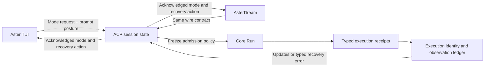

# Shared runtime repair

Status: the original 12 repairs are implemented and accepted by their focused
checks and fresh binary probes. Expanded ACP and repository validation is not
all green; the unchanged-baseline failures and remaining instability are
explicitly retained in FOLLOWUPS.md.

Baseline: `d4a8393f12a6d526a4d08693ac76e73e87414b14`.
Scope: all 12 findings in PLAN.md, including the common Core policy used by
host-direct tools and the nested batch background-receipt consumers.
No commit, release publication, user session recovery, or installed binary
replacement is part of this source change.

## Shared mechanism



The clients adapt presentation and input. Permission, effect observation and
reconciliation remain in ACP / Core. Model replacement retains the same
session permission state and queue rather than constructing a new authority.
Each admitted Run keeps its frozen policy; a confirmed change governs the next
admission.

## Changes and acceptance

| # | Resulting behavior | Owning regression / proof |
| --- | --- | --- |
| 1 | Research only narrows run admission; cleanup restores current desired policy and denies. | ACP permission-state tests; held local model wire probe. |
| 2 | Model / effort replacement retains the queue, permission state and asset deny gate. A host deny also wins in shared Core execution permission. | Governed host permission table; ACP actual denied write; model wire probe. |
| 3 | Over-budget baseline files retain descriptor-anchored metadata. Existing dirty paths beyond coverage report a budget gap. Known afterimages remain bound. | Porcelain large-file / restored-mtime and path-cap regressions. |
| 4 | A proven background terminal settles process identity independently of file coverage. Replay reconciles only exact, bound legacy observation keys. Real external operations remain unresolved. | Live / replay tests; cache fixtures with Unknown, wrong run, missing terminal and identical opaque external keys. |
| 5 | A refused mode prerequisite sends no prompt and restores the original /plan command and draft. | Fake ACP broker and dispatch restoration regressions. |
| 6 | Unknown-session model changes refuse before activation or global selection changes. | ACP state and wire tests. |
| 7 | Permission modes use a closed enum, canonical parsing, and validation before mutation. | ACP invalid seed / mode and wire tests. |
| 8 | Core publishes all four modes. Both hosts bind permissionPosture to prompts; ACP freezes it during admission. TUI sends acknowledged standard mode requests, uses each effect's target session, and narrows only that session on failure. | TUI published cycle, multi-tab and ACK failure tests; desktop prompt trace. |
| 9 | Interactive and stdio launch share model, effort, cwd and ACL argument construction. | Args regression and actual CLI fake-companion probe. |
| 10 | Batch compaction reserves lifecycle identity first. Oversized lifecycle evidence is an explicit bounded gap and produces Unknown, never successful execution. Live / replay consume bounded direct child results. | Compactor bounds, runner envelope, matching / wrong-run background tests. |
| 11 | Both binaries embed source-and-target identity. Packaging checks the pair and records SHA256SUMS; startup refuses a mismatched shipped companion. Installers stage and roll back replacements. | Unix fault injection, native sibling refusal, paired build; Windows native gate added to release CI. |
| 12 | Core emits typed ToolEffectUnresolved, ACP carries retryable=false and reconcile_tool_effects with exact obligation IDs. TUI and Dream avoid blind resend copy. | Wrapped Core failure / host event, ACP wire schema, TUI and desktop render tests. |

## Verification

| Command | Result | Evidence |
| --- | --- | --- |
| `cargo test --locked --offline -p a3s-code-core --lib -- porcelain:: harness_loop::background_receipt_tests fact_control::receipts:: agent_api::conversation_runtime::receipt_restore_tests event_protocol:: lifecycle_metadata_tests runtime_posture_and_host_deny runtime_policy_retains_visibility` | 170 passed, including legacy typed-child compatibility | [Core](logs/repair-core-acceptance.log) |
| `cargo test --locked --offline -p a3s-code-pager --lib -- app::dispatch::tests::modes:: app::effects::tests::persist_permission_mode permission_posture_and_prompt_metadata permission_ack_failure reconciliation_wire_kind both_stdio_entry_points refused_mode_precondition` | 91 passed | [TUI](logs/repair-tui-final.log) |
| `cargo test --locked --offline -p aster-dream --lib -- typed_reconciliation_is_actionable_without_reading_the_message standing_host_context_stays_out_of_the_user_text` | 2 passed | [Dream](logs/repair-dream-final.log) |
| `cargo test --locked --offline -p a3s-code-acp --lib -- permission_state_tests set_session_model_replaces_a_live_session opted_in_agent_registers_reader_on_open_and_replacement_only` | 9 passed at the permission-repair stage; all new permission tests also passed in the expanded full-library campaign | [ACP focused](logs/repair-acp-permission.log), [expanded run](logs/repair-acp-full.log) |
| `python3.13 -m unittest tests.cli_pair_delivery -v` | 9 passed | [Unix delivery](logs/repair-delivery.log) |
| `python3.13 -m unittest tests.agent_runtime_boundary tests.workspace_dependencies tests.cli_pair_delivery -v` | 36 passed, 2 baseline failures; each failure also reproduced alone | [Workspace final rerun](logs/repair-workspace-final.log) |
| `cargo test --locked --offline -p a3s-code-acp --lib` | 335 passed, 9 failed, 8 ignored; all failures isolated. Five persistent failures reproduce at unchanged starting HEAD; four passed alone. This is not a green full-suite claim. | [ACP full](logs/repair-acp-full.log), [follow-ups](FOLLOWUPS.md) |
| `cargo test --locked --offline -p a3s-code-acp --test v912_seam` | 6 passed, 1 failed, 1 ignored after updating retired-mode assertions to the closed refusal contract. The remaining foreign-commit attribution failure also reproduces at unchanged starting HEAD. | [ACP seam](logs/repair-acp-seam-final.log), [baseline](logs/clean-head-seam-baseline.log) |

| Final command | Result | Evidence |
| --- | --- | --- |
| `cargo check --locked --offline -p a3s-code-core -p a3s-code-acp --all-targets` | Passed after the typed-child compatibility change | [All targets](logs/final-core-acp-all-targets.log) |
| `cargo build --locked --offline -p aster -p a3s-code-acp` | Passed, both executables rebuilt together | [Paired build](logs/repair-paired-build-final.log) |
| `cargo test --locked --offline -p a3s-code-pager --lib -- both_stdio_entry_points` | 1 passed after moving the argument test into its sibling file | [Final args test](logs/repair-tui-argument-final.log) |
| `cargo fmt --all -- --check` | Passed earlier; the latest run fails on four concurrently edited memory / rules / test files outside this repair | [Latest format check](logs/repair-fmt-final.log), [concurrent changes](FOLLOWUPS.md) |
| Scoped `rustfmt --check`, with each owning edition, on the final Core / TUI compatibility files | Passed; exact commands and exit codes retained | [Scoped format](logs/final-scope-format.json) |
| `git diff --check` | Passed | [Diff](logs/final-diff-check.log) |
| Fresh wire probes below | All four passed; stdio's final acceptance was run alone | [Mode / admission](logs/final-wire-modes.log), [research](logs/final-wire-race.log), [model deny](logs/final-wire-model.log), [stdio](logs/final-wire-stdio-serial.log) |
| `bash scripts/package-aster-cli.sh macos target/debug .tmp/three-layer-audit.xpvRdQ/aster-cli-repaired-macos.tar.gz` | Passed; four closed-set archive members | [Packaging](logs/final-package.log) |
| `python3.13 docs/evidence/code/2026-10-20-shared-runtime-repair/probes/package_probe.py .tmp/three-layer-audit.xpvRdQ/aster-cli-repaired-macos.tar.gz` | Passed; streamed both binaries' SHA-256 and matched the manifest. A separate check matched the built executable bytes and both --build-id responses. | [Archive / executable identity](logs/final-native-package-verification.json) |
| `python3.13 -m unittest tests.cli_pair_delivery -v` | 9 passed again after binary-mode digest normalization | [Final installer checks](logs/repair-delivery-final.log) |

Final build identity: `aster-cli-pair-v1:6cef66f5cdcf53cf33ffbb40c1f66a8a9d661ca4:aarch64-apple-darwin`.

Native acceptance refers to this verified pair. Concurrent memory / rules edits
continued after the build; the latest whole-workspace format result is recorded
above. Those in-flight edits were preserved rather than included in this repair.

The local archive is at `.tmp/three-layer-audit.xpvRdQ/aster-cli-repaired-macos.tar.gz`;
it is an acceptance artifact, not a published release. Its exact member hashes
are retained in the verification JSON. The archive contains only `aster`,
`a3s-code-acp`, `BUILD_ID`, and `SHA256SUMS`.

To reproduce the wire probes from the repository root, set
`ASTER_REPAIR_PROBE_DIR` to a fresh scratch directory and run each corresponding
file in `probes/` with python3.13. For example:

```sh
ASTER_REPAIR_PROBE_DIR=.tmp/recheck-permission-race python3.13 docs/evidence/code/2026-10-20-shared-runtime-repair/probes/acp_race_probe.py
```

The three protocol probes use a loopback model or an unreachable loopback URL,
fixture-only credentials and isolated homes. The stdio probe checks argument
forwarding with spaces, a valid shipped pair, and a deliberately mismatched
sibling. Parallel stdio attempts exceeded their 20-second fixture deadline
while other work was active; the isolated final attempt passed. Startup latency
under concurrent packaging is not an acceptance claim.

The expanded ACP suite counts record that campaign. After the final receipt
compatibility change, the owning Core regressions, Core / ACP all-target
compilation and fresh binary probes were rerun; the full ACP suite was not
repeated.

Adversarial checks also retained true external uncertainty with the same opaque
key as a legacy observation gap, rejected wrong-run / Unknown background
terminals, preserved a newer prompt's identity during stale cleanup, and
verified rollback of an existing symlink. The runtime checker preserves model
visibility restrictions and freezes the host checker when it snapshots.
Receipt replay keeps the envelope's typed child identity authoritative; valid
older receipts need not duplicate that identity inside opaque metadata.

The initial validation caught a test-only constant export used in production;
the owner now exports that constant within the crate. The two new assertion
failures (batch live-child bookkeeping and wire-kind parsing) were rerun alone
before correction. Existing tests were updated only for deliberate new
contracts, such as unknown modes refusing rather than succeeding unchanged.

Known repository baseline checks remain outside this repair: Work has nested
Git metadata, and a3s-gateway has no publish=false. Each failure was reproduced
alone; no allowlist or guard was weakened.

## Protocol and observer choices

The workspace pins ACP schema 0.11.4 and protocol v1. The shared mode request
and update use the [v1 protocol surface](https://github.com/agentclientprotocol/agent-client-protocol/blob/main/docs/protocol/v1/overview.mdx).
A protocol-v2 migration is outside this repair; v2 replaces dedicated modes
with config options, as described in the [upstream migration](https://github.com/agentclientprotocol/agent-client-protocol/blob/main/docs/protocol/v2/migration.mdx).

Git observation commands set GIT_OPTIONAL_LOCKS=0 to avoid optional index
refresh writes. This follows Git's [background status guidance](https://git-scm.com/docs/git-status#_background_refresh).
It does not solve F6's separate foreign-commit attribution contract.

## Explicitly not claimed

- No live provider, production account, existing user fact log or user session
  was used as a fixture. Wire tests use a loopback model and fixture-only keys.
- No user process was restarted, and the installed old pair was not replaced.
- Rust consumers that exhaustively match AgentEvent must handle the added
  ToolEffectUnresolved variant. The existing Error variant and function APIs
  remain available; the versioned event catalog includes the new wire type.
- Windows native delivery checks are authored and wired to Windows release CI;
  they were not run on this macOS host. Power loss / SIGKILL across two file
  renames is not an atomic filesystem transaction; a mixed pair refuses startup.
- The release archive and installer must be delivered together. Old archives
  without BUILD_ID / SHA256SUMS now refuse instead of bypassing pair validation.
- This is not a claim that all tests in the root workspace or live cloud /
  PostgreSQL regimes pass. Unrelated API, cloud, Work packaging and other
  sessions' source edits were preserved.
