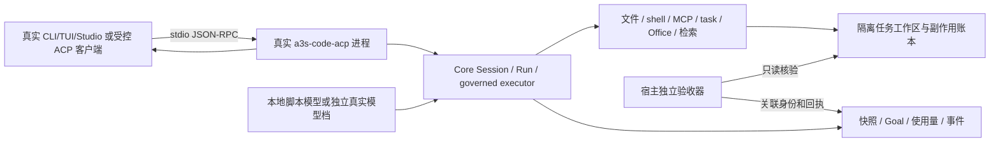

# Implementation Plan: ACP 长程任务端到端测试

**Branch**: 当前工作树 | **Spec**: [spec.md](spec.md) | **Input**: 用户要求全角度、全流程规划
**Gate context**: Product regime；本阶段形成可审查规划，随后按已获授权的目标实施真实 LLM E2E 与优化。

完整用例见 [cases.md](cases.md)，12 条主旅程见 [journeys.md](journeys.md)，落地顺序见 [tasks.md](tasks.md)，源码/协议依据见 [research.md](research.md)。所有新增 case 当前均为 **PLANNED**。

## 1. 架构视角：边界、状态、所有权

- 会话生命周期、一次 Run 的终态、Goal 的持久状态是三个维度。审批/表单等待是运行中的等待，不虚构成 `RunStatus` 新值。
- Core 当前 RunStatus 为 Created/Planning/Executing/Verifying/Completed/Failed/Cancelled。断连本身不能推导 Completed；Goal 暂停不是删除历史，关闭 Session 不是业务回滚。
- 各个进程、工具、MCP 连接、浏览器、文档 lease 和 native 工作线程都有精确 owner。清理断言针对 owner，不按进程名杀程序，不干扰其它会话。
- 原子写/patch 才检验相应原子承诺；任意 shell 多步修改没有全局回滚或 exactly-once 承诺。恢复遇到非幂等结果不明，应对账或暂停，不盲目重放。
- ACP/工具没有提供某项观察接口时，记录为测试观测缺口并由对应任务补足；不得把缺口当通过，也不靠读取私有内存冒充 wire E2E。

## 2. 测试工程视角：六层证据

| 层 | 执行边界 | 能证明什么 | 不能替代什么 |
| --- | --- | --- | --- |
| C0 | owning-package 小测试 | parser、状态转移、oracle 和故障点本身有效 | 真实进程和跨边界生命周期 |
| H0 | 实际 ACP 二进制 + 本地受控模型/客户端/真实工具 | 协议、权限、故障、资源和恢复可重复 | 模型自主规划与真实上游兼容性 |
| H1 | H0 的长轨迹与阶段依赖任务 | 多阶段、上下文压缩、重启、并发和持久化组合 | 真实模型成功率 |
| R | 固定真实模型版本 + 相同独立验收器 | 任务自主完成与真实协议兼容性，按模型分别统计 | 所有模型或所有输入的普遍能力 |
| U | 配对 aster TUI / 私有 Studio 的实际用户入口 | 可见状态、授权、停止、恢复、真实产物打开 | 仅文件或 SDK 返回值不能替代这一层 |
| S | 有界 soak / 负载与反复关闭 | 随时间增长的资源、停滞、隔离和清理 | 没有通过 R 的模型不能因跑得久而算任务完成 |

H0/H1 的模型脚本按 fixture 的封闭阶段/工具回执决策，不加入产品中的语义关键词匹配。Core 直调仅归 C0；H 层所有任务操作必须经过真实 ACP 进程。

## 3. 统一前置与阶段屏障

**每例基础前置 B**：当前源快照/二进制 SHA-256/配对 build ID 一致；隔离 HOME、配置、会话目录和工作区；ACL 指定权限/验证契约/预算；端口动态分配；保存初始文件与只读 checker 摘要；捕获 `initialize`、工具列表、sandbox 实际执行元数据；没有生产凭证或用户会话；每例有 owner 和宿主 deadline。

夹具放根仓库测试树；可变运行目录放 `target/e2e-acp/<campaign>/<attempt>/`。不 git init、不增加第二个 Cargo workspace/lockfile。优先 std-only Rust 小工程和已编译 fixture binary；真实项目只用本仓库授权的、可冻结的 fixture。代理可见自测与宿主独立验收器分离，验收器不接受代理修改后的答案或退出码。

| 屏障 | 可观察时点 | 典型故障 |
| --- | --- | --- |
| F0 | 进程启动后、initialize 前 | 错 build ID、EOF、配置坏 |
| F1 | Session 建立/加载请求开始、资源激活前 | 越界 cwd、损坏快照、能力错误 |
| F2 | LLM 请求接纳、尚未返回有效内容 | 429/5xx/认证错/慢首字节 |
| F3 | ToolCall 建立、审批未完成 | 拒绝、超时、取消、参数篡改 |
| F4 | 精确调用已接纳、写入前 | 目录替换、权限撤销、进程终止 |
| F5 | 外部副作用已记账、响应/快照未确认 | 丢响应、崩溃、非幂等重复风险 |
| F6 | 快照或验证记录发布前后 | 截断、磁盘满、旧 generation |
| F7 | 校验已通过、最终交付前 | 用户再编辑、模型无最终文本、宿主失联 |
| F8 | 终态/关闭已确认 | 迟到回调、遗留子进程、重复关闭 |

使用通知、文件提交点、服务响应或受控 fixture barrier 同步，不用任意 sleep 猜故障时点。真实跨进程事件使用单调时钟和因果序号；不存在全局 wall-clock 总序。

## 4. 长度、平台和能力矩阵

以下是拟定执行档，不是现有性能成绩；运行前写入 campaign ACL 并确认预算。不通过环境变量绕过产品权限。

| 档 | 规模与期限 | 目的 |
| --- | --- | --- |
| H0 | 单例宿主上限 120 秒；短受控轨迹 | PR 的可重复契约与边界 |
| H1 | 单旅程上限 15 分钟；受控 50/200/500 次工具交互档 | 长轨迹、压缩与因果故障；长轨迹由 fixture 生成 |
| R1 | 单旅程上限 30 分钟；真实工作目标 | 自主多阶段修复；不要求为凑数量多调用工具 |
| R2 | 单旅程上限 120 分钟；更大真实工作目标 | 多阶段、压缩、恢复的长程资格 |
| S1 | 8 小时受控 soak；24 小时单独排期 | 资源平台期和重复开关；默认不消费真实模型 |

- 模型/请求/token 最大预算必须显式声明；未声明则不启动 R。使用量未知时标 unknown，不当作 0；重试与辅助模型请求均计费计数。
- interactive 默认 `max_tool_rounds=0` 是现有无限轮数语义，测试不能误加产品上限；有限 case 明确配置 1/N，宿主统一期限负责收尾。
- 审批默认/关闭/极大值须按当前配置语义测试；测试配置较短审批期限，不改默认产品语义。人等待、模型时间、工具执行和基础设施等待分开计量。
- 平台为 macOS、Linux、Windows；native/OCI sandbox 只测已可用且已资格化的组合。不可用组合 BLOCKED，并点名平台，不能由另一个后端静默补位。
- 能力档：默认 ACP；显式 headless-search；Office host true/false；editor read capability true/false；native/OCI；interactive/unattended；client 自管/宿主管理账号。Aster 不引入账号，ToWork 的管理认证只在该租户验证。
- P0 安全/取消/恢复 case 对所有宣称支持的执行后端跑完整相关边界；其它组合以明确 pairwise 矩阵选择。矩阵未覆盖的交叉组合不得称为已验证。
- 每个平台都测中文/空格/长路径、换行/编码、退出码和其实际 shell。不能把 POSIX shell 测试成绩外推为 Windows 通过。

### 4.1 首轮 P0 capability register（2026-10-25）

本轮先冻结下列 capability ID × surface/variant 分母；新增能力必须显式加入清单，不能把 130 个 case、测试函数数或历史 86 个唯一测试名换算成能力覆盖率。`Native / Substituted / Unavailable` 只表示当前真实集成状态；`PLANNED / NOT_RUN / BLOCKED / PASS / FAIL / CANCELLED` 只表示执行状态，两者不得互相推导。当前工作树有并行未提交改动，因此这里冻结的是核对分母，不是发布候选；T001 仍须另存 source/submodule/binary 身份。

| Capability ID | Surface / variant | 集成状态 | 本轮执行状态 | 边界与证据口径 |
| --- | --- | --- | --- | --- |
| ACP-PROMPT-TEXT | ACP / H0 | Native | PASS | `prompt-end-turn` 通过；不外推 Studio U |
| ACP-PROMPT-IMAGE | ACP / H0 | Unavailable | PASS | `prompt-unsupported-content` 验证明确拒绝且零模型调用；不宣称图片已传入模型 |
| ACP-PROMPT-AUDIO | ACP / H0 | Unavailable | PASS | 同一拒绝用例通过；不宣称音频转写或传递 |
| ACP-PROMPT-RESOURCE | ACP / H0 | Unavailable | PASS | `embeddedContext=false`，文本/blob 小测试与 wire 拒绝均通过 |
| ACP-PROMPT-RESOURCE-LINK | ACP / H0 | Unavailable | PASS | 明确拒绝已验证；协议要求支持 resource link 的差距仍保留，不能据此宣称完整 conformance |
| STUDIO-INITIALIZE-NEGOTIATION | Aster / ToWork，U | Unavailable | NOT_RUN / NOT_RUN | 宿主尚未消费 initialize 结果驱动行为；源码存在响应不等于完成协商 |
| STUDIO-SESSION-NEW | Aster / ToWork，U | Native | NOT_RUN / NOT_RUN | 当前调用链已接入；本轮未跑双租户 U，旧证据不转记 |
| STUDIO-SESSION-LOAD | Aster / ToWork，U | Unavailable | NOT_RUN / NOT_RUN | ACP 的 load 能力不等于 Studio 已恢复 ACP/Core session；不得回退 new 冒充恢复 |
| STUDIO-PROMPT-TEXT | Aster / ToWork，U | Native | NOT_RUN / NOT_RUN | 仅记录宿主文本链路；H0 不替代真实入口 |
| STUDIO-TURN-CANCEL | Aster / ToWork，U | Native | NOT_RUN / NOT_RUN | 仅记录宿主取消链路；本轮未做可见终态与清理验收 |
| STUDIO-TOOL-PERMISSION | Aster / ToWork，U | Native | NOT_RUN / NOT_RUN | 工具与权限调用链存在；不把静态 schema 当 GUI 通过 |
| STUDIO-PROMPT-IMAGE | Aster / ToWork，U | Unavailable | NOT_RUN / NOT_RUN | Studio 发出的 image block 尚需 ACP/Core 完整转发；P0 不得宣称模型可见 |
| STUDIO-TYPED-GOAL-UNATTENDED | Aster / ToWork，U | Unavailable | NOT_RUN / NOT_RUN | typed Goal control/wait/import 与 unattended 未接入生产长任务；普通 turn 不算替代实现 |

本轮定向 C0 为 `unsupported_prompt_content_fails_closed_before_a_turn` 与既有 `tui_mappings_cover_cards_catalog_and_questions` 两项通过；H0 的 `acp_conformance_stdio` 测试目标 10/10 通过，其中 raw stdio conformance 11/11 通过。未执行 Studio U、真实模型或图片正向传输，不把这些格子计入通过。

## 5. 场景判定：结果、因果和验收器

1. 主任务例如“修复定价计算、增加输入校验、保留旧 API、输出迁移说明”。独立 checker 核验输出/回归、禁止范围、文件类型和值、契约与当前变更摘要。
2. 允许先读多个文件、一次修多个缺陷、并行只读、不同合法验证次数。若一次修复全部缺陷且有效验收通过，不判执行顺序失败。
3. `run→fix→run` 在用户明确要求指定顺序/阶段检查点，或错误发现/状态依赖确实是任务要求时属于必须遵守的约束。例如服务只有接收当前通过的迁移后才给出下一阶段数据；顺序由独立状态与证据证明。
现有 `tui_913_real_llm.rs` 的 LONG_PROMPT 明确指定先检查、rate→fee、每次修复后复验；该测试保留为“指定步骤指令遵循”门。新增自由修复档单独统计，不能放宽原提示或把其失败外推为所有长任务失败。

4. 最终文本、exit 0、文件存在、工具 success、某一次长任务通过，均不能单独证明完整任务或 harness 无缺陷。
5. 文件内容由独立解析器/测试验证；共享产品解析器时增加已知错误控制，避免产品和测试同错。语义类结论使用固定 rubric 的人工复核；不得只用另一个模型打分作为唯一 oracle。
6. 不确定副作用、退出、丢失 terminal event、缺少当前校验，必须给失败/未完成/需要对账的可观察结果。测试不会要求实现自动恢复未承诺的工作。

## 6. 证据与指标

每个 attempt 保存：case/journey/seed；精确命令/工作目录；当前源码摘要及 dirty/submodule 状态；所有执行二进制和构建 feature；协商能力；初始/最终 fixture hash；session/run/tool/approval/snapshot 身份；有界原始 wire 与回执；fault barrier 命中；文件差异；独立 checker；资源/使用量；终态与 owned-tree 清理。原始证据限量、截断需显式标志；不记录 chain-of-thought、密钥或用户凭证，优先记录推理 token 计数与协议类型。

建议证据上限：每 attempt wire 10 MiB、stderr 2 MiB、差异 2 MiB；诊断大文件另列并显式登记。安全/校验所需回执被截断时，该断言必须 insufficient-evidence，不能因采集上限放行。GUI 只保留必要截图/语义状态，VT 仅保留相关窗口。

| 指标 | 定义/放行解释 |
| --- | --- |
| 需求映射率 | 有 case+oracle 的需求 / 16；这是设计覆盖，非运行覆盖 |
| 实施率 | 已实现并可发现的 case / 130；M 与产品分别报 |
| 执行率 | 已执行目标 variants / 本次明确适用的目标 variants；保留完整分母、跳过与阻塞原因 |
| 首轮通过率 | 首次通过 attempts / 已启动 attempts；不拿重试最好结果覆盖首轮 |
| 任务完成率 | 外部验收通过且所有 P0 不变量通过的 tasks / 已启动 tasks；另外给有效基础设施样本分母 |
| 恢复率 | 恢复后外部验收通过 / 已注入恢复故障 attempts；报告已提交状态损失和重复副作用 |
| 资源 | 冷/热启动分开；取消和恢复时延 p50/p95/max；预热后 RSS 增量斜率、FD、子进程、磁盘、队列等待与最大值 |
| 成本 | 总请求/重试/辅助请求/token；有已锁定价格来源才报金额；审批等待单列 |
| 代码覆盖 | ACP 文件逐模块行/函数覆盖独立采集；分支覆盖仅在锁定工具链支持时报告，否则 UNMEASURED，不替换工具链或使用 RUSTC_BOOTSTRAP |
| 观测完整性 | 必须具备的回执、当前摘要、终态、清理证据全部齐备，否则不能完整通过 |

真实模型每个发布目标旅程/模型至少 5 个独立预注册 seed 首轮；全部尝试都报告，采用二项分布区间（例如 Wilson 95%）表达不确定性。5/5 不代表可靠性已达 95%。短期准入建议为所有选定任务首轮通过且零 P0 安全失败；更高可靠性 SLA 需要独立增加样本，不能由本规划声称达成。

### 6.1 耗时与 token 优化的受控实验

2026-10-24 实测诊断已发现固定输入较大、动态验证上下文伴随缓存读取下降，以及进展计数的组合风险。当前 R1 是单 seed 诊断，不是原 Terminal-Bench 重放，不能由它宣布模型天花板或优化百分比。沿用全部 130 case / 12 旅程的范围，优化按下列依赖推进，不另造一套测试平台。

| 顺序 / 关联 case | 实验与控制 | 通过证据 |
| --- | --- | --- |
| 1 / H05 H07 I01 I05 | 新增进展语义的版本标识；新增债务单独不能清零停滞计数；正向信息、有效变更与债务减少仍可续跑。保留旧 V1 的原始重放语义 | 修复前真实 fact fold 失败；修复后内存/文件日志及重新打开一致；旧合法 admission 不失效；真实 ACP 的完成/停滞/deadline 终态回归 |
| 2 / C01 K01 K03 | 精确 host 验证合同在首次检查前可发现；将合同的可见性、原命令、原退出码和覆盖范围一起检查。复合命令不能继承验证权 | H1 必须观察模型下一请求实际收到引导；R1 仍须初始失败、最终当前通过、独立 oracle 和绑定终态全部满足，不能因正确产物而放行过程失败 |
| 3 / C03 H07 L04 L06 | 分离稳定 system/tool schema 和动态验证状态，保持角色权威、原始回执与 context-input 绑定。先以同一受控工具轨迹比较，再用相同真实任务比较 | 记录每请求角色字节、schema/system/固定前缀摘要、原始 usage presence、缓存读写、实际请求数；注入未知/陈旧诊断不能获得权限或验证权；不是通过删除能力或正文来降低数值 |
| 4 / C01 C03 H07 | 对规划、摘要、记忆提取、委派与思考强度分别计数，逐项改变已有选项而非同时关掉功能 | 主任务与所有辅助请求共用总预算；同 oracle、同能力与安全约束，分别报告任务完成率和成本；不把少做要求当作加速 |
| 5 / G01 G02 G04 G06 H05 H07 | 在准入、流超时、429、永久拒绝、缺终态和取消屏障验证单一重试 owner 与预算 | 统计实际外发次数；辅助请求/重试/未知 usage 不漏账；预算不会随新 Run、压缩、恢复重新获得；deadline 后零新工作与有界清理 |

计时拆成候选构建/冻结与 runtime 校验、Session 初始化、模型请求等待与流完成、工具执行、审批等待、完成绑定、独立验收和清理。只有工作阶段可与同口径工作阶段比较。首次冷启动、预热、模型/网关限流和机器并发负载分别标注；编译或 1 GB runtime 摘要不能混成模型变慢。

每项先有 C0/H0/H1 的正反控制，再冻结 A/B 的源、实际二进制、runtime、任务输入、oracle、请求/输出预算和采样参数。真实比较每臂至少 5 个预注册独立 fixture seed，交替顺序，模型不支持采样 seed 时明确记录。失败也入分母；同时报告首轮完成率、输入/输出/缓存 token、实际请求数、工作耗时和区间，不能只保留最快成功样本。原始 provider usage 缺失时仅报 ACP 投影与 unknown billing，不以字节代 token。

优化必须保持当前产物语义、保护文件、验证绑定、安全与清理的 P0 不变量；性能阈值在冻结基线后再预登记。旧失败和旧构建独立保存，新提示或新产品语义开启新 cohort，不回写旧状态。具体阶段证据仍落在 T001/T005/T007/T008/T010/T011/T014–T017，未运行的 fault、入口、多平台和 soak 不能被优化样本替代。

## 7. 失败归因与不掩盖机制

结果状态采用测试侧封闭枚举：PLANNED/NOT_RUN/BLOCKED/PASS/FAIL/CANCELLED；归因另存 product/model/provider/test_spec/infrastructure/mixed/undetermined。暂时不能排除其它根因时用 undetermined。

- product：有效请求违反已声明契约，或有效回执/状态/副作用不能自洽。
- model：上游协议有效、工具可用、提示与 oracle 合法且没有产品问题证据，模型仍未达任务目标。不能仅由权限拒绝或不同修复顺序推出。
- provider：网关协议、认证、限流或模型输出编码不满足已声明格式；`-32603` 先定位发出层，不能直接说模型能力不足。
- test_spec：错误前置、错误 oracle、过度限制合法路径、混淆状态或错误工作目录。
- infrastructure：窗口/会话绑定、worker、sandbox 不可用、CPU/磁盘或网络外部故障。

批量失败后逐个 SOLO 复现；保留原失败，不删除/自动重试改绿。一次性重试成功单列 flaky，诊断失败不得混入最终通过数。安全失败不隔离放行；其它隔离需 owner/reason/issue/expiry 和精确范围。

## 8. 执行与发布门

1. T001 固定当前源码/环境，确认 Studio 子模块和配对身份；现有旧 benchmark 编译错误按当前实际状态重新核验，不能引用旧报告当已修复。
2. PR：M01–M10、自本地 H0 全部 P0 和 LH01/LH04/LH05/LH10 的短前缀；不使用真实 provider。建议热构建测试目标 10 分钟，先测基线再定性能 ratchet，编译耗时单报。
3. Nightly：H0 全集 + H1 的 LH01–LH10，覆盖默认和可选能力、并发与故障点；并行只在工作区/端口/owner 独立时使用，默认最多 4 个隔离 case。
4. 发布候选：每个目标平台/后端的 P0、支持的能力矩阵、R1/R2 选定模型五次预注册独立尝试，以及 LH11/LH12 真实入口交付。账号、GUI、native probe 不能以 ignore 记录视为完成。
5. Weekly/独立排期：LH10 的 8h soak 与负载扫点；24h 和任何真实模型耐久任务只在已声明预算下启动。
6. P0 安全/状态一致性/证据门要求所有适用 variants 通过，BLOCKED 不算完成。内核模块成绩、脚本模型成绩和真实宿主资格分别展示。
7. 首次覆盖率插桩建立真实基线，再设置只升不降的阈值；优先把未触达的权限/取消/恢复分支映射到场景。禁止宣称现有“19 个 TUI 断言”代表 ACP 总体 95%。

未来命令应优先扩展现有 owning-package targets，例如 `cargo test --locked -p a3s-code-acp --test acp_conformance_stdio`、`--test unattended_e2e`、`--test boundary_e2e`；新增 target 未落地前不能标为可运行命令。覆盖率入口可使用现装 `cargo llvm-cov -p a3s-code-acp --lib --json --summary-only -- --test-threads=4`，需保存原始报告并按 ACP 源路径过滤，防止依赖代码混入分母；完整 E2E 子进程插桩须另验证 profile 收集和合并。

TUI 复用 a3s-test ACL 与真实配对 `aster`；先 `check` 再 `run`。GUI 使用独占背景 lane 的观察→动作→再观察→断言→清理，只在稳定路径被实际观察后编写确定性 ACL。失去绑定或 `cgWindowNotFound` 即记录阻塞，不能靠切前台或换窗口续测。编制规划时不启动这些活动；实施阶段按已授权目标和明确预算执行。

## 9. Constitution Check

| Principle | Status | Evidence in the plan |
| --- | --- | --- |
| I Fail closed | PASS | 越权/未知状态/缺证据/预算耗尽均有拒绝 oracle |
| II Evidence retained | PASS | dated evidence 与 attempt manifest；历史不覆盖 |
| III Hermetic tests | PASS | C0/H0/H1 及测试工具自身负对照；R/U 独立资格 |
| IV Closed sets | PASS | T002 结果与归因枚举；fixture 事件精确标识 |
| V Workspace/public API | PASS | 根工作区、公开 Rust API、既有 ACP 协议；不造 SDK |
| VI Local schema | PASS | 只规划测试结果数据；无生产 schema 迁移 |
| VII Ratchets | PASS | 不放宽 allowlist/skip/阈值；已有故障保留 |
| VIII Transport | PASS | stdio 真实边界；不引入第二协议或 V2 |
| IX ACL | PASS | 产品与运行配置为 ACL；结果 JSON 仅证据 |
| XIII Repository | PASS | 测试与临时目录在本仓库；私有源留 Studio 子模块 |
| XIV Names | PASS | 精确 schema、能力、fixture ID，不提取猜测实体 |
| XV Meaning | PASS | 闭集 fixture 状态；语义由任务模型/人工 rubric，不新增分类词表 |
| XVI Pickers | N-A | 无产品 UI 改动 |
| XVII Dialogs | N-A | 无产品动画改动 |

## 10. Project Structure / Prior Art

| Layer | Existing prior art | Proposed extension |
| --- | --- | --- |
| ACP 真实进程与本地模型 | `crates/code/acp/tests/acp_conformance_stdio.rs`, `boundary_e2e.rs`, `unattended_e2e.rs` | 小型共享 test support 与 long_horizon_stdio target；先提取少量必要复用，禁止另造框架 |
| 权限、客户端 FS、插件 | `approval_rules_stdio.rs`, `client_fs_stdio.rs`, `plugin_workspace_stdio.rs`, `workspace_layer_trust_stdio.rs` | 各自扩展对应 fault variant，复用现有握手/进程 owner |
| 恢复/终态 | `acp/src/agent/resume_tests.rs`, `turn_terminal_tests.rs`; Core `tests/agent_exact_checkpoint_recovery_v1.rs` | ACP wire 贯通而非重复 Core 状态机 |
| 验证与长期目标 | `manual/HOST_VERIFICATION_CONTRACT.md`, `acp/tests/unattended_e2e.rs` | 固定 checker、当前字节证明、停滞/预算/最终答复 |
| TUI | `acp/tests/shipped_tui_e2e.rs`, `acp/tests/a3s-test/*.acl` | `crates/code/acp/tests/a3s-test/long_horizon.acl`（拟新增） |
| GUI | 私有 `apps/studio/src-tauri/src/agent_plane/turns.rs` 和私有测试树 | 私有宿主请求/可见状态/产物打开 E2E；父仓库只留公开案例 ID 和结果链接 |
| Core/工具 | `crates/code/core/tests/run_control_runtime.rs`, `test_session_close_lifecycle.rs`, `durable_memory_restart.rs` | 缺陷回落到 owning-package 小测试，不重复新内核 |
| Reporting | `docs/evidence/code/2026-10-24-sdk-capability-cleanup/OUTCOME.md` | 新 dated campaign，不把旧 374 个库测试算成这 130 个已执行 |

## Verification Plan

本次验证文档 ID、引用路径、16 个需求的 case/journey/task 映射、130 个用例和 12 条旅程计数、所有任务测试义务与边界一致性。未来实施按 tasks.md 逐阶段留下 owning-package、配对构建、ACL check、功能、覆盖率、模型与宿主分层证据。规划核对本身不运行产品或付费评测；通过核对后转入已授权实施。
