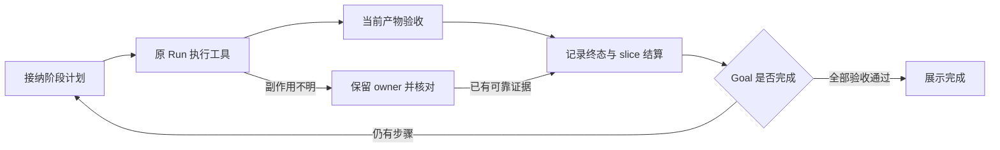

# Aster 长程任务优化计划：Core / ACP / 宿主分层

2026-11-02 v30 验收检查点：使用原 ACL 的 `glm-01/glm-5.3`、原任务/seed/40 次请求预算/4096 输出上限及 8 个冻结验收源文件，三条真实配对 TUI 用例全部通过：C01 两阶段正式接纳、Goal 完成及新 ACP 恢复；单 explore 子智能体；两个真实重叠子智能体。已上报 tokens 分别为 577,223 / 45,299 / 59,865，与最终 ACP、重新打开的 FileSessionStore 一致。三份 VT 录像与源码/二进制身份已复核。Core 修复为将完整且有界的阶段证据上限从32KiB调至64KiB；原49,417-byte现场回放红绿，48KiB有效输入和超64KiB拒绝均有 hermetic 覆盖，既有超限负例仅扩大输入到新界限之外、原断言不变。ACP/TUI 的输出来源与速率保留修复同轮实际通过。此前 v29 的40次预算失败和 v28 界面失败保留，不重判。完整130-case/12-journey、跨回合后台、其它原生平台与Studio仍未据此验收；整体保持 IMPLEMENTING。详见 [OUTCOME](../../docs/evidence/code/2026-11-01-tui-long-horizon-reliability/OUTCOME.md)。

日期：2026-11-01。状态：IMPLEMENTING。用户已授权按 R001–R008 顺序开发和测试；完成状态以逐项执行证据为准。

2026-11-02 最新检查点：v24 真实 GLM TUI 单子任务、双子任务并行已通过，恢复后的累计用量分别为45,268、59,948。后台子任务仍未通过：父请求内部错误、界面缺少完成行、恢复累计少于实时值。v25 的一次后台诊断停在第二次嵌套审批；一次 TUI Goal 停在 Bash 审批，均以取消/失败保留，未改判。新发现的 Core 失败终态漏存用量（4恢复成2）和宿主收到 Auto 确认后改回 Ask 均有真实组件红/绿回归；v27 正在进行组合回归与配对重建。v24 原有 PTY 启动/恢复/搜索/Goal 控制巡检通过，使用本地模型夹具，不计为 GLM 长程通过。

后台契约需要单独确定。现有 Core 的 `AgentToolCapabilityContext::admit_subtask` 把后台任务从 Turn 提升至 Run；`Supervisor::drive_close` 在 Run 关闭时取消子任务。“父 PromptResponse 已返回，子任务继续执行”因此不是现有 Run 契约。未完成的 v26 生命周期实验已保留为证据补丁并撤回生产路径；不增加新的事实类型来掩盖原有未结清义务。

| 后台契约 | Core 必要工作 | ACP 与宿主必要工作 | 验收边界 |
| --- | --- | --- | --- |
| 保留 Run 内后台 | 明确正常收尾与取消时机；只由原子任务 owner 的实际完成及身份绑定凭据结清对应义务；失败用量也保存 | 完整传递进行中/已取消/已完成，显示 Run 内状态 | 父任务可在子任务运行时做其它工作；不宣称跨 PromptResponse 继续 |
| 跨轮会话后台 | 用现有 Session/Run 能力机制接纳独立子 Run，冻结父调用允许的能力与预算，先保留准入再执行；原 Run 只结算派发，子 Run 自行承担实际工具回执；Session 关闭仍清理全部后代。单独说明旧日志与恢复兼容，不放宽未知副作用完成门 | ACP 在原 prompt 返回后仍订阅该 Session 的任务和用量；宿主跨 prompt 保留任务身份、停止入口与终态，不把旧子任务事件附到新请求 | 真实 TUI 必须先观察父 RPC 正常返回，再观察子任务6次实际读取及完成；停止、关闭、恢复、累计用量与残留进程分别验收 |

第二行涉及生命周期与恢复契约，需先按本文范围约束明确设计及兼容方式，不能从 R001–R008 的原授权中默许一次隐式迁移。两种契约的成绩分开记录，原600秒失败及冻结业务验收器不变。

2026-11-01 执行检查点：分层修复、真实配对 TUI 与 GLM5.3 C01 五种子对照已留证，首次成绩不改写。模型统计采用通用 Core/ACP/宿主链路：此前10模型中8个完成真实SDK对账和预检后的TUI校验，2个上游429；标题已接回原会话预算。晚到后台记忆用量的通知、去重、自动落盘及文件存储恢复已通过实际组件回归；用户批准的会话异步锁防止旧快照覆盖新累计值。恢复后的独立构建 v11 已通过复制产物身份预检，当前10模型TUI、协议/沙箱门和新增GLM分阶段Goal恢复验收仍在执行。额外长输出120秒超时、严格JSON形状验收失败、未降低消耗的大用户输入实验及此前冷启动失败均保留。工具结果压缩降低后续输入约32%。详见 [OUTCOME](../../docs/evidence/code/2026-11-01-tui-long-horizon-reliability/OUTCOME.md)。全旅程、其它原生平台及Studio资格不从这些结果推断。

本计划补充 [spec.md](spec.md)、[plan.md](plan.md) 与 [tasks.md](tasks.md)。它收敛既有 T001/T005–T008/T012/T014–T017 的近期落地顺序，不替换原有 130 个 case、12 条旅程或验收分母。R001–R008 是实施切片，不是新增 case，也不代表已执行覆盖。

## 1. 目标与范围

让长程任务逐阶段推进，在失败、取消、断连和恢复时给出可信状态。每个完成结论都关联当前产物和实际验收。优化基于现有 Core、ACP、TUI、检查点和回执，不引入新的编排框架。

范围：`crates/code/core`、`crates/code/acp`、`apps/aster` 及受影响的 terminal 源入口。保留公开 Rust API、现有 V1 schema、根 workspace、ACL、权限与进程所有权。若实施确需改变这些契约，先单独提出设计及兼容方案，不在本计划内默许。

本计划中的“宿主侧”指 `aster` CLI/TUI：入口在 `apps/aster`，交互与 ACP 子进程桥接主要在 `crates/terminal/.../aster-pager`。`aster-acp` 在架构上也承载 Core 的运行适配，但本计划单列为 ACP 层，避免“宿主”一词把两层混在一起。Studio 是另一个消费方，本轮不改其私有实现。

编制规划时未实施代码或运行模型。后续用户已授权按本计划开发和测试，按既有评测工作流运行真实模型和配对 TUI；不安装或发布。不把 TypeScript/tsrs 升级、Studio 改造、全仓格式清理纳入修复范围。Studio 原拒绝的资格仍需其授权宿主中的独立复现，TUI 成绩不能替代。

## 2. 已确认事实与待验证项

基线来自会话 `8de20dbf-1c46-4f73-ac87-a060e70ef12d` 的历史日志和本次读取。工作区同时存在其它任务的修改，历史运行与当前源码不能视为同一构建。

| 观察 | 已有证据 | 结论边界 |
| --- | --- | --- |
| 最后一次 slice 约 118 分钟、80 次工具调用 | 会话事实 seq 189–431；ACP `aster-acp.20758.log` 的 `events_drained_ms=7109511` | 不是模型或所有任务的性能基线 |
| 最后文本为 Partial，快照仍是 planning | 事实末项为 `model.turn`；没有之后的 `turn.complete`、Goal 结算；快照停在最后一次 update_plan | 已确认状态缺口，具体失败返回点待复现 |
| 持久目标只有一个 task | `goal.rs::bind_task_goal`，通用验收句、Simple 计划；聊天内另有四步 update_plan | 证明两套进度没有表达同一阶段计划，不证明模型已经遗忘 |
| 构建和子任务出现超时、锁等待 | 历史工具回执及权限诊断 OUTCOME；120 秒是部分调用显式指定值 | 不归因为统一默认超时，不直接整体延长所有期限 |
| 输入约从 13.7 万增至 27.4 万 token | 运行 ModelInput/ModelUsage；末期工具结果约 18.8 万估算 token | 证明上下文增长，不证明存在上下文溢出或能力下降的因果关系 |
| TUI 启动判定未通过，屏幕已有欢迎页和输入框 | `harness-tui-ask-verified.log`；wait_for_frame 优先寻找 ❯，欢迎输入框使用 → | 就绪识别需复现；尚未证明审批流程坏了 |
| 权限诊断已有局部修复 | 2026-11-01 权限诊断 OUTCOME，历史 406 Core / 5 ACP 通过 | 不等于原始 Studio 拒绝已解决或当前构建已验收 |

实施前把历史缺陷、当前已修路径和新失败分别标注。当前 `attempt.rs`、`turn_terminal_tests.rs` 已有 worker 完成与保留 sender 的处理，先验证现状，避免重复造同一修复。

## 3. 外部实践及 Aster 的取舍

下列资料是一手工程经验，不是所有模型和所有任务都适用的统一标准。本文的阶段顺序与落地取舍是针对 Aster 的判断。查阅日期均为 2026-11-01。

| 来源 | 可借鉴做法 | Aster 的落点 |
| --- | --- | --- |
| [Anthropic：Effective harnesses for long-running agents](https://www.anthropic.com/research/effective-harnesses-for-long-running-agents)，2025-11-26 | 逐项实施、明确未完成清单、给下一阶段留下可核验交接 | 接通现有 Goal 接纳计划和验收证据；不额外复制 feature-list 配置或自动提交 Git |
| [Anthropic：Harness design for long-running application development](https://www.anthropic.com/research/harness-design-long-running-apps)，2026-03-24 | 在实施前约定阶段交付和验收；执行与评估相分离；上下文策略依模型实测 | 用宿主验证合同和独立 checker；模型审查补充解释，不单独授予通过。不默认增加代理数量或强制清空上下文 |
| [LangGraph：Functional API / Determinism / Idempotency](https://docs.langchain.com/oss/python/langgraph/functional-api#determinism) | 从检查点重放，复用已完成任务结果；未完成副作用可能重执行，需幂等或核对 | 复用 invocation identity、receipt、checkpoint、original owner；不迁移到 LangGraph，不承诺任意 shell 的 exactly-once |
| [Temporal：Detecting Activity failures](https://docs.temporal.io/encyclopedia/detecting-activity-failures) | 区分排队、单次执行、整体重试期限和 heartbeat | 用既有执行/预算边界分别观测等待、存活、进展；全任务期限覆盖重试，不照搬其产品状态或默认数值 |
| [Anthropic：Effective context engineering for AI agents](https://www.anthropic.com/research/effective-context-engineering-for-ai-agents)，2025-09-29 | 压缩、结构化交接、按需读取，清理冗余工具正文 | 扩展现有 compaction carry 与 artifact 引用；保留权限、失败和未完成义务，阈值经固定轨迹实验决定 |

## 4. 需要保持的行为

1. **正文是展示，不是提交点。** 流式文本已经显示，不代表 Run、Goal 或任务已经完成。Run 正常结束也不等于整个 Goal 通过。
2. **已有日志和 owner 决定状态。** 生命周期失败通过原有终态发布路径表达。不能从 Partial、done、错误文案或工具退出 0 猜业务完成。
3. **不明副作用先核对。** 尚无完整回执时沿用 Reconcile / ReceiptUnsettled，显示可操作原因，保留原 owner；不伪造成功、不强制释放、不盲重试。
4. **阶段计划明确接纳。** 复杂工作的步骤由模型提出，ACP 适配为现有 typed command，Core 校验身份、范围、版本与预算并接纳；宿主提交目标并展示结果。简单任务保留单步路径，不按关键词或文件数猜复杂度。
5. **存活与进展分开。** heartbeat、日志输出或同一查询的新调用 ID 不能单独清零停滞计数。当前字节变更、验证改进和新有效信息继续按现有进展规则判断。
6. **等待不扩大授权。** 审批、构建锁、后台任务和 provider 失败有各自恢复动作。审批等待不是自动拒绝；明确拒绝不能换工具绕过。
7. **兼容既有状态。** 复用 RunStatus、GoalState、GoalTickDecisionV1、turn outcome。展示“等待审批”“等待工具”“需要核对”不要求新增持久 RunStatus。

图中正常路径是设计顺序，不是跨存储原子事务承诺。任何中断都从现有日志/检查点核对；未证实的步骤不能跳过。

## 5. 三层责任、归因与影响面

### 5.1 三层各自拥有的职责

| 层 | 拥有的职责 | 代表实现 | 本层验收 |
| --- | --- | --- | --- |
| Aster Core | Run/Goal 的权威状态、计划与阶段接纳、工具副作用回执、checkpoint/恢复核对、执行权限与预算约束、取消清理、上下文压缩与完成门 | `crates/code/core/src/{run,goal_control,compaction_carry}.rs`、`agent_api/conversation_runtime`、`fact_control`、`tools` | SDK/真实实现的 owning-package hermetic tests；同一约束不依赖具体 UI 或 ACP 才成立 |
| Aster ACP | 把 ACP 请求和可信宿主输入接到 Core；构造当前入口的 Goal/SessionOptions；驱动 goal tick；排队与 generation；桥接审批/取消；传递 Core 事件、错误、usage、终态与 PromptResponse | `crates/code/acp/src/goal.rs`、`agent/{session_open,goal_ext,attempt,turn,protocol,resume}.rs`、`host_context.rs` | Core 行为不变时，真实 ACP stdio 的 new/load/prompt/cancel、审批和终态投影准确；无桥接丢失或误报 |
| Aster 宿主 | 配对 CLI/ACP 启动和进程管理；提交 cwd/模型/配置选择及用户授权输入；显示阶段、等待、验收和失败；收集审批答复；发起停止/恢复；处理终端输入与协议断连展示 | `apps/aster/src/main.rs`；pager `src/acp/aster_spawn.rs`、`src/app/{acp_handler,turn_completion}`、`src/views` | 真实配对 `aster`/`aster-acp` 中输入可用、授权可操作、状态有依据、断连不误报完成；用户能停止和恢复 |

配置与权限需要贯通三层：宿主提交选择与授权输入，ACP 校验并组合当前会话上下文，Core 在执行边界落实约束。Core 不从 UI 推断许可；ACP 不从 EndTurn 推断 Goal 成功；宿主不从最终文本或 spinner 停止推断完成。可信宿主提供的验证合同经 ACP 接入，Core 核验执行回执与当前产物；“宿主提供合同”不意味着完成门属于 TUI。

### 5.2 对本次现象的分层归因

| 现象 | 优先定位层 | 跨层检查与归因条件 |
| --- | --- | --- |
| 正文已有 Partial，Run 仍是 planning、slice 未结算 | Core 终态/持久化与 ACP worker 桥接分别定位，根因未定 | Core 没有权威结算先查原 owner；Core 有终态但 ACP 未传递查 ACP；ACP 已传递而界面仍显示运行查宿主。用同一 session/run/prompt 身份比对 |
| 上文已有阶段计划，入口仍绑定一个 task | ACP 主责 | `acp/src/goal.rs::bind_task_goal` 构造单步计划；Core 已有 ProposePlan/AcceptPlan 与验收 API。先修入口接线，Core 仅修实测的校验/投影缺口；宿主负责显示接纳后的阶段 |
| 同一权限拒绝缺少原因或无法继续 | Core 原因生成、ACP 审批桥接、宿主授权输入各有边界 | Core 决策错误修 Core；正确原因在 wire 丢失修 ACP；正确审批请求已到客户端但未显示/回传修宿主。实际策略拒绝不自动归为缺陷 |
| 长工具、后台子任务超时 | Core 工具生命周期与 ACP 任务驱动分别定位 | 模型显式指定的 timeout 是输入；Core 执行其语义，ACP 传递等待/取消/总预算，宿主管理 ACP 进程并显示状态。机器上 Cargo 锁竞争单列 infrastructure，不直接增加全局产品锁 |
| 输入从约 13.7 万增至 27.4 万 token | Core 压缩/工具历史投影主责；ACP 会话选项协作 | 对照 Core 有效窗口/水位、ACP `core_session_options` 注入和宿主所选模型配置。不能只读旧快照就断言 Core 压缩失效 |
| 欢迎页已显示，wait_for_frame 仍超时 | 测试侧先修正就绪判据 | `boundary_e2e.rs` 虽位于 ACP 测试目录，验证的是宿主就绪。若产品实际能接收输入，只改测试；若真实输入不可用才修宿主，不据此改 Core 或 ACP 业务逻辑 |

产品责任层与测试文件所属包分别记录。某个测试位于 `aster-acp/tests`，不等于被测缺陷属于 ACP。

### 5.3 既有实现入口

| 内容 | 既有源入口 | 调用者和验证 |
| --- | --- | --- |
| 生命周期、发布、恢复 | `core/src/agent_api/conversation_runtime/{owned_worker,owned_launch,owned_fact}.rs`、`run_admission/{publication,joined_failure}.rs`、`core/src/run.rs` | ACP `agent/{attempt,turn,resume}.rs`；Core 原 owner / checkpoint tests，ACP terminal tests |
| 目标计划、阶段验收 | `acp/src/goal.rs`、`agent/goal_ext.rs`；Core `goal_control`、`agent_api/goal_facade.rs`、`fact_control/goal_evidence.rs` | `core/src/tools/builtin/update_plan.rs`；Core goal facade tests、ACP goal tests；已有 plan 展示 |
| 授权和审批 | Core `fact_control/{receipts,tool_results}.rs`、`permissions`、`tool_confirmation` | `permission_diagnostics.rs`、ACP `approval_rules_stdio.rs`、`boundary_e2e.rs` |
| 长工具和子任务 | Core `tools/task/{parallel_execution,parallel_task}.rs`、`tools/{process,builtin/bash}.rs`、现有 budget / run_control | process ownership tests、task tests、ACP terminal/cancel tests |
| 上下文与交接 | Core `agent/loop_builder.rs`、`fact_control/{compaction,checkpoints}.rs`、`compaction_carry.rs` | compaction / carry tests、模型输入与原始 usage 记录 |
| TUI 可见状态 | terminal `aster-pager/src/app/turn_completion.rs`、`app/acp_handler`、`views/welcome/prompt.rs` | pager sibling tests、真实 `boundary_e2e` / `shipped_tui_e2e` |
| 资格和指标 | ACP `tests/long_horizon/{candidate,driver,artifact,metrics,report}.rs`、`long_horizon_contracts.rs` | 现有 H/R/U cohort 与外部 checker；不新建测试平台 |

表内 `core/` 和 `acp/` 分别相对 `crates/code/`。terminal 定位于 `crates/terminal/crates/codegen/aster-pager/`。目录名不决定文件是否生成；R001 必须依据文件头和 owning-source 工作流核对生成边界。生成文件只改其源并再生，保留 pager 来源与许可证。

### 5.4 每个切片的主责与跨层交付

下表 C/A/H 是切片内的 Core/ACP/宿主交付标签，不是新增任务或状态。`测试侧` 只改测试与证据，不默认要求三层产品一起改。

| 切片 | 主责 | Core 交付 | ACP 交付 | 宿主交付 / 测试侧交付 |
| --- | --- | --- | --- | --- |
| R001 | 测试侧 | 观察实际 Run/Goal/receipt/checkpoint | 对齐 wire 与 Core 身份 | 冻结配对构建和真实画面/输入；记录丢失发生在哪层 |
| R002 | 测试侧；真实输入缺陷才由宿主修 | 无默认改动 | 无默认改动 | 修 ACP 测试目录中的宿主就绪 oracle；有产品缺陷才改 pager 输入/就绪实现 |
| R003 | Core 与 ACP 分别主责；宿主接线 | R003-C：结算、持久化、原 owner 核对及失败原因 | R003-A：drain/join、错误与终态的 wire/response 映射 | R003-H：按真实信号显示结束/失败/待核对及断连，不自行结算 Run |
| R004 | ACP 主责；Core 保持接纳规则 | R004-C：验证现有计划/阶段 API，修实测缺口 | R004-A：将模型提出的实际步骤接到现有计划 API，驱动下一个已接纳步骤 | R004-H：展示同一 plan revision 的阶段、剩余项及验收，不复制计划权威 |
| R005 | Core/ACP/宿主分别按权限边界主责 | R005-C：正确执行与诊断，原调用身份仍生效 | R005-A：策略上下文和精确审批身份的请求/回传 | R005-H：授权输入、审批展示和答复；测试确认拒绝零执行 |
| R006 | Core 工具执行主责；ACP 续跑/等待主责 | R006-C：工具 deadline、后台 handle、进展/预算、取消与后代清理 | R006-A：goal tick/队列/等待和取消桥接，守住宿主传入的总期限 | R006-H：ACP 进程生命周期和可见等待；机器构建竞争归测试环境 |
| R007 | Core 主责；ACP 配置接入协作 | R007-C：压缩、义务保留、工具摘要和 artifact 引用 | R007-A：确认有效模型窗口/SessionOptions/usage 注入正确 | R007-H：验证宿主模型选择与上下文展示；不在 UI 增设压缩器 |
| R008 | 测试侧，按层收集资格 | C0：实现与 SDK 不变量 | H0/H1：真实 stdio 接线与组合恢复 | U：真实配对 TUI；R：固定真实模型任务；各层成绩分列 |

实施顺序保留阶段 A→B→C。每项跨层工作先确认生产者的事实，再检查 ACP 传递，最后检查宿主消费；测试先证明判据有效。性能分别归到 Core 的模型/工具耗时与 token、ACP 的排队/事件传递、宿主的启动/渲染/交互，构建锁等待另列，不把它们混成“模型慢”。

## 6. 有序实施任务

实施状态与逐项证据见 `docs/evidence/code/2026-11-01-tui-long-horizon-reliability/OUTCOME.md`；未满足验收的任务保持未勾选。每项按 §5.4 分层交付，在同一次变更中加入实际实现的 owning-package hermetic 回归，随后做相邻层接线验证。先复现，确认当前源码仍有缺陷再修。任务共享生命周期和验收状态，不标记可并行。

### 阶段 A：建立可靠的观测和收尾

- [ ] **R001 — 冻结基线和最小复现**。关联 T001/T003/T014，US2/US6。记录 dirty/submodule、工具链、features、运行时依赖、配对二进制摘要和当前任务源摘要。使用现有 candidate/preflight 与受控 fixture，新增身份不匹配的负对照；重现“文本已输出、终态缺失”和“界面已就绪、等待器超时”。单列模型、产品、测试和机器并发的影响。产物是失败回执与归因，不能预设某一行就是根因。

- [x] **R002 — 修正 TUI 就绪判据**。依赖 R001，关联 T012/T016，US4/US6。先在 `boundary_e2e.rs` 验证 →/❯ 差异及稳定画面的后备判定。复用产品当前输入就绪语义或精确可见结构，不依赖单个装饰字符或整屏静止。小测试覆盖未就绪、当前欢迎页、错误画面；保留真正发送输入、展示选项、回传选项、无泄漏的断言。不能靠增大 45 秒或删审批断言通过。

- [ ] **R003 — 贯通原 worker 的终态和恢复核对**。依赖 R001，关联 T007/T008/T016，US2/US5/US6。沿 owned worker、failure publication、Run store、Goal settlement、ACP response 和 TUI projection 追踪丢失点；检查 streaming Result 的错误传播，并验证已有 guardian/failure publisher，不能另造发布者。扩展实际 Core owner 测试与 ACP `turn_terminal_tests.rs`：文本后返回错误、worker 无 End、后台 sender 留存、终态后断连、终态持久化失败、迟到子任务、重启后恢复。正常错误必须有保留原因的失败投影；未证实 owner 退出或副作用结算时继续核对并拒绝新写入。成功、失败、取消不得相互覆盖，预算不能随恢复重置。TUI 测试核对有终态、缺终态及核对中的三种展示结果。

阶段 A 出口：受控复现能分别证明正常结束、明确失败和待核对；不能仅依据最终文本或 RPC 返回形成通过结论。原始 owner 的退出/持久化仍不明时，明确报告，不强制变成“已完成”。

### 阶段 B：让阶段计划和等待能够收敛

- [ ] **R004 — 接通实际阶段计划**。依赖 R003，关联 T005/T008/T016，US1/US2。复杂任务使用现有 ProposePlan/AcceptPlan 与 plan revision，保存明确阶段产物、前置依赖和验收条件；把已授权的上文计划通过模型转换成 typed proposal，绑定其 source facts，不由字符串规则猜含义。检查 `update_plan` 与 durable plan 的调用关系，避免把 UI todo 的 completed 当 StepAccepted；使用现有目标事实作为验收来源，不新增第二份权威进度存储。扩展 goal facade / ACP goal tests：前置未通过、阶段校验失败、恢复后剩余工作、旧 plan revision、范围修订和简单单步任务。阶段验收不能仅凭模型自评通过，也不要求不必要的逐文件操作顺序。

- [ ] **R005 — 验证权限诊断与精确恢复**。依赖 R003，关联 T006/T016，US3。复核已存在的 reason/arguments_changed/execution_started 分支，补齐 ACP 到 TUI 的可观察性。现有明确允许的临时工作区读取须成功；明确拒绝、改写参数和 child 缺少审批通道须不执行。审批取消、迟到审批、恢复时策略变化均走现有 identity 与审批路径。工具进程成功退出和审查实际覆盖分别说明：审查受阻不能作为审查通过。无证据不扩大 ACL，不读取旧会话已拒绝的私有文件来绕过限制；原 Studio 资格留给独立宿主复现。

- [ ] **R006 — 长工具按存活、进展和总预算处理**。依赖 R003/R004，关联 T007/T010/T011/T016，US5。先测排队/锁等待、执行和清理时间。复用已有后台 task、进程 owner、取消 token 与预算，等待已有 handle，不重复提交同一构建。检查 fan-out 显式 timeout 与后台参数的兼容；到期不把已进入的副作用当未发生。宿主总 deadline 覆盖重试和辅助请求，保留 interactive 0=unlimited、现有审批等待语义。heartbeat 只说明存活，语义进展仍由现有 delta 判定。用受控进程/通知屏障验证：长但有进展、静默但存活、真正无进展、锁等待、取消和迟到回执；同一重试只有一个 owner。只有证实现有边界无法表达缺口才提出最小 ACL 扩展，数值由基线决定，不先硬设通用分钟数。

阶段 B 出口：用户能看见当前阶段、已验收项、剩余项与停止原因；阶段失败保留可恢复义务。长工具继续运行、等待授权和停止执行三者可区分。

### 阶段 C：减少上下文消耗并验证完整任务

- [ ] **R007 — 按阶段交接与按需读取上下文**。依赖 R004/R006，关联 T005/T008/T016，US1/US2/US5。核对实际模型窗口、有效 compaction 水位与 token 计量；不以旧快照的配置字段直接推导运行阈值。复用 compaction carry，保留目标/计划版本、当前阶段、未满足条件、权限与未决副作用、验证命令、当前 source/effect 身份及 artifact 引用。完整大日志保留为 artifact，模型先看有界摘要、原退出码和来源，再按需读取。稳定系统/工具定义与动态证据沿现有权威层级组织，不通过移动角色降低权限约束。测试压缩前后义务一致、原始失败不丢、陈旧验收失效、UTF-8 有界、日志仍可读取。先同轨迹比较；全量重置上下文或增加代理，仅在单独实验有收益且不丢状态后再另提案。

- [ ] **R008 — 固定任务做组合回归与对照**。依赖 R002–R007，关联 T014–T017，US1–US6。复用 `long_horizon_rust_stdio.rs`、`long_horizon_real_llm.rs`、`boundary_e2e.rs`、`shipped_tui_e2e.rs`。依次执行阶段修复任务、恢复任务、权限等待任务、长工具任务和上下文交接任务，沿 cases/journeys 的原 ID 记账，不新增分母。先 H0/H1，再固定真实模型与真实 TUI；比较同一 fixture、prompt、oracle、预算、features 与能力。所有尝试入账，失败单例复现；checker 不由任务代理改写。保存当次源码/配对二进制、退出码、wire、当前产物、验收和清理证据。Windows/Linux/macOS 按既有 CI 与原生执行端列资格，未执行目标明确标记。

阶段 C 出口：只对已执行组合声称能力；当前字节外部验收、恢复一致性与权限不变量全部通过后，才统计任务完成。原 017 的其它格子保持原状态。

## 7. 验收、测量与发布次序

| 门 | 必须观察到的结果 | 产出任务 |
| --- | --- | --- |
| 终态一致性 | 选定每个注入屏障具有绑定同一身份的正常/失败/取消或明确核对结果；无假成功、无丢失失败、无未证实释放 | R001/R003/R008 |
| 恢复一致性 | 已确认提交的步骤不重复执行；未完成项不丢；未知非幂等副作用保持拒绝并核对；旧验证不覆盖新字节 | R003/R004/R008 |
| 权限与取消 | 明确拒绝执行次数为零；允许夹具成功；取消后无越权或遗留可写后代，审批未被自动转为批准/拒绝 | R005/R006/R008 |
| 阶段完成 | 每个选定要求关联验收；失败步骤不推动 Goal 完成；工具 success 和审查文本不是独立验收器 | R004/R005/R008 |
| 真实 TUI | 输入、等待、审批、失败、恢复和完成在配对 CLI/ACP 上可观察，不能以 Core pass 替代 | R002/R003/R008 |
| 成本与时间 | 分别报告首次完成率、恢复率、总调用/辅助调用、实际 token/缓存、工作耗时与锁等待、清理耗时；unknown usage 不补零 | R001/R006/R007/R008 |
| 全仓既有门 | owning-package tests/Clippy、format、适用 dependency/drift checks 如实报告；已有失败不算本次已修，也不伪造通过 | R008 |

性能先冻结基线，再预登记阈值。首轮不承诺“提速 30%”或“完成率 95%”。同轨迹 H1 应证明上下文缩减且义务与最终产物不变；真实任务采用 017 既定每臂至少五个预注册 fixture seed、交替顺序。报告所有失败与区间，五次通过不等于 95% 可靠性。若模型不支持采样 seed，fixture seed 与模型随机性分开记录。

本地定向回归通过后才扩大到 H1，再运行真实模型及配对 TUI。真实模型运行沿现有 campaign 的 ACL、模型、输入、oracle 和预算执行；首次失败与重试分别留证。不增加新的 CI 系统、全局锁管理器或调度服务；先复用现有流水线与串行构建。

未来从根目录使用 pinned Rust 工具链并初始化已授权 Studio 子模块；受影响 owning packages 为 `aster-core`、`aster-acp`、`aster-pager`，CLI 接线变化另含 `aster`。对各包运行 `cargo clippy --locked -p <package> --all-targets --no-deps` 与适用受支持 features，配合 focused tests 和 `cargo fmt --all -- --check`。可选 Core `advanced-harness,deep-live` 沿既有门执行，不能以可选检查替代默认构建。二进制必须成对构建，不把源码测试通过当安装资格。

最终证据放 `docs/evidence/code/<execution-date>-tui-long-horizon-reliability/OUTCOME.md`。记录 exact commands、OS/架构/工具链/features、首次及重试、失败归因、当前源/运行时摘要、未执行目标和 Explicitly not claimed。发布或安装仍走既有完整性与 sandbox gate，本计划不授权发布。

## 8. Constitution Check

下表仅判断计划设计合规，不表示实现或运行通过。

| 原则 | 计划结论 | 对应约束 |
| --- | --- | --- |
| I Fail Closed | PASS | R003/R005；未知副作用核对、明确拒绝不执行 |
| II Evidence Retained | PASS | R001/R008；保留历史失败，规划不冒充验收 |
| III Hermetic Tests | PASS | R002–R007 各自带实际实现回归；H/R/U 分层 |
| IV Closed Sets | PASS | 复用现有状态/拒绝枚举，不按文案分支 |
| V Workspace / Public APIs | PASS | 现有 product regime、root workspace 和公开 API |
| VI Local Schema | PASS | 保留 V1；必要变更须先另提兼容方案 |
| VII Ratchets | PASS | 不调低基线、删测试或放宽 allowlist |
| VIII Replaceable Transports | PASS | Core 不依赖 TUI；保留 ACP stdio 边界 |
| IX One Configuration Language | PASS | 产品/campaign 配置仍为 ACL，无新配置格式 |
| X Test Files | PASS | owning-package sibling tests 与公开 integration tests |
| XI–XII Judgment / Adversarial Review | PASS | 先证伪根因；负对照、独立 checker 与已知失败 |
| XIII One Repository | PASS | 当前 checkout，不创建 worktree 或新仓库 |
| XIV–XV Names / Meaning | PASS | 模型提出 typed plan；精确身份，不用关键词推断目标 |
| XVI–XVII UI Constraints | PASS | 只调整已有展示/就绪语义，不加 native picker 或改变对话动画 |

## 9. Final Verification Gate

- [ ] R001–R008 按 §5.4 分别记录 Core、ACP、宿主或测试侧交付；每个实际行为改动有 owning-package 回归，测试目录不作为产品归因依据。
- [ ] 选定故障屏障、阶段验收、恢复核对、权限与清理门全部满足。
- [ ] 配对 TUI 输入和最终交付通过；失败/核对展示不能误报完成。
- [ ] 固定评测输入、oracle、模型和预算，首次失败与重试分开统计。
- [ ] format、Clippy 和适用 workspace gates 有真实结果；失败保留。
- [ ] 未执行平台、宿主和 017 剩余用例明确列出；没有替换原分母。
- [ ] 无新配置语言、依赖/工作区迁移、私有源复制、扩权或发布。

## 10. 扩展目标：TUI 功能与效率

用户将目标更新为确保 Aster TUI 各项功能有效且高效，重点为长程任务、子智能体、并行执行和后台任务，并要求使用项目 ACL 中的 GLM 做真实端到端验收。沿用此前已确认的精确模型 `glm-01/glm-5.3`；已核实目录没有 `GLM45.3` 这个 ID。原配置保持不变，未授权启用其它账号或静默替换模型。

按下列顺序复用现有用例和测试入口。该表是执行顺序，不增加 130 个 case 或 12 条旅程的分母；每个故障变体、真实模型与 TUI 成绩仍分别记账。

| 顺序 | 重点与原用例 | 必须观察到的结果 |
| --- | --- | --- |
| 1 | 阶段与恢复：LH01/LH03/LH05，C01、H09/H10、I01–I10 | 关闭已复现的阶段证据缺口；当前字节验证、阶段接纳和恢复一致；文字完成不能替代 Goal 完成 |
| 2 | 子智能体：LH06，F04/F05、E02/E03、H07 | 真实 child Run 及父子归属、权限/预算继承、结果和用量汇总；父取消后无遗留写入者 |
| 3 | 并行：LH06，F01–F03/F10、L03 | 存在真实重叠执行；队列有界、无双接纳、跨会话与迟到回调不串线；分列排队时间与执行时间 |
| 4 | 后台：F05、H01/H02/H04/H07、L10 | 后台任务可观察、可等待、可停止；父回合结束不伪造子任务结束；终态与独立账本一致 |
| 5 | 核心交互：A/B、E02、H03/H08、L07 | 实际输入、模型/模式、读写、审批、问题/表单、停止、恢复、任务面板和产物交付可用；GLM 真调用与配对二进制身份可核验 |
| 6 | 效率与长期负载：L01–L06、H07 | 固定配置与负载测量启动、排队、模型/工具、渲染、清理、token/缓存及资源；冷/热、构建/运行分别记录；未知计量不补零 |

先运行 owning-package 受控回归和真实 stdio/沙箱，再运行固定 GLM 和真实 TUI。沿用现有 `shipped_tui_e2e`、`tui_913_real_llm`、`long_horizon_*` 与 A3S Test；原来固定 Kimi 的用例不能换模型后冒充原用例通过。新变体先登记输入、预算、验收与清理条件。实际没有调用子任务、没有并行重叠或没有命中故障屏障时，该对应检查不通过。

当前 133 项 Goal/验证投影回归通过；阶段真实沙箱、GLM 与扩展 TUI 验收仍未完成。macOS 本机资格、其它原生平台和 Studio 分列；本目标不授权安装、发布、原私有宿主改造或全仓格式清理。

## 10. 规划一致性复核

| 复核项 | 结论 | 说明 |
| --- | --- | --- |
| US1–US6 与任务映射 | 无遗漏 | US1：R004/R007；US2：R001/R003/R004；US3：R005；US4：R002；US5：R003/R006/R007；US6：R001/R008；R008 做组合验收 |
| Core / ACP / 宿主责任映射 | 分层交付 | §5.1 定义职责，§5.2 按证据归因，§5.4 映射全部八项；就绪 oracle 与机器锁竞争单列测试/基础设施 |
| 与原 spec 范围一致 | 无冲突 | 测试中发现产品缺陷按原 T016 修复；不扩大至 Studio/TS 升级或发布 |
| 尚未确定的实现原因 | 实施前置 | R001/R003 复现具体丢失点；当前代码的已有修复须重新验证 |
| 性能阈值与平台资格 | 未声明通过 | 基线后预登记，未执行保持未执行 |

结论：可从 R001 的基线与故障复现开始；后续修改取决于复现证据。本文件没有授予任何实现项完成状态。

## 11. 已确认的后台子智能体生命周期（2026-11-02）

用户已明确选择：**父答复后继续运行，后续回合可查询、等待和取消**。这取代此前待确认的 Run 内后台语义；不是进程退出后自动执行或新建守护进程的授权。原跨父答复的 GLM 用例、原提示、模型、预算、600 秒期限和验收条件保持原样，历史失败不改判。当前 v31 的“子任务先完成、父任务后结束”修复只消除漏结算，不构成跨回合通过。

根因已定位：`AgentToolCapabilityContext::admit_subtask(background=true)` 将任务提升到父 Run；`SessionCapabilityRun::close` 关闭其 Session/Run；完成门同时将活跃子任务视为未结算义务。单独移走 JoinHandle 或取消 token 不能解决这三个边界。现有 Run owner 的真实关闭/发布证明、权限租约和未知副作用保护必须保留。 正常父答复释放父执行归属；明确取消/到期仍按原取消树传播到该执行创建的子任务，单个后台任务也可在后续回合按任务 ID 单独取消。会话关闭必须等待实际清理，不把取消请求当作子任务已退出。

| 顺序 | 主责 | 最小实现与约束 | 必须通过的验收 |
| --- | --- | --- | --- |
| R006-B1 | Core | 为显式后台任务接纳独立的会话级执行归属，复用 capability supervisor、现有 Session 关闭入口、冻结的 capability generation 和 `SessionCapabilityRun::admit`。通过既有 catalog pin 入口取得独立租约；校验与原调用 generation 一致，按现有 provider 重新接纳 Use lease。不得给 non-clone 资源租约增加通用 Clone，不延迟或伪造父 original Run 的关闭证明。后台 Hook 绑定自己的 supervisor。 | 通知屏障固定子模型不返回；父 send 正常返回且原 owner 真实释放；下一 send 可进入；父回合结束不取消子任务。权限、沙箱、共享预算、原 deadline 和并行配额继续约束子任务；会话关闭有界取消、join，再关闭共享服务。 |
| R006-B2 | Core | 显式记录原调用、任务、后台执行归属与子会话的绑定。区分“父答复已结束”和“全部工具效果已结算”：仅父叙述答复可以携带已接纳且仍由会话拥有的后台义务返回，未完成项继续保存在日志/检查点中；不写代表全部结算的 `turn.complete`，不接受 Goal 阶段或宽免其它未知副作用。完成记录仍来自实际子日志与工作区观察。 | 删除或改绑记录、丢失执行归属、未知写入、取消而未结算均不能被答复文本清零；原 Goal/evidence/cache-coverage 与原 owner 负向回归继续通过。并发读取/提交复用原 FileLog 及其 fence，不另造事实来源。 |
| R006-B3 | Core | 复用会话现有 subagent tracker、查询与取消 API，补有界、可取消、事件驱动的等待；模型通过最小控制工具访问同一实现。优先采用宿主已识别的输出等待/停止入口，不改变现有 TaskParams 的 Rust 构造和 `tasks` 调用。只查询本会话任务；等待超时返回仍运行，不能取消或重发任务。 | 第一次父答复后，后续回合分别查询、等待同一任务的真实结果及取消另一任务；无重复执行、无忙等、无跨会话访问；取消保留真实终态与 token 消耗。 |
| R006-B4 | ACP / 宿主 | 先复用 `aster/session/background-tasks/v1`、其 stop 入口和 `aster/subagent/cancel`，普通工具通道传递模型等待/取消结果。后台进展与最终 usage 不依赖已结束的父 prompt 接收器；TUI 继续显示独立子任务行，父输入可用。 | 原配对 TUI 用例满足正常 PromptResponse 早于子完成、父 beta 读取在子运行期间、子真实六次 read/结果与可见完成行、无遗留进程。累计 tokens 与原 wire 和重开存储一致；未确认计费不补零。 |
| R006-B5 | Core / ACP / 测试 | 重启只恢复已保留事实，不重放旧后台任务。原运行进程已不存在且没有原完成证明时，展示明确中断/待核对，不伪装 Completed，也不借旧 capability generation 授权新执行。 | 父答复后进程中断再加载：已完成结果可查，未结算义务保留；不自动重新调用模型或工具，不重置预算。最后在同一新配对构建上重跑既有 Goal/单子任务/并行及原后台 GLM 用例。 |

这些子项属于 R003/R006/R008 的实现顺序，不增加原 130-case/12-journey 分母。当前状态均为未完成；以实际生产路径和固定端到端结果逐项验收。原生 Windows/Linux 与 Studio 没有执行证据时继续标为未验证。

### 11.1 当前验证切片 v31

冻结构建 `50cbc313be48056ef12ebef9df99b129e8eecb6f` 的 GLM TUI 选定三例全部通过：原 C01 两阶段 Goal 与新 ACP 恢复、单子智能体、双子智能体并行。已报告累计 tokens 分别为 570,919、45,160、59,732，均与 ACP 和重开存储一致；两个子任务实际重叠 12,490ms。单/并行例各有一个计费未知的中断辅助响应，不补零。独立 H1 tool-result 上下文变体也通过原精确命令与编译沙箱验收。真实输出速率来自实际测量，不是服务器内部推理速度，也不据单次运行宣称性能提升。

Core 独立修复“子任务已完成但父任务缺少结算记录”的缺陷：实际 SDK 原实现失败，修复后的正例及缺失/错绑/不完整证据负例通过；配对特性回归 579 pass / 1 existing ignore，默认 Core 特性定向回归 114 pass，Clippy 与变更路径格式通过。以上均不代表 §11 的跨回合生命周期已经实现。完整结果和限定见 `docs/evidence/code/2026-11-01-tui-long-horizon-reliability/glm-tui-v31-cohort-summary.json` 与 `v31-final-artifact-source-audit.json`。本计划的 R006-B1–B5 保持未完成。

### 11.2 当前验证切片 v32（进行中）

Core 已实现会话持有独立后台 capability Run 的原型；父正常返回保留真实后台 owner，后续 send 可进入，父 gate 错误仍取消后台。`turn.yielded` 只记录明确后台义务，不覆盖其它 prepared invocation、不提交 Goal。实际 SDK 4 项正负例通过；扩大回归 761 pass / 1 unchanged Knowledge binding fixture failure / 2 existing ignored，失败在 Session 构造前且相关源码与 v31 冻结一致。Core all-target Clippy 与 19 个变更 Rust 路径格式通过；警告标题多重集仍为 49。原始 GLM TUI 后台优先四场景的新配对资格验证进行中，不提前判通过。模型查询/等待/取消、取消效果结算、重启及 Goal 组合仍待完成。
