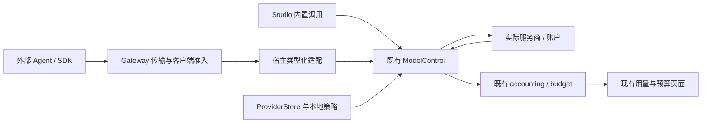

# Implementation Plan: Magpie 全功能业务对齐

> **2026-11-03 范围更新**：第三方 harness 不属于 Aster 产品范围；本任务不再扩展其托管或 CLI 接入。以 [tasks.md 的产品范围收敛](tasks.md) 为准。历史参考与未完成状态保留。

**Updated**: 2026-11-01（补充现有 UI 融合、单一执行链与性能验收） | **Spec**: [spec.md](spec.md) | **Status**: 实施进行中；T005 冻结旧回归基线，T143 审查完整替代的当前快照增量

**Gate context**: 当前 checkout；`apps/gateway`、`apps/aster`、`crates/code`、`crates/search`、`crates/use` 与既有 Studio 私有子模块。根 workspace、pinned 工具链。不修改 Cloud/API/control-plane，不创建 worktree。

## Summary

保留内嵌 Gateway、ProviderStore、Preferences 和现有 CLI 配置适配器。先固定参考契约，接通 Studio 已有的调度、预算和账本，再逐条完成协议、授权、账户路由和计量；之后交付隐私、Agent 管理、插件、工具、共享同步与操作入口。每阶段包含业务、调用方、UI/权限、迁移和测试，不把底层能力存在或接口同名计为完成。

范围见 [功能清单](contracts/capabilities.md)、[Agent 清单](contracts/agents.md)、[Provider 清单](contracts/providers.md) 和 [Studio 能力与 UI/UX 复用约束](ui-reuse.md)。后者规定具体页面归属、已有组件/接口和挂载缺口，不建立独立 Magpie 管理中心。任务保留原编号；T001/T002 保留历史完成状态，其余不因本次规划勾选。

## 1. 对齐边界与完成声明

- 保留 Magpie `0.1.2141` 二进制基线；首次实施记录 executable 版本、SHA-256、OS/架构和启动参数。
- 需求文档冻结为上游 `9162277b91c9327773b5a1e0413d59f24de6f3af`。A 阶段区分二进制已确认行为、文档新增需求与 Aster 扩展。不能静默换基线、fixture 或 grader。
- 文档新增需求也有 owning task；未由参考 executable 验证前不声称 live differential。更换参考版本须单独审查并保留旧 corpus。
- 用户 2026-11-01 再次明确完整替代，T143 因此单独冻结当次官方最新 v0.1.2523 的 release/tag/asset/文档及需求增量，保留旧基线；不无限追随动态 main。AG65–AG70 和 T138–T142 补齐已证实的遗漏，不能将旧 90 项当作范围上限。
- 对齐业务结果、协议、权限、路由、持久化和工具行为。保留 Aster 名称、端口、UI、命令组织与 ACL；不要求相同像素、命令拼写、资源占用或性能数字。
- 不复制遥测、广告、合作伙伴追踪；这不影响业务功能范围。
- `aster` 仍无产品账户系统；第三方订阅仅为显式授权的本地来源，不恢复 toyou 的 managed authentication，租户与 instance 数据保持隔离。

| 里程碑 | 允许声明 | 不能据此声明 |
| --- | --- | --- |
| G1 | 实测平台的核心协议兼容 | 本地网关已完整替换 |
| G2 | 协议、密钥、账户路由和用量支持本地网关替换 | 所有 Agent、插件与共享齐备 |
| G3 | 冻结清单业务全功能对齐，附适用平台证据 | 未来 main、未测订阅/架构自动兼容 |

## 2. 当前代码基线

| 范围 | 实现事实 | 开发含义 |
| --- | --- | --- |
| 生命周期/寻址 | local_api_gateway 已内嵌；修正 group priority 从 0 开始；四种 alias 实际 HTTP 通过，缺候选/alias 冲突明确拒绝 | 保留旧客户端；完整 start/stop/restart/status、坏配置与快照刷新仍待验收 |
| 协议 | Responses HTTP、Messages/count_tokens 已准入并接既有控制；Gemini 公开入口仍 Reserved，原生计量/上游内核已推进；Responses WS 未实现 | 已准入不等于完整兼容；逐条补实际调用与错误/权限/计量证据 |
| 客户端 key | 宿主生成一个 inference credential，授权全部 alias | 复用 grants，补命名 key 与周期预算 |
| 上游多 key | providers_keys 已存多 key；selected_key 取首个启用项；gateway_models 只投影一个 | 扩展候选/身份，不重建凭据库 |
| 账户 | Core 有 Grok/Cursor/Codex opt-in，Studio 有派生 Codex | 不代表都已成为通用网关 provider |
| 路由 | local_policy 仅 Fixed/Ordered；候选为 ModelReference | 扩策略/组引用，保留旧 ACL |
| 目录 | 启动时投影 enabled chat 模型 | 刷新、非 chat 与按 Agent 可见性待接入 |
| 隐私 | wire 有掩码/恢复和 SSE chunk 限制；Studio 未启用 wire | 验证接线及流式稳定映射 |
| Agent | 9 个 file adapters，另有特殊 CLI 分支 | 逐项验证，不按 adapter 数量推断覆盖 |
| 内部协议/计量 | 公开 Chat 已经由现有内部 HTTP 进入 ModelControl；保留已有非 Chat 直连分支；真实别名、预算拒绝、身份与重试/取消已测 | Chat 切片通过不等于 U0 全部完成。其余协议、命名客户端、UI 持久化全流程和性能继续验收 |
| UI 挂载 | 已补网关导航/搜索/深链；ModelSettings 已挂载 routes/budgets；48 项 renderer tests、网关→路由/预算→保存返回流程、13 个设置入口的浏览器回归通过 | 这些是 renderer/测试夹具证据；原生请求、预算执行与账户计量仍须验证。继续使用同页编辑器 |
| 同步/证据 | 通用备份存在；双方对照 harness 与证据已建立，两个冻结版本 JSON/SSE 成功已运行，429 差异仍红 | 通用备份不算网关恢复；完整对照/平台/性能/打包待验收 |

## 3. Constitution Check

PASS 表示设计符合约束，不表示实现通过。

| Principle | Status | Evidence in the plan |
| --- | --- | --- |
| I. Fail closed | PASS | 必需鉴权/配额/脱敏/能力失败拒绝；可选 transform 异常不能绕过必需检查 |
| II. Evidence retained | PASS | 每阶段 docs/evidence/local-gateway/<date-slug>/OUTCOME.md，保留失败/计数/未声称事项 |
| III. Tests follow regime | PASS | owning package hermetic tests；原生/真实账户另验，不引入 PostgreSQL 门 |
| IV. Closed sets | PASS | 协议、策略、状态、周期、hook、错误有 parse/as_str |
| V. Workspace / APIs | PASS | 根 workspace；owning crate 公共 API；不破坏现有公开类型形状 |
| VI. Owner schema | PASS | §4.1 指定唯一编辑/配置/执行 owner；Preferences/ProviderStore 与 model_accounting 扩原 schema，不增加第二份权威或锁文件 |
| VII. Shrink-only | PASS | 不扩 allowlist、不删失败用例、不恢复 ElysiaJS |
| VIII. Transports | PASS | Gateway 保留外部传输与准入；本地请求接既有 ModelControl。适配层不另选上游或结算，见 §4.1 |
| IX. ACL only | PASS | 产品策略 ACL；Agent 原生文件/导入为数据，不加入配置发现 |
| X. Commands / tests | PASS | calling-window permissions；sibling tests；共享逻辑不依赖 Tauri |
| XI. Judgment | PASS | 修正 Reserved 文档、多 key 现状与清单遗漏 |
| XII. Adversarial review | PASS | 阶段含取消/断流/并发/恢复反例，未修复项有任务 |
| XIII. One repository | PASS | 当前 checkout；Studio 私有 submodule 边界不变 |
| XIV. Names | PASS | 精确 model/provider/account ID，不猜人名或文件路径 |
| XV. Meaning | PASS | 意图由显式 classifier 判断，不用关键词猜语义 |
| XVI. Pickers | PASS | DESIGN.md picker，不用 select/datalist |
| XVII. Dialogs | PASS | 管理弹窗就地 fade/scale，保持既有 motion |

模板旧 apps/work/apps/desktop 路径按仓库现状改为 apps/studio。无需宪法豁免；远程管理仍为本地产品管理面，不顺带改 Cloud。

## 4. 文件与复用计划

| 层 | 现有 owning 文件/目录 | 修改范围/调用方 |
| --- | --- | --- |
| 协议 | apps/gateway/src/inference/standards.rs、openai_request.rs、translation.rs、entrypoint.rs | admission、JSON/SSE、错误、取消；entrypoint sibling tests 与 reserved 回归 |
| 授权/调度 | apps/gateway/src/inference/authorization.rs、config/inference.rs、inference/ | grants、限流、候选、usage；managed/principal 隐藏资源、快照、计量契约 |
| 宿主 | apps/studio/src-tauri/src/local_api_gateway.rs、lib.rs | 完整快照、生命周期、更新边界；复杂主题放 sibling module |
| Provider/key | Studio providers.rs、providers_keys.rs、providers_persistence.rs、providers_local.rs | 全部 key/账户、catalog、代理、导入、身份传递；沿用现有存储 |
| 本地策略 | crates/code/core/src/llm/local_policy.rs、config/account_import.rs、llm/codex_login.rs | 兼容扩展策略/opt-in，不泄漏桌面私有协议 |
| 预算/用量 | Studio model_control.rs、model_accounting.rs、model_accounting_usage.rs | attempt/request、预留、价格、窗口、缓存、会话、导出 |
| 隐私 | apps/gateway/src/wire.rs、crates/sentry/ | SSE/工具恢复、强制脱敏、检查页，宿主接线已有 feature |
| Agent | Studio src/renderer/pages/code/cliConfig/、src/shared/utils/cliConfig.ts | 增量编辑、Profile/Library、撤销；需无头复用时只维护一份编辑器 |
| 插件 | crates/use/src/plugin_lifecycle/、plugin_runtime/、Studio capabilities.rs | 安装/授权/生命周期、OpenCode/pi 适配；先探测现有 runtime |
| 工具 | crates/search/src/providers/、crates/code/core/src/tools/、mcp/、Studio agent_plane/ | 搜索/网页/媒体/外部 MCP；visual feedback 不算生成器 |
| UI | Studio ProviderSettings/、ModelSettings/、UsageSettings/、ApiGatewaySettings/、pages/code/ 与 plugins/capabilities | 按 ui-reuse.md 分配原入口：上游账户/key 在模型服务，路由/预算在模型配置，用量原页；网关只扩自身策略，不建第二 dashboard |
| 共享 | Studio services/BackupService.ts、pages/settings/DataSettings/、既有 remote packages | 网关数据成员与凭据边界；不恢复旧配对 |
| CLI/TUI | apps/aster/src/、apps/gateway/src/main.rs、terminal authored sources | 复用独立 Gateway；codegen 只改 owning source 再生成 |
| 权限/发行 | Studio src-tauri/permissions/、capabilities/；根 .github/workflows/ | 最小权限、native checks、最终归档；沿用 release governance |

新增 module/命令/表须由 owning task 证明复用不足。每个 PR 查调用方、schema、权限、fixture、文档与迁移，不只改底层。

### 4.1 唯一入口、数据与执行 owner

“复用 UI”包含三个条件：进入同一编辑器、保存到同一权威、实际请求读取该权威。
相似控件、相同字段名或一份投影快照均不足以证明完成。35 项 CAP 的页面映射以
[ui-reuse.md](ui-reuse.md) 为唯一清单，本节只规定跨页面契约。

| 业务对象 | 唯一编辑入口 | 配置与执行 owner | 其他页面的职责 |
| --- | --- | --- | --- |
| 上游 provider/模型/key/账户 | 模型服务的现有连接抽屉、登录面板、同步预览 | ProviderStore/providers_keys、既有授权 adapter | 网关和 Code 读取同一目录并跳转编辑，不复制账户或 key 列表 |
| 模型路由、候选与策略 | 模型配置 → 路由计划 | Preferences → LocalModelPolicy；本地 ModelControl 执行 | 网关仅显示摘要与深链，Code 只选择发布的路由 |
| 本地额度与预算 | 模型配置 → 本地预算 | 既有 model_accounting 与 Core budget/local | 客户端抽屉关联同一预算并跳转编辑；供应商余额另由 quota adapter 观测 |
| 网关运行与客户端授权 | API 网关 | LocalApiGateway 的运行状态、原 Preferences 策略、credentials/grants | Code 读取连接参数与授权目录，不管理另一份网关状态 |
| 消费、请求与尝试 | 用量页的既有筛选、详情和导出 | model_accounting/model_accounting_usage | 网关显示只读摘要与带筛选条件的链接，不另建图表或 CSV 管道 |
| Agent 配置与 Profile | Code 的现有配置侧栏 | 原 cliConfig adapters、原生文件 API、Profile 引用 | 不在网关复制 Agent 编辑器；Profile 引用已有模型、路由和内容 |
| skills/MCP/指令/插件 | 既有能力页与插件页 | 原 capability catalogue、插件生命周期与内容 owner | Library 分发保存引用和托管标记，不复制第二套内容管理系统 |
| 远端连接、备份与迁移 | 设备连接与数据设置 | 新网关授权适配、既有备份 facade 与真实 native store | 复用现有控件。旧 remote IPC 或旧 IndexedDB 备份不能代替新实现 |

外部客户端 key 与上游 provider key 是两种不同对象，各有自己的授权用途。
它们使用同一套控件风格，但不能合并凭据列表或 API。命名客户端取代现有单 key 区，
默认客户端承接旧 key 的兼容语义。客户端预算仍引用同一预算实体。

#### 本地请求的一条执行链

现状证据：`compile_gateway/render_model` 保留已有非 Chat targets；
`local_api_gateway_control.rs::connect_model_control` 将公开 Chat、Responses HTTP、Messages 和计数绑定到既有内部 HTTP，
每个 alias/入口协议只有一个可选宿主 target，共用同一 ModelControl 服务，移除旧分支的对应 grant。ModelControl 选择真实候选、
检查能力、预留预算并结算。原有 UI 编辑器和配置 owner 没有增加一份副本。

目标是让 Studio 内置调用与本地网关调用进入既有 ModelControl 执行链：



- Gateway 保留外部鉴权、模型/协议授权、传输与取消。适配层将已授权的 client、
  request/session、target 和 protocol 交给已有 `DispatchInput` 边界。
- ModelControl 负责本地候选选择、能力检查、实际 provider/key/account、上游尝试与结算。
  外部请求不能冒充 `BuiltinSource::Chat`，不能把内部 host token 变成外部客户端 key。
- 本地 Gateway 不能再独立展开同一路由或重复扣同一预算。不同 scope 的预算在既有账本
  中分别约束；一次 request final 和每次真实 attempt 只结算一次。
  每个真实重试独立保留实际消费与必要预留；禁止的是同一 attempt 在两个 owner
  中重复扣减，不能按 request ID 合并掉真实的失败消费。
- 协议 codec 复用 Gateway 既有转换；用量观察复用 Core `WireMeter/SseMeter` 的真实字段。
  只在选定上游后转换一次，计量读取转换前的真实用量。不能新增第三套转换或计量引擎。
- Chat/Responses/Messages HTTP 接线已区分 built-in 与默认网关客户端。网关请求使用 Gateway 所有的 request ID、
  `api-gateway` source 和稳定的 `default` client ID；伪造归因 header 不改变身份。
  命名客户端的独立授权与持久化仍待 C 阶段。Core SSE 已扩为每事件最多 16 MiB 的原始帧缓冲，
  已验证单行 8 MiB payload 及常见字段开销；两者限制的单位不同，不能声明完全相同。
  先补身份与边界契约，再选择现有 owner 的公用接口。不能用更小上限缩减目标功能。
- Messages 计数使用独立 `messages-count-tokens` grant；保留鉴权与 RPM/并发准入，token 预留为零。
  只尝试同一模型的原生计数 key，不跨模型回退；非原生/多模型组或明确 501 返回带
  `x-aster-token-count-source: estimated` 的估算，原生成功标 `upstream`。其他上游错误不伪装成估算。
  不启用生成账本/spool，因此不改现有 cloud usage v2 endpoint 闭集；完整媒体/tokenizer 与 SDK 对照仍待 T017。
- 跨 crate 只能调用 owner 的公开 API。宿主适配保留在 Studio；只有已证明同时服务桌面
  与无头入口的逻辑才提到合适的既有 crate。保持现有公开 API，不新增 workspace/crate。
- standalone Gateway 的已有产品职责保持独立。本地宿主模式的一次请求只启用一条业务
  执行链；其 transport/运维事件不能成为第二份本地消费账本。

接线的完成证明是“UI 设定的预算拒绝实际外部请求且上游调用为 0”，以及“失败后备用
成功时，用量页只增加一次请求并保留全部真实尝试”。这两项优先于增加新的设置区。

### 4.2 页面内的具体交互

| 用户动作 | 扩展现有交互 | 状态与返回规则 |
| --- | --- | --- |
| 配置服务商与导入模型 | 扩原连接/key 抽屉、OAuth 面板、模型同步预览 | 失败保留草稿；预览后再写；保存成功后更新原目录 |
| 编辑路由与预算 | 保留 ModelSettings 三个分段和现有 PageSidePanel | 高级策略在同一侧栏渐进展开；候选用原模型选择器；返回保留实体与筛选 |
| 管理客户端 | API 网关的单 key 区扩为命名客户端列表，侧栏编辑模型授权并关联预算 | 创建/轮换在提交后反馈；撤销说明对已写 Agent 配置的影响 |
| 配置 Agent 与 Profile | 在 Code 原配置面板中选网关/模型/effort，预览文件差异后保存 | Profile 复用同一配置写入器；失败恢复已写集合；撤销只处理托管内容 |
| 定位调用与额度 | 用量页增加 client/account/route 过滤及同一请求的尝试详情 | 未知与估算分开显示；从网关进入时带过滤条件，返回不丢位置 |
| 配置隐私 | 网关页增加必要的规则/试用区；详情仍在用量页 | Try it 调用实际处理链；记录类型、计数和占位符，不保存原始 secret |
| 插件、工具与内容分发 | 扩原插件配置、能力页与 runtime 安装进度 | 安装/授权/卸载共用原生命周期；本地 catalogue 与 managed authority 分开 |
| 远端与迁移 | 替换旧设备页后端适配，沿用数据页的预览/冲突/恢复交互 | 明确访问范围；导入不读真实登录态；失败保留原文件与有效配置 |

协议可用性由同一 native 能力投影驱动。模型选择器、Code 配置、网关说明和目录发现
读取它；同时区分“服务商已配置”和“当前客户端通过此入口可调用”。外部可用性
取模型能力、网关实际准入、客户端授权与目标 Agent 格式支持的交集。内部能调用
不能自动推出外部可用；后端仍执行授权，不依赖 UI 过滤。
不在各页面手写一份“支持协议”列表。`useApiGatewayProvider.ts` 当前固定声明
三个 endpoint 的做法必须改为真实能力投影。未完成能力保留明确原因与下一步操作，
不能显示“已连接/可调用”。最终 G3 仍要求全部必需能力成功，不能以禁用界面代替实现。

所有页面沿用 SettingsPrimitives、SearchSelect/既有模型 picker、SegmentedControl、
PageSidePanel、toast 和当前排版。页面标题由 SettingsPage 负责；移除子组件中重复的
同名页面标题。通过稳定实体 ID 和现有路由历史进入/返回同一编辑器，保留筛选、草稿
和焦点，不新增另一套跳转状态。修改不扩大全局 ActivityBar 或另建管理中心。

导航分组遵循 `DESIGN.md` §10：API 网关归「连接」，模型服务与模型配置归「智能」。
`settingsMenu.ts` 已将网关从 agent 分组移入原有 connections 分组，并移除页内重复标题。
31 项 renderer 测试及两项浏览器流程通过；这些 UI 证据不能证明原生请求已执行预算。
沿用原导航和搜索数据，不增加第二个同名项。
`LocalGatewayModelLinks` 当前统计启用模型；该数量不能标成「此客户端可调用」。
调用数量与模型选择器必须读同一授权/准入投影，配置总量保留原有明确含义。


## 5. 阶段、依赖与验收

| 阶段 | 交付 | 前置 | 完成门 |
| --- | --- | --- | --- |
| A | 冻结版本/清单、双方 fixture、文档纠偏 | 无 | 每项有状态/任务/来源，harness 可复现成功和失败 |
| B | Chat/Responses HTTP+WS/Messages/Gemini、计数、rerank/目录与跨协议流式 | A | G1：工具/推理/usage/错误/取消对照及鉴权回归通过 |
| C | 命名 key、模型权限、轮换撤销、周期预算 | A；入口接线依赖 B | 未授权/超限上游调用为 0，并发/恢复正确 |
| D | 多 key/订阅、策略、nested、粘性、意图、decision group、warm-up | B、C 身份契约 | 实际账户归因，承诺后重放为 0 |
| E | 动态 catalog、价格、窗口、缓存、会话、OTLP 与状态自查/管理 API | B、C、D | G2：核心矩阵/迁移通过，扩展缺口公开 |
| F | 流式脱敏、规则、可选本地识别、检查页 | B、C、E | 原值不出站，工具/签名/缓存稳定，不可用拒绝 |
| G | 全部 Agent、格式保留、Profile/Library、版本管理 | B、C、E；插件注入依赖 H | 清单每项有 fixture、撤销和适用 native 证据 |
| H | OpenCode/pi provider、hooks、工具/页面/Agent 扩展 | B、C、D、E | 兼容、超时/崩溃/撤销、能力/runtime 交付通过 |
| I | 搜索/网页、图像/视觉/视频/音频、工具 MCP/router | B、C、E；插件工具依赖 H | 外部调用、取消、费用、输出、多 key 通过 |
| J | LAN、远端 gateway、备份恢复、WebDAV/S3/GitHub、Magpie 导出迁移 | C、D、E；Agent 恢复依赖 G | 真实恢复、无凭据泄露/重复转换，冲突不覆盖 |
| K | CLI/TUI、无头/web、后台/容器、托盘/WSL | G2；按 F–J 开放扩展入口 | 无聊天窗口可管理/调用，同一权威，推理 key 无管理权 |
| L | 逐项审计、原生矩阵、性能、最终归档、证据 | A–K | G3：无必需待验收项，适用平台/Agent 全有证据 |

依赖：A→B；A→C；B+C→D→E；E→F/G/H/I/J/K；H→插件工具和 Agent 插件；G→Agent 同步恢复；全部→L。分支仅表示可独立排队，不要求多 Agent 执行。共享文件/状态串行修改。

### A–B：先建立可比较的协议

A 按 T005→T143→T007→T003→T004→T006：冻结来源与当前版本增量，逐段盘点，不只看 README 标题。golden 仅归一化提前声明的随机 ID、时间和端口；错误、usage、SSE 顺序和 tool ID 关联必须比较。无参考 executable 时运行 corpus，不声称本次 live differential。确认 Windows native/订阅/runtime 资源，缺资源只阻塞相关验收。

B 顺序：Chat/models→Responses→Messages/count_tokens→Gemini→跨协议组合。每个协议 PR 都含 bounded body、auth/grant、model rewrite、JSON/SSE、工具参数增量、reasoning/signature、usage、错误、取消。Responses 明确 stateful continuation 与 stateless translation，不能吞 previous_response_id。

不能只改 Reserved。local embedded 开放时，managed/principal 保留授权、额度、资源隐藏、计量门；未支持模式继续拒绝。不得落到普通 proxy 绕过鉴权。旧拒绝测试只有对应能力完整通过后才改成功测试，并保留无权限反例。

### C–E：先身份和计量，再扩路由

沿用 Core metering、Studio accounting 已有 request/attempt/credential/gatewayClient ID、begin/settle/recovery 与 Core budget/local 的 admit/window。只补缺少的 account 维度和外部 Gateway 接线，不新建 ID/预留引擎。ProviderStore 仍拥有上游 key；target 携带实际 key/account ID。保持 opt-in，不扫描未授权状态。

周期配额明确时区/重置。硬成本限额仅接受能确定价格、最大消费且上游能约束输出的请求；上界未知时拒绝该硬限额请求，不能事后补拦截。无 usage/断流保留未知或估算身份，不能释放全部预留形成绕过。

先 order/rotate/usage/pace/smart；旧规格 weight/free/fast 区分参考能力与 Aster 扩展。nested 验证空组、循环、展开上界。意图由 classifier 决定，失败走显式 fallback，不用词表代替。

catalog 先补启停、alias、能力、真实 upstream ID、按 Agent 可见性，再接活跃快照。新请求用新 revision，在途流保持原 revision，不引入分布式配置服务。最终 request 与各 attempt 分记，失败重试消费不能消失。

### F–I：扩展必须接到真实请求

隐私先修 chunk/UTF-8/tool arguments 恢复，再做检查页和可选本地识别。映射仅内存、有界、与会话/缓存生命周期一致；启用却不可用时拒绝发送。人名/地址来自模型或明确配置，不写规则猜名字。

Agent 未改内容保持原字节，parse/stringify 不算格式保留。先修已有 adapter，再扩全清单。Profile 多文件失败恢复已写文件；撤销/升级只处理托管字段。Library 覆盖指令、MCP、skills、subagents，目标仍是原生格式。

插件先探测既有 lifecycle/runtime 对 OpenCode/pi、npm/local/git、auth/refresh/usage/hooks 的能力。确需 helper 时复用进程/隔离 adapter，记录具体缺口与成本，不另起网关。强制 auth/隐私失败拒绝；参考允许的可选 transform 异常保留原请求，仍执行强制检查。

搜索复用 providers，接通源排序、启停、多 key、冷却和 quota。图像/视觉/视频逐个核对真实 provider，不把预览/视觉反馈算生成。外部 MCP/内置工具共用授权、配额、归因；MCP router 发现、同名消歧、可见性独立验收。

### J–K：恢复与操作入口

LAN/远端先交付授权内推理；web 管理另需管理权限。远端仅用远端公开模型/组，不复制订阅 token，不重复翻译。备份明确 ACL/catalog/route/Profile/Library/usage/凭据的成员规则。默认导出无原始凭据，主动跨设备凭据恢复按参考要求保护，通用聊天备份不算完成。

无头服务不依赖 webview。先复用 aster-gateway 独立入口，仅将真正需共享的宿主逻辑迁入已有合适 crate/module，保留公开入口，不维护第二份实现。写入口沿用 revision/commit。

WSL 用发行版身份、原生路径与 process API，不靠路径字符串替换猜位置。托盘、后台、开机启动、保持唤醒、主题、升级来源逐平台验收；unsupported 明确失败。容器卷重建保留配置，不打包开发者登录态。

### 5.1 按完整用户流程交付

A–L 保留完整功能范围。下面调整实施切片，不新增另一份任务清单，也不把 UI 推到
整个后端阶段的末尾。每个切片同时包含 native 接线、原页面操作、拒绝路径和证据。
表中任务是参与该切片的既有任务，不表示必须先把整项任务全部完成。U0 仅使用已准入
Chat、默认客户端、既有路由/预算和账本做接线子切片；多协议、多账户与命名客户端的
完整矩阵仍在 U1–U4 和原 A–L 依赖下验收，避免形成 B→E→B 的循环依赖。

| 顺序 | 交付切片 | 现有任务 | 结束时必须看到的结果 |
| --- | --- | --- | --- |
| U0 | 统一执行与数据来源 | T015 T016 T020 T023 T026 T042 | 内置/外部复用同一本地策略与账本；client/attempt 身份不丢；没有重复预留/结算 |
| U1 | 一条可用 Agent 主流程 | T010 T011 T012 T013 T014 T018 T024 T047 | 模型服务配置 → 路由/预算 → 网关 → Code 写配置 → 真实请求 → 用量详情；各协议逐条完成，不因名称相同直接放开 |
| U2 | 多客户端、多 key 与硬预算 | T020–T026 T030 T037–T044 | 密钥、授权、账户选择、窗口和撤销从同一 UI 生效；越权/超额上游调用为 0 |
| U3 | 高级路由与解释 | T031–T036 T100 T136 T137 | 同一路由编辑器配置策略/嵌套/意图；详情说明实际选择，承诺后不重放 |
| U4 | 全 Agent、Profile、Library 与插件工具 | T045 T052 T053 T104–T107 T109–T119 T138–T141 | 原 Code/插件/能力页覆盖冻结清单；外部工具真实调用、写入/回滚/撤销均可验证 |
| U5 | 隐私、远端与迁移同步 | T051 T101–T103 T060 T061 T120–T123 T130 T142 | 实发与试用一致；远端授权内调用；导入/备份恢复不破坏原数据 |
| U6 | 原生、性能与最终安装 | T070–T073 T124–T129 T131–T135 T143 | 桌面/CLI/无头/适用平台的真实文件、进程、请求和归档通过；方可声明 G3 |

T138–T141 的协议与目录工作仍从 B 阶段开始，U4 是完整 Agent/工具体验的验收落点。
UI 可以先暴露清晰的不可用状态以便开发，但不可据此关闭任务或缩减完整替代范围。

### 5.2 U0 接线的实际改动边界

接线前基线中，`RequestRequirements::refusal` 对不同协议返回 `protocol_incompatible`。
后续实施已为 ModelControl 复用 Gateway 的 Chat↔Messages、Responses→Chat codec，
JSON/SSE 按实际上游认证与计量。公开 Chat 随后接入同一调度器，原生 HTTP 已验证默认
客户端身份、预算拒绝时上游调用为 0、四种 alias、失败后备用的全部真实消费，以及
首个输出前后取消。完整协议矩阵和 UI→原生保存/回读仍未完成，不能计为 U0 完成。

Core SSE 前置修复复用原解析器：跨 chunk 保留扫描位置、每批只压缩一次缓冲，按单帧
限制保留的原始字节，并把未完成的 UTF-8 尾字节计入上限。6 项 SDK 边界测试、9 项解析器
测试及 14 项计量测试通过，包含 8 MiB payload、超过 16 MiB 的合并数据块、LF/CRLF/CR
和拒绝超限后保留真实计量。Studio 提交前缓冲按首个语义输出之前的帧与未完成后缀
计数；37 项 ModelControl 与 8 项 agent-plane 调用方测试通过，包含真实 native 大首包、
取消和一次结算。空白 CR 行收到即结束事件；真实上游保持连接时，也已验证转换结束、
释放连接与单次结算，无需等待 EOF。原始帧字段开销超过 16 MiB 的组合仍待兼容矩阵验证。尚未测得 §7.2 的
完整链路性能，不能把扫描复杂度改进当作吞吐或延迟达标。

Chat 接线保留原 ProviderStore 的公开协议投影：内部偏好 Responses 的服务商，其原有
公开 Chat endpoint 不被改成 Responses。`ModelAudience` 将这个已准入入口交给同一个
模型 lookup；重试、预算和账本仍由 ModelControl 唯一执行。`apiModelId` 经同一模型
元数据 helper 获取，请求发送实际部署名，用量仍归因到原 stored model ID。

损坏的持久账本不再换成空内存账本；坏策略不再回退为空预算。真实文件测试已复现
这两条绕过路径，当前实现传播 typed error 并保留原文件。取消前已发起但未报告的
消费保持未知和保守额度；已知消费按实际值计入，不能将释放连接等同于消费为零。

| 顺序 | 扩展既有实现 | 必须先证明的结果 |
| --- | --- | --- |
| 1 | `local_api_gateway.rs`、`model_control_http.rs`、`DispatchInput` 的宿主边界 | 真实 client/source/request/session 归因；默认客户端身份跨重启/轮换保持；伪造 caller header 不能改变授权或归因；内部 token 不进入外部响应、日志或 Agent 文件 |
| 2 | `RequestRequirements::refusal` 与既有 Gateway codec 的兼容判定 | 客户端协议、实际上游协议分别保留；真实 endpoint/认证与原始 usage 按上游协议处理，响应按客户端协议返回；已有同协议与跨协议 JSON/SSE 不回退；不全局取消协议检查 |
| 3 | `compile_gateway/render_model` 与原 ModelControl 路由执行 | 本地模式只展开一次路由；保留四种 alias；stored model ID 与 `apiModelId` 不相同时仍正确寻址/归因；备用成功保留实际 key 与所有尝试 |
| 4 | 原 accounting/budget 与用量查询 | UI 的相同预算拒绝内置和外部请求；无权限/超额上游调用为 0；成功仅一份 request final，真实失败消费不丢，取消/缺 usage 不记作零 |
| 5 | 原 native 能力快照、Code provider 和网关链接卡片 | 配置量与可调用量区分；保存、原生请求和用量回读一致；未准入协议不提前承诺；完整链通过后测 §7.2 的新增开销 |

使用同进程接口还是现有内部 HTTP 是宿主适配的实现选择，不能改变以上业务 owner。
只复用 owning crate 的公开接口；若采用内部 HTTP，其额外连接、序列化、取消传播和
时延均纳入真实链路验收。默认客户端的单一正确身份不等于提前完成命名客户端矩阵。
首次 Chat 接线不能将现有 Completions/Embeddings 等入口指向只支持 Chat 的内部后端。
中间切片须保留这些入口的已有行为，再由相应协议任务接入同一执行链；临时兼容分支
不能计为完整统一调度，也不能因内部暂不支持而静默返回 404 或删掉客户端授权。
该表细化既有 T015/T016/T020/T023/T026/T042，不新增任务 ID 或关闭对应完整任务。

## 6. 迁移、回滚与风险

| 具体风险 | 处理 | 必测反例 |
| --- | --- | --- |
| 全局协议开放影响现有用户 | admission 连同授权/计量门修改 | 无 grant/无模型/超额/快照撤销不触达上游 |
| 多 key 压成一个 | target 传真实 key/account 身份 | 首 key 失败、备用成功逐 attempt 归因 |
| Agent 文件破坏 | 增量编辑、revision、原子替换 | 注释/顺序、空格/非 ASCII、只读、中断、并发编辑 |
| 并发/断流绕过预算 | 预留/结算，未知消费不伪造零 | 跨周期、重启、无 usage、取消 |
| 同步跨租户/泄露 | 显式成员、tenant/instance 校验、凭据保护、冲突拒绝 | 错租户、损坏包、旧 schema、不完整恢复 |
| 占位符断在 chunk | 有界完整 token 恢复 | 所有切分点、UTF-8、tool arguments、reasoning |
| runtime 不足 | H 探针决定缺口，未支持不启用 | 缺架构/runtime、超时、崩溃、撤销、越权 |

迁移先读旧 schema 并验证，再原子写 owning store。保存格式变化必须说明旧版重启行为：可读兼容，或明确拒绝并提供备份恢复；不承诺未经测试的降级。回滚不删历史。secret 保持原 owner，不新增通用 vault 或全面重写 ProviderStore。

## 7. Verification Plan

1. owning package 小型 hermetic tests 覆盖算法/状态/拒绝。
2. loopback HTTP/SSE 走 listener→鉴权→路由→上游→计量，不只测转换函数。
3. 双方同一离线上游，保存脱敏请求/响应/事件；不换 prompt/model/timeout/grader 获得通过。
4. Vitest 验证 renderer/schema/配置，Playwright 沿用现有配置验证 UI。
5. native 桌面/CLI/WSL/最终安装包验证真实进程、文件、请求、退出；启动或模型口头确认不足。
6. 真实订阅/付费 provider 另验，固定输入与次数，记录消费和未测项。

### 7.1 功能有效与消除重复的验收

- **入口**：CAP01–CAP35 均有对应的可用操作、状态或命令入口。需要编辑的业务对象
  只有一个主要编辑器；协议/运行能力不为了凑页数另建表单。其他页面仅引用或深链，
  点击、搜索、直接进入都抵达正确页面，不再把网关链接送回通用。
- **持久化**：修改 → native 确认 → 退出/返回 → 重启后回读一致。保存失败保留草稿，
  不提前提示成功；异步失败和权限错误能重试。
- **真实执行**：从 UI 建立配置后，由目标 Agent/SDK 发起真实请求。验证实际 endpoint、
  模型、工具参数、推理、usage、终止与取消，不能用组件测试或“已启动”代替。
- **同一事实**：内置和外部各发一次请求，账本与 UI 各出现对应的一次 request final。
  失败回退保留所有实际 attempt。配置和快照只做投影，不能成为第二个 owner。
- **反例**：无 key、模型未授权、硬预算超额、key 撤销、坏配置均不触达上游。
  断流、缺 usage 和取消不伪造零成本；承诺后故障重放次数为 0。
- **资源与布局**：键盘、焦点返回、窄窗口、明暗主题、reduced motion、未安装工具与
  无效远端状态均覆盖。保持当前 ActivityBar/设置容器规格。
- **范围**：35 CAP、70 Agent、provider/地区/订阅清单逐行保留。真实账户、平台和安装包
  的缺证据项继续开放，不使用通用 URL、占位页或禁用开关冒充完成。

每次 code review 还需回答：是否增加了第二份 editor、credential store、route policy、
reservation、usage/CSV、Profile writer、catalogue、scheduler 或 plugin lifecycle？
若是，先定位已有 owner 并缩回适配层；确有缺项则扩原 owner，不复制并长期双写。

### 7.2 高效的实现约束与性能门

以下是待测的工程目标，不是当前成绩，也不要求复刻 Magpie 的时延数字。
T072 在首次性能运行前冻结 fixture、样本数、构建模式、硬件、阈值与原始输出。
已有 reference corpus、prompt/model/timeout/grader 保持不变。

| 维度 | 固定场景与实现约束 | 计划准入目标 |
| --- | --- | --- |
| 页面交互 | 100 个服务商、1,000 个模型；缓存就绪后切分段、打开侧栏、选模型、输入 | 反馈 p95 ≤100 ms；新增功能不产生大于 50 ms 的主线程长任务 |
| 用量规模 | 100,000 条历史；复用当前每页 50 条的查询与后端聚合 | 初次摘要+首屏 p95 ≤500 ms；不把全量历史搬到 renderer 聚合 |
| 数据请求 | 同一筛选/实体/revision，复用 DataApi cache、失效与 generation | 同一活动查询不重复请求；离开页面停止无用途刷新，不为每个组件增加轮询 |
| 网关开销 | release 构建、固定 loopback 上游；分别测原生与转换后的 JSON/SSE | 相对功能门通过的完整基线，融合新增处理开销 p95 ≤10 ms；可比场景吞吐回退不大于 5% |
| 长流与取消 | 并发 1/8/32，30 分钟 SSE；包含工具和大终态事件 | 内存由有效的 frame/output/并发上限界定，无持续增长；本机取消后上游连接与 permit 在 1 s 内释放 |
| 扩展成本 | 同一 fixture 分别测关闭/开启隐私与插件 | 单列 CPU/RSS/p50/p95/TTFT；不能用跳过检查、丢事件或提前失败换取低时延 |

页面复用已有数据缓存和发布事件。只在用户修改或原 owner revision 变化时刷新。
SSE 沿用背压与有界缓冲，UI 合并绘制不能合并或丢弃协议语义。价格、quota 与目录
由各自 owner 提供；不在 renderer 重算计费或同时轮询全部账户。

性能先在协议、授权、预算、取消用例通过后比较。完整请求链的时延也必须记录，
不能只报告适配层的低时延。使用现有 Criterion、Playwright
与 native fixture/进程观测记录，分别报告冷/热路径和新增开销。阈值若经测量证明
不适用，保留失败及原因，修订受影响契约后重新验收；不得只改数字让测试通过。

### 命令与前置

Rust 从根运行，pinned 1.97.1。Studio 先按现有 checkout 脚本初始化，再按 .github/workflows/ci.yml 的 studio_product.py 流程生成 tenant TAURI_CONFIG、构建/stage companions，不伪造 companion 标志。

```sh
cargo fmt --all -- --check
cargo test --locked -p aster-gateway --lib
cargo clippy --locked -p aster-gateway --all-targets --no-deps
cargo test --locked -p aster-studio --lib --no-default-features --features tenant-aster local_api_gateway:: -- --test-threads=1
cargo clippy --locked -p aster-studio --all-targets --no-deps --no-default-features --features tenant-aster
cargo test --locked -p aster-core --lib local_policy::
python3 tests/workspace_dependencies.py
python3 tests/account_import_contract.py
```

隐私另跑 Gateway --features wire tests/clippy；其他 owning crate 用支持 feature，不盲目 all-features。匹配 0 tests 不算通过。跨租户接线跑 tenant-toyou 回归。

前端在 apps/studio 用 pnpm 12.6.0/Node >=24.12.0：`pnpm exec vitest run --project renderer <实际测试文件>`、`pnpm typecheck`、`pnpm exec playwright test --config playwright.settings.config.ts <实际 spec>`。先扩 ui-reuse.md 对应的现有测试；仅真实新流程放 tests/e2e/local-gateway/。路由/预算必须从实际入口验证，孤立组件测试不足以证明挂载。

### 平台与发行

普通 Rust CI 当前 macOS/Linux；desktop release 当前仅 darwin-aarch64。Windows/Intel Mac/其他 Linux 架构不能据此算已测。L 在现有 workflow 加 native job 或记录受控 native 证据，不建新 CI 体系。结果记录 OS/架构、工具链、features、Agent 版本、native/cross 与未测项。

最终归档按 source contract 检查 ACP、Office、sandbox、OCR/字体/capture、renderer 与本功能 runtime。隔离前缀安装后发送真实模型/工具请求；macOS CLI 保留 tests/cli_sandbox_smoke.py。发布不在本次规划操作范围。

## 8. 启动顺序与 Done

首批先复核已冻结的 T005/T007/T143 与现有证据，再按 U0 收敛 ModelControl/公开网关的执行差额。随后 T010 Chat→T011 Responses→T012 Messages→T013 Gemini→T014/T018，每条同时接到 U1 的 UI/Agent/用量流程。C 的身份契约随切片落地；共享文件修改串行。

无差异 corpus、Windows 验收资源与插件探针结果前不承诺日历工期。A 完成后按实际 fixture/Agent/provider 数估算；H 探针后估插件尾部。不得为工期把剩余 Agent 或缺环境平台标 N/A。

任务 done 包含代码、调用方、UI/权限、迁移、hermetic tests、实际命令和证据。阶段 done 要求其清单行通过，有后续任务的失败仍算未完成。G3 要求冻结清单无必需待做/未测项；N/A 须有上游及产品适用条件依据。

## 9. 本次规划验证范围

本次 UI 融合规划在原 spec/plan/tasks/data-model/ui-reuse 中增量更新，不复制模板覆盖既有计划，也不另建第二份实施清单。复读并校验链接、任务依赖、35 项映射与冻结范围。上一轮 UI 实施的结果另据真实日志补齐 evidence；本次规划不追加产品代码、依赖、workspace、runtime 或发布操作。性能目标尚未运行，不计为成绩。
