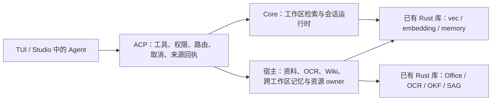

# Implementation Plan: ACP 检索闭环与性能优化

**Branch**: 当前 checkout，无新 branch／worktree | **Spec**: [spec.md](spec.md) | **Input**: 用户要求细致优化计划。

**Gate context**: Product regime；Core、ACP、共享检索库与既有私有 Studio host。已授权按本计划实施并执行端到端验证。

本计划是 [Aster Core 机制完整替代](../../docs/xerj-replacement.md) 的检索基础阶段。最新目标要求机制复用与收敛；聚合、集群和 Corpus 的真实缺口仍须跟踪。上游协议用作对照入口，不据此增建兼容运行时。本阶段完成不能代替完整功能资格。

## Summary

先修正真实 engine 测量链路，冻结质量与 release 基线；再用实际 ACP／宿主调用证明可达性。优先消除已定位的启动阻塞、重复工作和 executor 占用，然后完成显式启用的本地记忆语义召回。宿主继续拥有资料目录、入库／OCR、跨工作区 scope 和持久资源生命周期。ANN、跨会话向量缓存及新数据库能力本期只做证据驱动的决策，不预设必须上线。

已有 bundled provider 进程缓存已在前一 slice 落地，不再重复建设；当前约 5–7 秒的完整冷路径和 23.609 ms 的局部查询最大值都是 debug 样本，不能直接当本计划的 release 基线。

## Responsibility boundaries



- 同一能力由哪一层执行，取决于原有 owner；ACP 的要求是 Agent 可通过获准路径使用。
- 纯 ACP 与 Studio 有不同 capability profile；缺席能力不按缺陷处理，已声明但不能执行才需要修复。
- 模型对象可共享；来源、会话索引、profile 和资料权限不因此共享。
- 所有性能结论必须带测量范围。完整 prompt 含 LLM HTTP 的时间与工具自身耗时分别报告。

## Constitution Check

此表检查设计，不宣称实现已合规。实施后由 T029–T032 提交实际证据。

| Principle | Status | Evidence in the plan |
| --- | --- | --- |
| I. Fail closed | PASS | T006–T008、Q02/Q04–Q06/Q20/Q28；沿原声明、权限、来源与错误边界。 |
| II. Evidence retained | PASS | T001 冻结身份，T032 独立 attempt + OUTCOME；历史 evidence 不覆盖。 |
| III. Hermetic tests | PASS | 每个行为 task 附 owning tests；脚本模型与真实 native 检索分层。 |
| IV. Closed sets | PASS | T006/T016/T021 使用 typed capabilities／scope／status，未知值拒绝。 |
| V. One workspace / published APIs | PASS | 根 Cargo workspace、1.97.1、local deps；Studio gitlink；不增加 SDK。 |
| VI. Local schema changes | PASS | T023 如需派生 schema，只在 memory owner 定义；默认不做持久缓存 schema。 |
| VII. Shrink-only ratchets | PASS | T029 不扩大 allowlist，不改 frozen graders／已有阈值。 |
| VIII. Replaceable transports | PASS | 原 `DocumentBridge` 与 Core API，测试 adapter 不反向改变生产 envelope。 |
| IX. One configuration language | PASS | T021 只在必要时扩展受信任 ACL；数据 fixture／report 不参与产品配置发现。 |
| X. Commands / test files | PASS | sibling tests；宿主新命令若必要只给实际调用 surface，沿现有 capability。 |
| XI. Independent judgment | PASS | T028 可以结论为保持 exact／不加缓存；不把宿主执行判成缺陷。 |
| XII. First principles / review | PASS | T002/T005 先修测量，T009 等先复现；T029–T031 反例与独立复核。 |
| XIII. One repository | PASS | 当前 checkout；私有 Studio 源码留子模块；无新 repo／worktree。 |
| XIV. Names are not guessed | PASS | 原 owner ID、stored path、source span；SAG entity 来自原 host 模型抽取政策。 |
| XV. Meaning is not matched | PASS | 模型选工具／typed scope；不加 regex 意图路由或词表型 query planner。 |
| XVI. Pickers are drawn | N-A | 无新 product picker；若后续需要展示状态，沿原 house components。 |
| XVII. Dialogs stay in place | N-A | 本计划无 dialog 改造。 |

## Project Structure

### Documentation

```text
specs/032-acp-retrieval-optimization/
├── spec.md
├── plan.md
├── research.md
├── data-model.md
├── tasks.md
└── contracts/
    ├── qualification.md
    ├── performance.md
    └── host-operations.md
```

### Source Code

这些是实施候选路径，不是本轮已经修改的代码；没有证实缺陷的模块不强制改动。

| Layer | Existing paths | Planned change / new files |
| --- | --- | --- |
| Qualification harness | `tests/retrieval_bench/{run_quality,metrics,mini_corpus}.py`、ACP `tests/support/` | 修复指定 engine 的实际执行／拒绝；拟新增 `test_engine.py`。旧 labels／metric 公式不调分。 |
| Actual ACP qualification | `crates/code/acp/tests/shipped_tui_e2e/retrieval.rs`、`src/agent/retrieval_seam_tests.rs` | 拟新增 portable `tests/retrieval_qualification_stdio.rs` 和独立 v1 fixture；复用 helpers，不复制检索算法。 |
| ACP runtime / bridge | ACP `src/agent/{protocol,session_open,host_methods}.rs`、`host_context.rs`、`document_read.rs`、`wiki_search.rs`、`memory_search.rs` | 阶段观测、真实可达性、取消／宿主错误；缺桥时才添加单一 source-search operation。 |
| Core retrieval | `crates/code/core/src/workspace/{services.rs,retrieval/}`、`tools/builtin/` | 定位后的热路径、增量、source verification 与状态一致性；复用现有 facade。 |
| Embedding | `crates/embedding/src/{adapter,provider}.rs` 与 sibling tests | 仅在测到同步 CPU 占用后修改内部执行方式；保留模型 assets、现有 API、bounded batch。 |
| Local memory | Core `durable_memory_vec.rs`、`durable_memory/`、`memory/semantic_refresh.rs`、`agent_api/session_options.rs` | 对照兼容后接最小语义投影；原记录与政策保持，复用已有 refresh 部件。 |
| Memory admission | Core `config/{mod,loader,acl_render}.rs`、`memory.rs`；ACP `agent/{session_open,memory_management}.rs` | 只有无既有入口时才新增一个默认关闭的 trusted ACL 字段；codec／trust／caller 同批。 |
| Studio host | `apps/studio/src-tauri/src/agent_plane/{turns,workspace_wiki_search,workspace_memory_search,document_read}.rs`、`local_documents/library.rs` | 原 owner 的闭环、耗时与缓存／扫描优化；保留入库／OCR／SAG 编排。 |
| Host tests | 上述 sibling tests；Studio `tests/{workspace_document_stdio,document_tools_native}.rs` | 区分 probe stub 与实际 native 工作；必要时扩展既有真实 host fixture。 |
| Product entry / CI | `tests/e2e/workspace-retrieval.acl`、现有 CLI／Studio fixtures、`.github/workflows/{ci,qualify-aster-cli}.yml` | 必要时接 focused contract tests，沿已有 runner；不以此启动发布。 |

## Phases, order and exit gates

每阶段先复现／测试，随后改原 owner，再跑实际调用链。任务细节在 [tasks.md](tasks.md)，36 个验收点在 [qualification.md](contracts/qualification.md)。

| Phase | Priority / tasks | Work | Exit gate | 粗估投入 |
| --- | --- | --- | --- | --- |
| P0 测量可信 | P0，T001–T005 | 冻结能力与 source、修实际 engine runner、固定 60-query 语料、拆阶段、release baseline | engine 确实执行；控制／真实 provider 分栏；输入与新目标在优化前固定 | 2–3 人日 |
| P1 调用可达 | P0，T006–T008 | C0/C1/H1 工具声明、真实调用、拒绝／失联／partial／cancel | 已声明能力均有实际入口；缺席能力准确，基础正反例可重复 | 1–2 人日 |
| P2 ACP 运行开销 | P1，T009–T012 | 冷启动关键路径、CPU 编码、模型／增量复用、迟到结果与关闭 | release 首次／第二会话和 L1 查询达门；无旧结果发布、无重复文档 embedding | 2–3 人日 |
| P3 宿主检索闭环 | P1，T013–T020 | Wiki／memory、OOXML／PDF／OCR、SAG 原文、fanout 与 scan／lock | 原 host 资源经真实 ACP 可用；同 digest 不重复提取；scope／cursor／coverage 保真 | 3–5 人日 |
| P4 本地记忆语义 | P2，T021–T025 | 兼容决策、显式准入、有界回填、变更／重启与 ACP／host 查询 | 原记录完整；同义召回覆盖旧记录；删除／prune／模型变化不返回旧投影 | 3–5 人日 |
| P5 质量与规模决策 | P2，T026–T028 | 固定集消融、RRF／MMR、L3 性能；ANN／缓存 go/no-go | 质量硬门不退化；保留失败；不需要后端改造也是有效结论 | 1–2 人日 |
| P6 整体验收 | P1，T029–T032 | code review／guard、原生目标、固定发布复测、证据与入口 smoke | 适用用例通过或明确 blocked；未测范围不宣称完成；paired build 完整 | 2–3 人日 |

合计约 **14–23 人日**，假设实施者熟悉仓库；不包含等待原生 Windows 环境、缺失 OCR assets、外部模型预算或既有无关故障的日历时间。这是规划估算，不是交期或测试成绩。

T005 先测当前已实现的档位；尚无入口的新能力标 NOT_RUN，不虚构零分／零耗时。某个宿主档位因资源阻塞，不阻止已有 C0/C1 档位定位和修复；该宿主档位的正向资格保持 BLOCKED，不能据此宣称整个 epic 完成。

依赖主线：P0 → P1；工作区由 P2 进入自己的质量／规模资格，宿主 P3 与记忆 P4 分别进入各自资格，最终 P6 汇总全部适用结果。P5 各子资格不等待无关功能，但完整任务完成仍要求全部子资格。涉及同一 `session_open.rs`、`document_read.rs` 或 Studio route 的写入串行。未安排自动委派 agent。

### Milestones

1. **M1：能测、能调**（P0–P1）：可信基线和能力矩阵，首先解释冷路径，而不是先改缓存／ANN。
2. **M2：常用路径快速且完整**（P2–P3）：启动、热查、资料和跨工作区调用闭环；原宿主 owner 不迁移。
3. **M3：记忆语义与策略可信**（P4–P5）：旧记录／重启／失效资格完成，再决定需要的 ranking／backend 后续工作。
4. **M4：可以交付本 slice**（P6）：真实入口和原生平台证据，精确区分通过、blocked 和后续工作。

## Detailed optimization strategy

### A. 先定位完整冷路径

在 bin 配置加载、`new_session`、`ensure_core_agent`、`session_options_for`、模型载入、manifest 激活、lexical／semantic ready 处关联原有 IDs 和 elapsed。分开 account/provider catalog、Core construction、LSP／MCP lazy activation 和模型成本；不预先删其中任何一个。

首条交互只等待其必需前置，索引按已有后台方式准备。已声明为可立即使用的模式必须按原 readiness 契约等待／报告 partial，不靠伪 Ready 缩短耗时。第二会话需单列同目录与不同目录，防止把索引串用误认复用。

### B. 先消除重复工作，再考虑复杂后端

模型缓存保持；检查同字节保存、manifest metadata-only 变化、query embedding 与文档 embedding 的独立计数。保留 source verify 所需读操作，复用内容 digest／publication，不把“不读磁盘”设成不正确的优化目标。

同步编码若占 executor，使用现有 bounded blocking owner 模式，或在既有 batch 边界拆分并检查取消；不造新线程池。native 计算不能仅由 drop handle 宣称停止。查询、后台回填和宿主入库有明确 owner，不新增猜测性的全局协调器。

### C. 宿主保持资源所有权

先验证宿主的已有资料与索引是否真正经 ACP 被调用。资料原文入口缺失才按 [host-operations](contracts/host-operations.md) 增加最小只读桥；宿主继续完成 source scope、抽取、SAG 和 publication 校验。

对 8／32 owner 的逐层调用、全量 scan 与 global map lock 先分解耗时。仅对证实的瓶颈优化，例如复用已生效的来源 invalidation／snapshot、缩短与查询无关的锁区间、使用既有有界并发。每项必须同时证明 current binding、分页覆盖和总预算不退化。

### D. 记忆语义从原权威记录派生

先对照两套现有接口，冻结无破坏的兼容方案。不能简单 set provider 就记完成：必须回填旧记录、覆盖变更／delete／prune、在启动和模型变化时核对派生身份。只读 owner、故障和取消保留原记录及词法服务。

不自动改变记忆激活、去重、保留或远程 egress 政策；v2 refresh 只在接口和政策兼容时复用。确需新公开入口时受本 spec 边界约束，并记录 API／调用者／测试覆盖，不做 repository 迁移。

### E. 排序与规模用固定证据决策

BM25／hybrid／semantic 和 RRF／MMR 分栏比较。Exact symbol、无匹配、来源当前性优先于平均分。推广任何策略同时检查输出字节、provider 次数、latency 和 accounted memory。L3 不达标再决定 ANN 或重启缓存的后续 slice；不以本 epic 为这些复杂机制预先开工。

## Verification Plan

所有命令从根执行、使用 pinned toolchain，先初始化既有 Studio submodule。下面为实施命令模板，不是本轮执行记录。

```sh
cargo build --locked -p aster -p aster-acp
cargo test --locked -p aster-acp --lib -- agent::retrieval_seam_tests agent::local_embedding:: search::
cargo test --locked -p aster-acp --test shipped_tui_e2e shipped_retrieval_stdio
cargo test --locked -p aster-acp --test retrieval_qualification_stdio
cargo test --locked -p aster-core --lib workspace::retrieval::
cargo test --locked -p aster-core --lib durable_memory_vec::
cargo test --locked -p aster-core --test durable_memory_retrieval_eval
cargo run --locked --release -p aster-core --example workspace_retrieval_benchmark
cargo run --locked --release -p aster-core --example workspace_persistent_index_production
python3 tests/workspace_dependencies.py
python3 tests/agent_runtime_boundary.py
cargo fmt --all -- --check
```

`retrieval_qualification_stdio` 是 T002/T007 拟新增 target；其余是已存在的入口。Python 要求支持 tomllib 的现有解释器，不为本任务新增依赖环境。

- 对 materially changed Rust：`cargo clippy --locked -p <owning-package> --all-targets --no-deps`，逐包使用支持 features；Core／ACP，若动 embedding／SAG／vec／memory 则加入该 owner。不要把库全部 capabilities 打开掩盖实际产品 features。
- Studio 原生测试：`cargo test --locked -p aster-studio --lib --no-default-features --features tenant-aster <focused-filter>`；另测 `tenant-toyou` 的受影响模块。Clippy 同样分别使用这两个既有 tenant features。
- `workspace_document_stdio`／`document_tools_native` 是 `harness=false` 且 `test=false` target，需按 target 自己的入口执行并读取输出；前者 stub 不能计作后者 native processor 正向通过。
- 既有指标自测继续运行 `tests/retrieval_bench/test_metrics.py`／`test_mini_corpus.py`；真实 engine 新路径另有 positive／negative tests。原 3-query mini corpus 不改分。
- 新 portable ACP cases 不能依赖 POSIX shell。macOS／Linux 用现有 qualification runner，Windows 用已有原生 runner／人工同命令；另做中文和空格路径的原生验证。环境缺失只记 BLOCKED。
- UI 无新增设计；T031 用既有 TUI 和 Studio 入口各走一条已有检索旅程，验证实际结果／来源／取消。若运行交互式测试，沿仓库既有 A3S Test 流程；不以截图静态出现替代执行。
- 不执行全 workspace 的无关测试、不跑付费模型、不安装新服务或发布；真实模型自主选择工具另需固定版本、输入与预算才单列。

## Change control and rollback

- 每个 phase 可独立交付；实际 defect 的最小 owning fix 与测试同批。profile 未通过就不推广到默认策略。
- rank／semantic 新策略关闭后继续原词法／RRF 行为。只回滚新代码或派生投影，不删除／还原用户权威记忆和宿主资料。
- 如果需要提高现有限额、改变记忆激活政策、迁移 owner、增加框架／依赖或新权限边界，停止该扩展，记录具体失败、发生条件和代码代价；在当前任务授权与 AGENTS 规则下单独决定，不悄悄扩大本计划。
- 既有版本 header、full fmt 和其它脏工作区失败单列；T029 确认本批无新增问题，不放宽 guard。全仓 gate 有既有失败时，明确阻塞资格，不写“全绿”。
- 实施与验证已授权；无 commit、stage、安装版替换或 release 授权。
